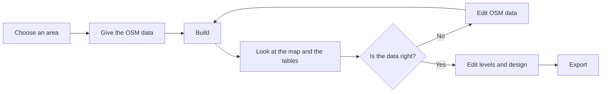

# duckOSM Studio

**A portal that turns OpenStreetMap data into a routable road network, in your browser.**

You choose an area on a map. The portal builds the driving, walking and cycling networks. You look at the roads, fix the errors in the OSM data, build again, and export the result to the software that you use. No server receives your data.


Open duckOSM Studio: <https://khoshkhah.github.io/duckosm-studio/>. Read the manual: [The editing cycle](docs/manual/cycle.md).

## What is important in it

- **A routable network from OSM data.** The raw data has no junctions, no directions and no travel times. The build cuts the ways at the junctions, sets the length, the speed and the travel time of each edge, and applies the turn restrictions. The result is the input of a router or a simulator.
- **A stable `edge_id` for each edge.** The `edge_id` is a hash of the OSM way and the two end nodes. The same road has the same `edge_id` in every build. Other projects join their data on it.
- **The same result as [duckOSM](https://github.com/Khoshkhah/duckOSM) 0.6.0.** Every row of every table is equal to the output of duckOSM.
- **A fix loop.** You can change the OSM data in the portal and build again. The tables, the map and the exports have your fixes.

## Advantages

| Advantage | What it means for you |
|---|---|
| Nothing to install | Open a page. The build runs in your browser. Your area and your data stay on your computer. |
| Fast | Estonia takes 19 seconds and 1.5 GB. duckOSM in Python takes 1,545 seconds and 10 GB. |
| One result everywhere | The page and [duckOSM](https://github.com/Khoshkhah/duckOSM) (command line and Python) use the same Rust engine. They give the same tables. |
| Three networks in one build | Driving, walking and cycling, with the edge graph and the turn restrictions. |
| Fix the data | Change a road, a building, a node or a turn rule. Draw a new road. Build again. |
| A clear map | The roads have the style of [roadstyle](https://github.com/Khoshkhah/roadstyle): outlines, bridges and tunnels. 33 ready themes. |
| SQL in the page | Ask questions to the tables with DuckDB. No other tool is needed. |
| Export to your tools | PMTiles, MBTiles, GeoPackage, GeoJSON, kepler.gl, MATSim and SUMO. |
| Your work stays | The page saves each build in your browser. **Open** loads it with no new build. |


<!-- retake: after the duckOSM PR that moves Edit OSM data into duckOSM -->

## The cycle



[The editing cycle](docs/manual/cycle.md) explains each step.

## What you get

For each network, a build writes the tables `edges`, `nodes`, `edge_graph`, the turn restrictions and more. Each table is a GeoParquet file. One DuckDB file has all of them. [The tables](docs/manual/tables.md) explains each table.

## Start

### In the browser

1. Open <https://khoshkhah.github.io/duckosm-studio/>.
2. In step 1, search for a place and click a match.
3. In step 3, press **Get** for a region file that covers the area.
4. In step 4, press **Build**.
5. In step 6, press **Show on map**.

[Your first map](docs/first_map.md) has the details.

### On the command line and in Python

For a script, a server or Python code, use [duckOSM](https://github.com/Khoshkhah/duckOSM). The duckOSM Studio page and duckOSM use the same Rust engine, and they give the same tables.

```bash
pip install duckosm
duckosm build --pbf monaco.osm.pbf --output monaco.duckdb --modes driving
```

The Rust engine comes with the next duckOSM release. The version on PyPI today (0.6.1) is from before the engine moved into duckOSM. [Command line and Python](docs/cli.md) has the details.

## Documents

| For | Read |
|---|---|
| Users | [The manual](docs/manual/cycle.md), [first map](docs/first_map.md), [concepts](docs/concepts.md), [the tables](docs/manual/tables.md), [columns of the tables](docs/output-tables.md), [command line and Python](docs/cli.md), [troubleshooting](docs/troubleshooting.md) |
| Developers | [Development](docs/development.md), [design](docs/design.md), [page code](docs/app.md), [benchmark](docs/benchmark.md), [to do](docs/todo.md) |
| Decisions | [Name](docs/proposals/name.md), [hosting](docs/proposals/hosting.md), [disk store for the result](docs/proposals/disk-store.md), [less memory in the build](docs/proposals/build-memory.md), [a build by tiles](docs/proposals/tiled-build.md) |
| History | [Changelog](CHANGELOG.md) |

The user documents are also a [mkdocs](https://www.mkdocs.org) site. To read it on your computer, run `pip install mkdocs mkdocs-material` and then `mkdocs serve`.

## Status

The driving, walking and cycling networks of Monaco, Tartu and Estonia equal duckOSM row for row. Only the direction labels of some connectors differ, which duckOSM does not fix.

The Rust engine moved into the [duckOSM](https://github.com/Khoshkhah/duckOSM) repository (`rust/`) on 2026-11-04. This repository keeps the browser page (`crates/duckosm-wasm`) and the docs. The app is called duckOSM Studio. The repository is `duckosm-studio` (it was `duckosm-rust`).

## License

MIT, as duckOSM.
