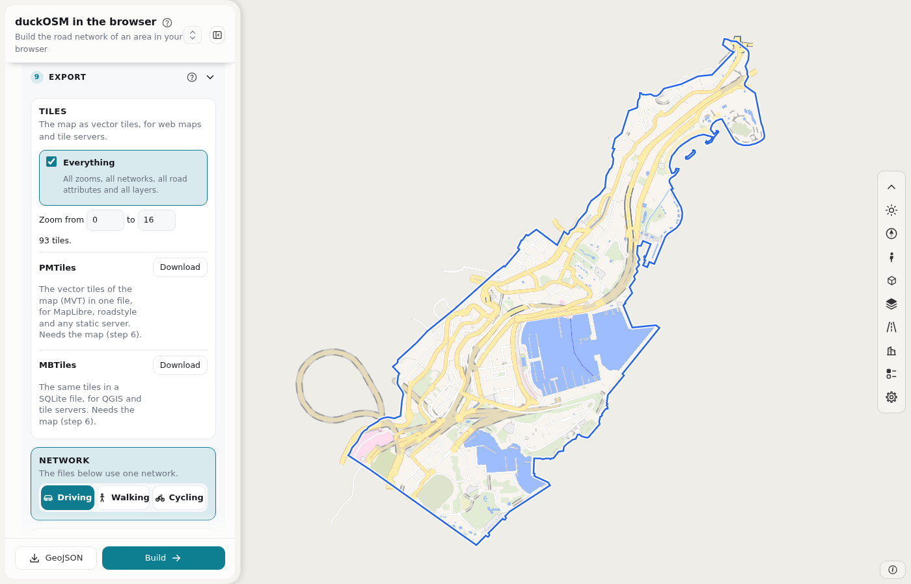
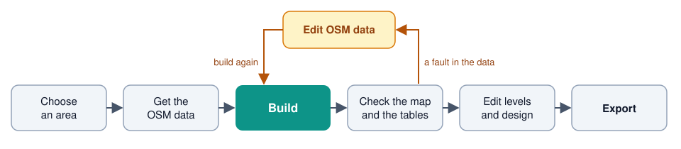

# duckOSM Studio

Build a routable road network from OpenStreetMap in your browser. Fix the OSM data, style the map and export the result. You install nothing, and your data stays on your computer.

**[Open duckOSM Studio](https://khoshkhah.github.io/duckosm-studio/)** · **[Read the manual](https://khoshkhah.github.io/duckosm-studio/manual/)**

## How it works

1. Choose an area: search a place, draw a shape, load a file or pick H3 cells.
2. Get the OSM data: a region file, the Overpass API or a cut file.
3. Build the driving, walking and cycling networks.
4. Check the roads on the map, and the tables with SQL.
5. If the data has a fault, edit it (a road, a building, a node, a turn or a new road) and build again.
6. Edit the drawing order of bridges and tunnels, and the design of the map.
7. Export to your tools.

## What you get

- **Three networks:** driving, walking and cycling, with the graph of legal turns and the turn restrictions.
- **A stable `edge_id`:** a hash of the OSM way and its two end nodes. The same road has the same `edge_id` in each build.
- **The tables of [duckOSM](https://github.com/Khoshkhah/duckOSM):** the same Rust engine, the same rows.
- **Speed:** Estonia builds in 19 seconds.
- **Exports:** PMTiles, MBTiles, GeoPackage with a QGIS style, GeoJSON, kepler.gl, MATSim and SUMO.

## Documents

- [The manual](https://khoshkhah.github.io/duckosm-studio/manual/): every step, every editor, every export and every table.
- [Development](https://khoshkhah.github.io/duckosm-studio/manual/development/): build and test the page.
- [Changelog](CHANGELOG.md)

## License

MIT
