# The browser dashboard: a guide to every part

This guide describes each part of the duckOSM-rust page, from the top of the panel to the last card. Each part has a picture and a list of what you can do. The page runs fully in your browser: no server receives your area or your data.

- To see how the page is made (files, code), read [app.md](app.md).
- To see how the fixes are saved and applied, read [osm-editing.md](osm-editing.md).
- To see the columns of each table that a build writes, read [tables.md](tables.md).

All pictures show Monaco. To make them again, run `python crates/duckosm-wasm/www/docs_shots.py` (see [How the pictures are made](#how-the-pictures-are-made)).

## The page at a glance

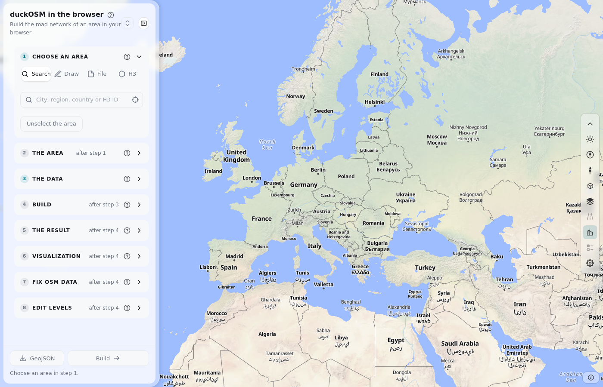

The page has three parts:

| Part | Where | What it does |
|---|---|---|
| The map | The whole window | Shows the base map, the area that you chose, and the roads after a build. |
| The panel | The left side (a bottom sheet on a phone) | Holds the cards: **Your areas**, then steps 1 to 8. |
| The bar | The right side of the map | Holds the tools of the map: theme, zoom, street view, base map and more. |

The cards follow the steps of the work. A card is off (gray) until the card before it is ready. For example, **Build** stays off until you choose an area and give a data source. Each card has a title, a **?** button that opens its help window, and a chevron that folds the card. A check mark on the title means that the step is done.

After a build the page looks like this:


## The steps in order

1. Choose an area (step 1). Use Search, Draw, File or H3.
2. Check the area (step 2). Give it a name and an optional buffer.
3. Give the OpenStreetMap data (step 3). Use a region file, Overpass or a cut file.
4. Build (step 4). Choose the networks and press **Build**.
5. Read the result (step 5). Query the tables and download them.
6. Show the map (step 6). Draw the roads on the map.
7. Fix OSM data (step 7). Change roads, buildings, nodes and turns, and build again.
8. Edit levels (step 8). Open the level editor.

## The bar of tools

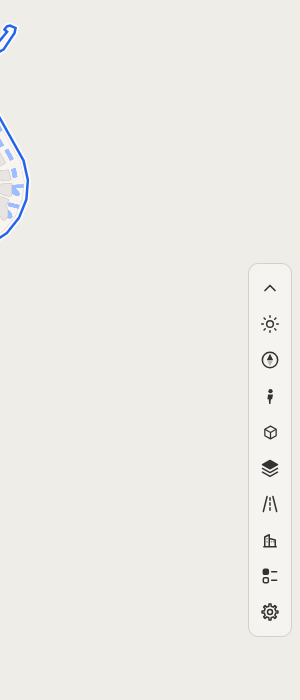

The bar is roadstyle's. From the top to the bottom:

| Tool | What it does |
|---|---|
| Chevron (**Fold the bar**) | Folds the bar to one button. |
| Sun or moon (**Light / dark**) | Changes between the light and the dark theme. The panel and the base map follow it. |
| Compass (**Navigate**) | Zoom in, zoom out and the compass. Ctrl + drag on the map turns and tilts it. |
| Person (**Street View**) | Shows photos from Google Street View or Mapillary for a point that you click. It needs a key (see Keys and settings). |
| Cube (**Google 3D**) | Opens the Google 3D window for a place. It needs a key. |
| Layers (**Base map and layers**) | Opens the base-map box (below). |
| Road signs (**road types to filter**) | Off on this page: the page has no road types to filter. |
| Building (**Buildings in 3D**) | Shows the buildings of the base map as 3D shapes. It needs a vector base map. |
| List (**colour options and live data**) | Off on this page: the page has no color options and no live data. |
| Gear (**Settings**) | The keys for Google and Mapillary, and other settings. |
| (i) | The sources of the base maps (attribution). |

### The base-map box

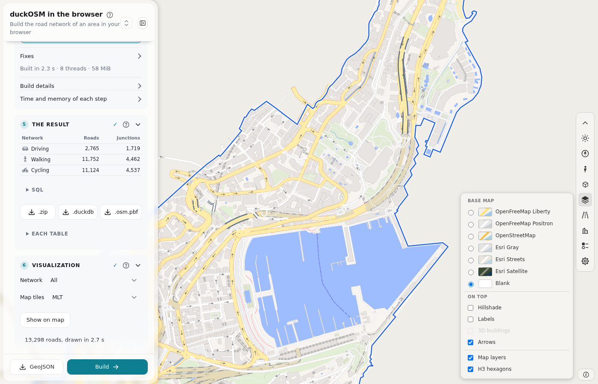

The box has three groups:

- **Base map.** One choice: OpenFreeMap Liberty or Positron (vector maps), OpenStreetMap, Esri Gray, Esri Streets, Esri Satellite or Blank. A map and its dark twin share one choice, so the theme can change the map to its dark twin.
- **On top.** Hillshade, Labels (street names), 3D buildings and Arrows (the direction of one-way roads). The choice is kept for each base map.
- **Map layers and H3 hexagons.** **Map layers** shows or hides the layers that a build makes (water, land use, buildings). **H3 hexagons** shows or hides the grid of the H3 tab.

A build sets the Blank base map for its first drawing so that the roads are easy to see. This does not change your saved choice: the next visit starts on your base map.

## Your areas

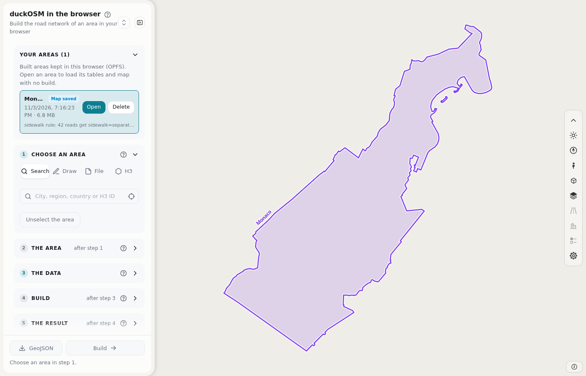

The card shows only when the browser has a saved area. Each build is saved in the browser (OPFS), with its tables, its drawing cache and its cut file.

- **Click a row** to see the boundary of the area on the map. The map zooms to it. A second click hides it.
- **Open** loads the area into DuckDB and draws the map again with no build (Monaco: 1.6 s).
- **Delete** asks a second click, in place.

A new visit starts on the OpenFreeMap base map and with no area. This card is the way back to your work.

## Step 1: Choose an area

Step 1 has four tabs. Each one makes the same thing: the area as a GeoJSON shape.

### Search

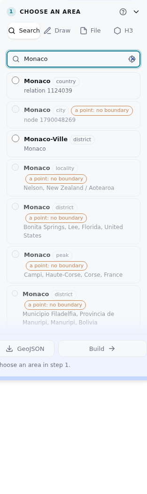

1. Type a city, a region or a country. The page asks photon.komoot.io and lists up to 10 matches.
2. Click a match. The page asks Nominatim for its boundary, draws the boundary and zooms to it.
3. To remove it, click the chosen match again, or press **Unselect the area**.

Also in the box:

- **An H3 cell ID.** Type one H3 cell ID (15 hex digits), or several separated by spaces or commas. The page makes the area from the cells with no network, opens the H3 tab and zooms to them. The cells must have one level from 5 to 10.
- **What is here? (the target button).** Press it, then click the map. The page lists the areas at five levels around the point.

If Nominatim fails (a network rule or a limit), the map still moves to the box of the match. A second click asks again, and **use the box of the place** makes the area from the box.

### Draw

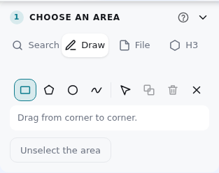

Pick a tool, then draw on the map:

| Tool | Key | How |
|---|---|---|
| Rectangle | R | Drag from corner to corner. |
| Polygon | P | Click each corner. **Enter** closes the shape. |
| Circle | C | Drag from the center out. |
| Freehand | F | Drag around the area. |

Other buttons: **Merge** (joins shapes that overlap), **Delete** (the selected shape, key Delete) and **Clear** (all shapes). You can move the corners of a shape. More than one shape makes a multi-polygon.

### File

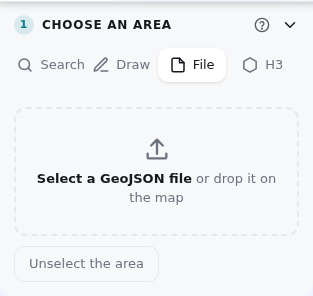

Select a GeoJSON file, or drop it on the map. The file is a FeatureCollection, a Feature or a geometry. The page takes every Polygon and MultiPolygon in it, and the name and the source from the properties of the first feature. If the file has no polygon, the page says so. The format is the one that `duckosm boundary` writes.

### H3

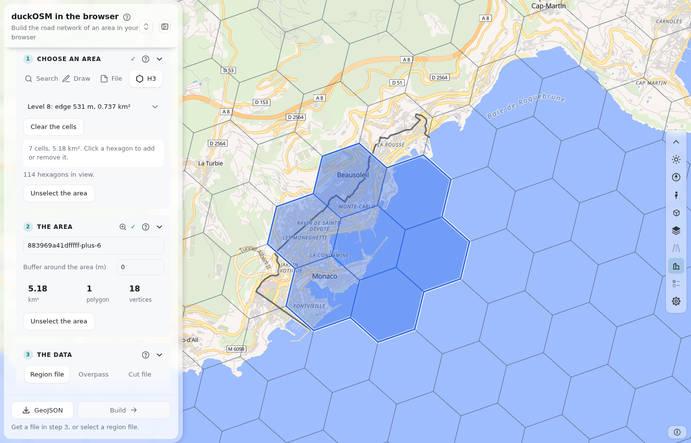

The area is the union of hexagons of the [H3](https://h3geo.org) grid.

1. Choose the level (5 to 10). The list shows the edge and the area of one cell.
2. Click a hexagon on the map to add it. Click it again to remove it.
3. **Clear the cells** removes all of them.

A thin grid shows the hexagons in view, the hexagon under the pointer is lit, and the picked cells are filled. If the view has too many hexagons, the grid goes off and the text says to zoom in. The area has at most 500 cells and 5,000 km². A change of level removes the cells.

## Step 2: The area

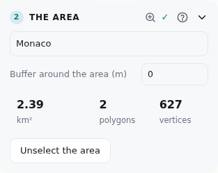

- **Name.** The name of the area. It is the name of the files and of the saved area. For an area from hexagons, the page suggests the H3 ID of the first cell (with `-plus-N` for N more). A name that you type stays.
- **Buffer around the area (m).** Grows the area on all sides (0 to 50,000 m, in the UTM zone of the center), as duckOSM's `boundary.buffer_m`. The cut and the downloads use the grown area.
- **Summary.** The size in km², the number of polygons and the number of vertices.
- **Zoom to the area** (the magnifier in the title) moves the map to the area.
- **Unselect the area** removes the area so that you can choose another one.
- **GeoJSON** (at the bottom of the panel) downloads the area as `boundary.geojson`.

The boundary shows on the map in blue:

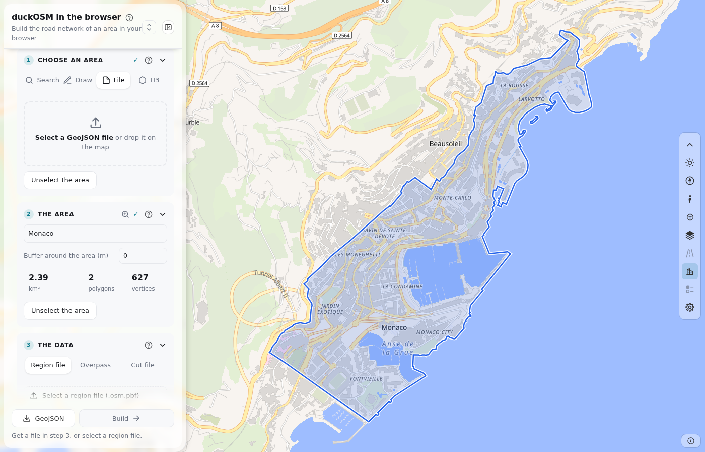

## Step 3: The data

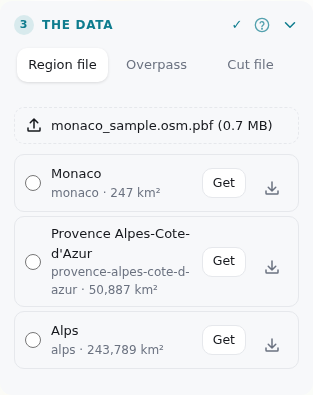

Card 3 tells the page where the OpenStreetMap data comes from. It has three tabs:

- **Region file.** Select an `.osm.pbf` file of a region. The list under the button shows the Geofabrik extracts that cover the area, each with a download button. A file that you used before is kept in the browser, and the list shows it as **kept**. This source gives all the layers.
- **Overpass.** The page asks the [Overpass API](https://wiki.openstreetmap.org/wiki/Overpass_API) for the roads of the area. It needs no file, but it gives no layers.
- **Cut file.** Select an `.osm.pbf` file that is already cut to the area (for example the cut file of an earlier build).

## Step 4: Build

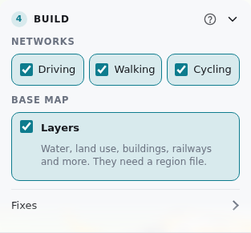

| Part | What it does |
|---|---|
| **Networks** | The driving, walking and cycling networks to build. |
| **Layers** | Water, land use, buildings, railways and more (the base map of the area). It needs a region file. With the layers on, the build also makes `main.building_faces` and the tables of the fixes panel. |
| **Fixes** | A fixes file (`.yaml`) that the build applies. The fixes panel (step 7) writes one. |
| **Build** (the main button) | Starts the build. The map shows a box with the step that runs. |

When the build ends, the card shows the time and the memory:

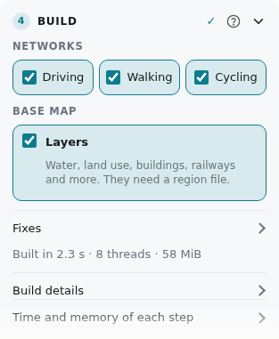

**Build details** lists what each step made. **Time and memory of each step** is a table for each step. The page builds with threads when the browser allows it.

## Step 5: The result

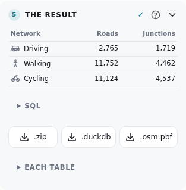

- **The result table.** The number of roads and junctions of each network.
- **SQL.** Run a query on the tables in the browser (DuckDB with the spatial extension). The first query is an example: roads by class.
- **Downloads.** **.zip** (all tables as Parquet files), **.duckdb** (one database file), **.osm.pbf** (the cut area, after a build from a region file) and **.yaml** (the fixes file of this build).
- **Each table.** The list of the files, with a link to the columns of each table ([tables.md](tables.md)).

## Step 6: Visualization

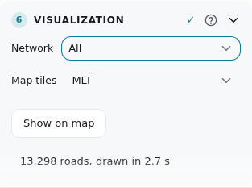

- **Network.** The network that the map draws (driving, walking, cycling or all).
- **Map tiles.** MLT (the default) or MVT. The choice is kept.
- **Show on map.** Draws the roads. A small area (up to 20,000 roads) draws by itself after a build; for a larger area, press the button. The map has a limit: 200,000 roads on a computer and 40,000 on a small device. If the area is larger, the page lists the networks that fit. You can use `?maxroads=N` in the address to change the limit.
- **The note under the button** says how many roads were drawn and how long it took.

## Step 7: Fix OSM data


Card 7 shows the number of fixes and has the button **Edit fixes**. It opens the fixes panel. The card is off until a build has made the tables that the panel needs. Build with **Layers** on to get walls and doors. A fix is a rule that you add to a list. A rule changes nothing in the data until you build again. The rules are kept in the browser for the area, and the **.yaml** button of card 5 downloads them.


The panel has a header and six tabs:

- **Steps** (top left) closes the panel and shows the steps again. The picks on the map go away, and they come back when you open the panel again.
- **Hide panel** (top right) gives the map the whole width. The button at the corner of the map shows the panel again, with the tab and the picks as they were.
- **Add to changes** (the button at the bottom of a tab) keeps your edits in the list of changes. Until then, an edit is a draft: the tab shows "N changes not added yet". **Reset form** drops the draft. **Remove from changes** takes the rule of this object out of the list.
- **Unselect** (in each tab) takes the picked object out of the tab.


### Road

Click a road on the map, or type its way ID and press **Load**. The form shows the data of the road in groups (Basics, Lanes and speed, Sidewalk, cycleway and crossing, Surface and access, Level). A field that you change gets an amber mark and a ↺ button that takes the change back. **Modes** lets you remove the road from one network (for example, from walking). **Other tags** adds or deletes any tag. **Delete** removes the road from the data.

### Building


Click a building. The form has the fields of the building (levels, height, roof shape, roof color, materials). Below it:

- **Walls.** The page finds the walls of the building from its outline and gives each wall a type: **front** (green; faces a street), **back** (red), **side** (gray), **party wall** (purple; two buildings share it) or **courtyard wall** (teal; a wall of an inner ring). The map draws each wall in its color and shows its number (`#1`, `#2`, ...), as in the list. The row of a wall has the same color, the length, the street that it faces, and a short note when the type is a guess (see below). Click a row or a wall on the map to select it. **Previous** and **Next** step through the walls. You can change the type of a wall and give it a **Door** (main, service and so on). A door belongs to the wall and has no place on it. Both changes wait for **Add to changes**.
- **Doors.** The doors that OSM has on the outline (nodes with `entrance`), with a kind that you can change.
- A building that is a multipolygon relation has walls for its outer ring and for each courtyard.

How a wall gets its type, in order of strength:

1. A wall with an OSM entrance node is a front wall (`entrance`).
2. The street that the `addr:street` tag names is preferred (`address`).
3. A wall faces a street that it can see: a line from one of three points of the wall reaches the street with no wall in the way. A street of a higher class wins (`street`).
4. A building that sees no street gets the wall that faces the nearest street within 150 m (`inferred`, shown as "guess").
5. A wall that points away from the front wall and faces no street is a back wall. A wall that two buildings share is a party wall.

Check the walls that say "guess" or "no street seen". The method is in [osm-editing.md](osm-editing.md).

### Node


A node is one point of OSM. Here it is a traffic signal, a crossing, a stop sign, a give-way sign, a bus stop, or a junction of roads. The map shows the signals and crossings as dots from zoom 14, and the junctions (gray dots) from zoom 16. Click a dot, or type the node ID.

The **Kind** field offers only the kinds that the node can have, and the reason is under the field: a node must be on a road of the driving network; a traffic signal, a stop sign and a give-way sign need a junction of at least 3 roads; a crossing needs a road of the class residential, service, tertiary, secondary or primary; a motorway or a trunk road takes none of them.

### Turn


A turn rule says that a driver cannot make a turn (or must make it) at a junction.

1. Click the road that the turn starts on, or type its way ID, and press **Find turns**.
2. The list **Junctions at the end of the road** shows each junction and how many roads leave it. The first one is picked. Click another to pick it.
3. The map shows the road that the turn starts on (blue), the junction (a ring) and the roads that leave it (green). Point at a row, and its road is outlined on the map. Click a row to keep the outline.
4. For each road that leaves, the list offers **Allowed**, **No** and **Only** for the way of that turn (left, right, straight on or U-turn). The page finds the way from the directions of the two roads.
5. Press **Add to changes**. All the rules that you chose are added at once.

The rules are for the driving network. **Roads that arrive at this junction** lists the roads that you can use as the start road.

### New road


Click points on the map to draw a road that OSM does not have. A click near a junction joins it. Set the kind, the name, the one-way rule and more, then finish. The road is a rule `new_ways` in the fixes file. You can edit a new road again from the **Changes** tab.

### Changes


The list of all the rules: roads, buildings, walls, nodes, other objects, turn rules and new roads. Click an item to show it in its tab. The × button takes it out. **Undo** and **Redo** step through your changes. **Download** writes the fixes file. **Clear** removes all the rules. The tab shows the number of changes. **Build** (at the bottom of the panel) builds again with the rules.

### Guards: the lists that limit each other

A choice in one list closes a field, or narrows the list of a field, for another. The reason shows under the field, and **Add to changes** refuses a value that a guard closed. The rules are data in `app/presets.json` (`_guards`). Examples:

| Choice | Effect |
|---|---|
| One-way road: yes | The lanes for each direction are closed. |
| Bridge: yes | The tunnel field is closed (and the other way round). |
| Class motorway or trunk | No sidewalk, no cycleway, no crossing. The surface is paved. |
| Class footway, path, steps | No lanes, no speed limit, no sidewalk. |
| Roof shape: flat | The roof levels are closed. |
| Kind of node: not a crossing or a signal | Crossing, kerb and tactile paving are closed. |
| Kind of node: traffic signals | Only the crossing value `traffic_signals` stays. |

## Step 8: Edit levels

Card 8 opens roadstyle's level editor for the roads that you built: change the level of a road, and see the effect on bridges, tunnels and crossings. The level editor is described in [levels.md](levels.md).

## The dark theme and the phone

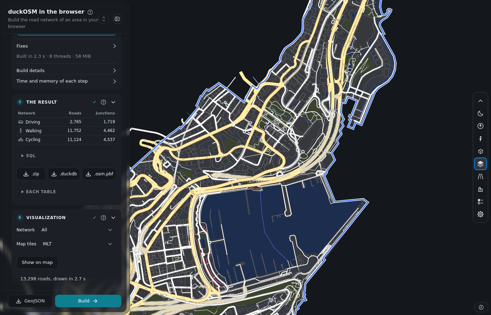

The theme button of the bar changes between light and dark. The page follows the setting of your system at the first visit, and keeps your choice.

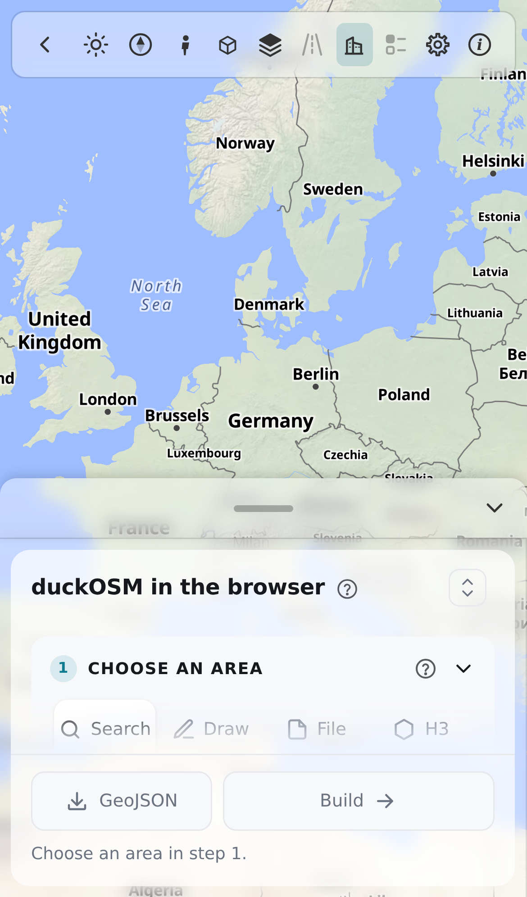

On a phone the panel is a sheet at the bottom of the screen: drag its grip to make it taller or shorter. The map has the full width. The panel has no **Hide panel** button on a phone, because the sheet does that job.

## Keys and settings

The gear in the bar opens the settings. Street view and the Google 3D window need a key:

- **Google key.** Save it in the settings. The deployed site has its own key.
- **Mapillary token.** Save it in the settings.

For a test on your own computer, put the keys in `crates/duckosm-wasm/www/local_keys.json` (`{"google": "...", "mapillary": "..."}`). Git ignores this file, and only a page on `localhost` reads it. See [development.md](development.md).

## Limits and things to know

| Topic | Fact |
|---|---|
| Size of the map | 200,000 roads on a computer, 40,000 on a small device. Use `?maxroads=N` to change it. |
| Area from hexagons | At most 500 cells and 5,000 km². |
| Memory | The page needs memory for the area. A large area can fail on a small device. |
| Saved areas | They stay in this browser only. Clear the site data and they go. |
| An old file in the browser | If the page shows a red bar with "the browser may have an old file", press Ctrl+Shift+R once. |
| Data from Overpass | No layers, so no walls and no fixes panel. |

## How the pictures are made

The pictures of this guide come from one script. It builds Monaco in headless Chromium, takes a picture of each part, and writes the files to `docs/img/dashboard/`:

```bash
python crates/duckosm-wasm/www/docs_shots.py
```

Build the page first (see [development.md](development.md)). The Search picture needs the network.
