# The browser dashboard: a guide to every part

This guide describes each part of the duckOSM-rust page, from the top of the panel to the last card. Each part has a picture and a list of what you can do. The page runs fully in your browser: no server receives your area or your data.

- To see how the page is made (files, code), read [app.md](app.md).
- To see how the fixes are saved and applied, read [osm-editing.md](osm-editing.md).
- To see the columns of each table that a build writes, read [tables.md](tables.md).

All pictures show Monaco. To make them again, run `python crates/duckosm-wasm/www/docs_shots.py` (see [How the pictures are made](#how-the-pictures-are-made)).

## The page at a glance


The page has three parts:

| Part | Where | What it does |
|---|---|---|
| The map | The whole window | Shows the base map, the area that you chose, and the roads after a build. |
| The panel | The left side (a bottom sheet on a phone) | Holds the cards: **Your areas**, then steps 1 to 10. |
| The bar | The right side of the map | Holds the tools of the map: theme, zoom, street view, base map and more. |

The cards follow the steps of the work. A card is off (gray) until the card before it is ready. For example, **Build** stays off until you choose an area and give a data source. Each card has a title, a **?** button that opens its help window, and a chevron that folds the card. A check mark on the title means that the step is done.

After a build the page looks like this:

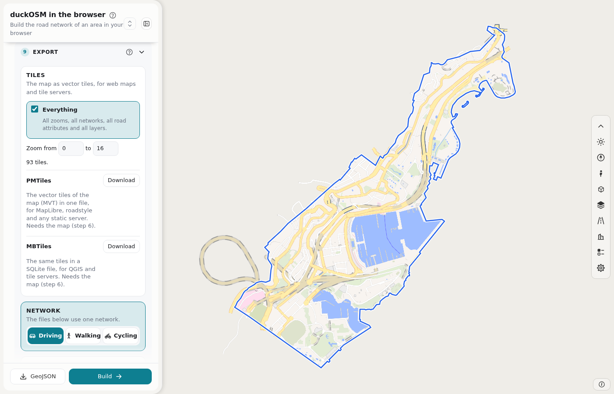

## The steps in order

1. Choose an area (step 1). Use Search, Draw, File or H3.
2. Check the area (step 2). Give it a name and an optional buffer.
3. Give the OpenStreetMap data (step 3). Use a region file, Overpass or a cut file.
4. Build (step 4). Choose the networks and press **Build**.
5. Read the result (step 5). Query the tables and download them.
6. Show the map (step 6). Draw the roads on the map.
7. Fix OSM data (step 7). Change roads, buildings, nodes and turns, and build again.
8. Edit levels (step 8). Open the level editor.
9. Design (step 9). Change the colors, widths and text of the map, and set the profile of the tiles. This step is on at all times.
10. Export (step 10). Give the network or its tiles to other software: PMTiles, MBTiles, GeoPackage, GeoJSON, MATSim and SUMO.

## The bar of tools


The bar is roadstyle's. From the top to the bottom:

| Tool | What it does |
|---|---|
| Chevron (**Fold the bar**) | Folds the bar to one button. |
| Sun or moon (**Light / dark**) | Changes between the light and the dark theme. The panel and the base map follow it. |
| Compass (**Navigate**) | Zoom in, zoom out and the compass. Ctrl + drag on the map turns and tilts it. |
| Person (**Street View**) | Shows photos from Google Street View or Mapillary for a point that you click. It needs a key (see Keys and settings). |
| Cube (**Google 3D**) | Opens the Google 3D window for a place. It needs a key. |
| Layers (**Base map and layers**) | Opens the base-map box (below). |
| Road signs (**road types to filter**) | Off on this page: the page has no road types to filter. |
| Building (**Buildings in 3D**) | Shows the buildings of the base map as 3D shapes. It needs a vector base map. |
| List (**colour options and live data**) | Off on this page: the page has no color options and no live data. |
| Gear (**Settings**) | The keys for Google and Mapillary, and other settings. |
| (i) | The sources of the base maps (attribution). |

### The base-map box


The box has three groups:

- **Base map.** One choice: OpenFreeMap Liberty or Positron (vector maps), OpenStreetMap, Esri Gray, Esri Streets, Esri Satellite or Blank. A map and its dark twin share one choice, so the theme can change the map to its dark twin.
- **On top.** Hillshade, Labels (street names), 3D buildings and Arrows (the direction of one-way roads). The choice is kept for each base map. The arrows are off at the first visit: switch them on here.
- **Map layers and H3 hexagons.** **Map layers** shows or hides the layers that a build makes (water, land use, buildings). **H3 hexagons** shows or hides the grid of the H3 tab.

A build sets the Blank base map for its first drawing so that the roads are easy to see. This does not change your saved choice: the next visit starts on your base map.

## Your areas


The card shows only when the browser has a saved area. Each build is saved in the browser (OPFS), with its tables, its drawing cache and its cut file.

Each row has the name (in full), the date and size of the save, and a chip for each network with its icon (car, walker, bike) and its number of roads (point at a chip for the name). The pill **Opens fast** shows when the drawing of the roads is saved too, so **Open** shows the map with no wait. Without the pill, **Open** loads the tables and the page draws the map when you press **Show on map**.

- **Click a row** to see the boundary of the area on the map. The map zooms to it. A second click hides it.
- **Open** loads the area into DuckDB and draws the map again with no build (Monaco: 1.6 s).
- **Delete** asks a second click, in place.

A new visit starts on the OpenFreeMap base map and with no area. This card is the way back to your work.

## Step 1: Choose an area

Step 1 has four tabs. Each one makes the same thing: the area as a GeoJSON shape.

### Search


1. Type a city, a region or a country. The page asks photon.komoot.io and lists up to 10 matches.
2. Click a match. The page asks Nominatim for its boundary, draws the boundary and zooms to it.
3. To remove it, click the chosen match again, or press **Unselect the area**.

Also in the box:

- **An H3 cell ID.** Type one H3 cell ID (15 hex digits), or several separated by spaces or commas. The page makes the area from the cells with no network, opens the H3 tab and zooms to them. The cells must have one level from 5 to 10.
- **What is here? (the target button).** Press it, then click the map. The page lists the areas at five levels around the point.

If Nominatim fails (a network rule or a limit), the map still moves to the box of the match. A second click asks again, and **use the box of the place** makes the area from the box.

### Draw


Pick a tool, then draw on the map:

| Tool | Key | How |
|---|---|---|
| Rectangle | R | Drag from corner to corner. |
| Polygon | P | Click each corner. **Enter** closes the shape. |
| Circle | C | Drag from the center out. |
| Freehand | F | Drag around the area. |

Other buttons: **Merge** (joins shapes that overlap), **Delete** (the selected shape, key Delete) and **Clear** (all shapes). You can move the corners of a shape. More than one shape makes a multi-polygon.

### File


Select a GeoJSON file, or drop it on the map. The file is a FeatureCollection, a Feature or a geometry. The page takes every Polygon and MultiPolygon in it, and the name and the source from the properties of the first feature. If the file has no polygon, the page says so. The format is the one that `duckosm boundary` writes.

### H3


The area is the union of hexagons of the [H3](https://h3geo.org) grid.

1. Choose the level (5 to 10). The list shows the edge and the area of one cell.
2. Click a hexagon on the map to add it. Click it again to remove it.
3. **Clear the cells** removes all of them.

A thin grid shows the hexagons in view, the hexagon under the pointer is lit, and the picked cells are filled. If the view has too many hexagons, the grid goes off and the text says to zoom in. The area has at most 500 cells and 5,000 km². A change of level removes the cells.

## Step 2: The area


- **Name.** The name of the area. It is the name of the files and of the saved area. For an area from hexagons, the page suggests the H3 ID of the first cell (with `-plus-N` for N more). A name that you type stays.
- **Buffer around the area (m).** Grows the area on all sides (0 to 50,000 m, in the UTM zone of the center), as duckOSM's `boundary.buffer_m`. The cut and the downloads use the grown area.
- **Summary.** The size in km², the number of polygons and the number of vertices.
- **Zoom to the area** (the magnifier in the title) moves the map to the area.
- **Unselect the area** removes the area so that you can choose another one.
- **GeoJSON** (at the bottom of the panel) downloads the area as `boundary.geojson`.

The boundary shows on the map in blue:


## Step 3: The data


Card 3 tells the page where the OpenStreetMap data comes from. It has three tabs:

- **Region file.** Select an `.osm.pbf` file of a region. The list under the button shows the Geofabrik extracts that cover the area, each with a download button. A file that you used before is kept in the browser, and the list shows it as **kept**. This source gives all the layers.
- **Overpass.** The page asks the [Overpass API](https://wiki.openstreetmap.org/wiki/Overpass_API) for the roads of the area. It needs no file, but it gives no layers.
- **Cut file.** Select an `.osm.pbf` file that is already cut to the area (for example the cut file of an earlier build).

## Step 4: Build


| Part | What it does |
|---|---|
| **Networks** | The driving, walking and cycling networks to build. |
| **Layers** | Water, land use, buildings, railways and more (the base map of the area). It needs a region file. With the layers on, the build also makes `main.building_faces` and the tables of the fixes panel. |
| **Fixes** | A fixes file (`.yaml`) that the build applies. The fixes panel (step 7) writes one. |
| **Build** (the main button) | Starts the build. The map shows a box with the step that runs. |

When the build ends, the card shows the time and the memory:


**Build details** lists what each step made. **Time and memory of each step** is a table for each step. The page builds with threads when the browser allows it.

## Step 5: The result


- **The result table.** The number of roads and junctions of each network.
- **SQL.** Run a query on the tables in the browser (DuckDB with the spatial extension). The first query is an example: roads by class.
- **Downloads.** **.zip** (all tables as Parquet files), **.duckdb** (one database file), **.osm.pbf** (the cut area, after a build from a region file) and **.yaml** (the fixes file of this build).
- **Each table.** The list of the files, with a link to the columns of each table ([tables.md](tables.md)).

## Step 6: Visualization


- **Network.** The network that the map draws (driving, walking, cycling or all).
- **Map tiles.** MLT (the default) or MVT. The choice is kept.
- **Show on map.** Draws the roads. A small area (up to 20,000 roads) draws by itself after a build; for a larger area, press the button. The map has a limit: 200,000 roads on a computer and 40,000 on a small device. If the area is larger, the page lists the networks that fit. You can use `?maxroads=N` in the address to change the limit.
- **The note under the button** says how many roads were drawn and how long it took.

## Step 7: Fix OSM data

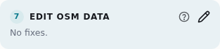

Card 7 shows the number of fixes and has the button **Edit fixes**. It opens the fixes panel. The card is off until a build has made the tables that the panel needs. Build with **Layers** on to get walls and doors. A fix is a rule that you add to a list. A rule changes nothing in the data until you build again. The rules are kept in the browser for the area, and the **.yaml** button of card 5 downloads them.

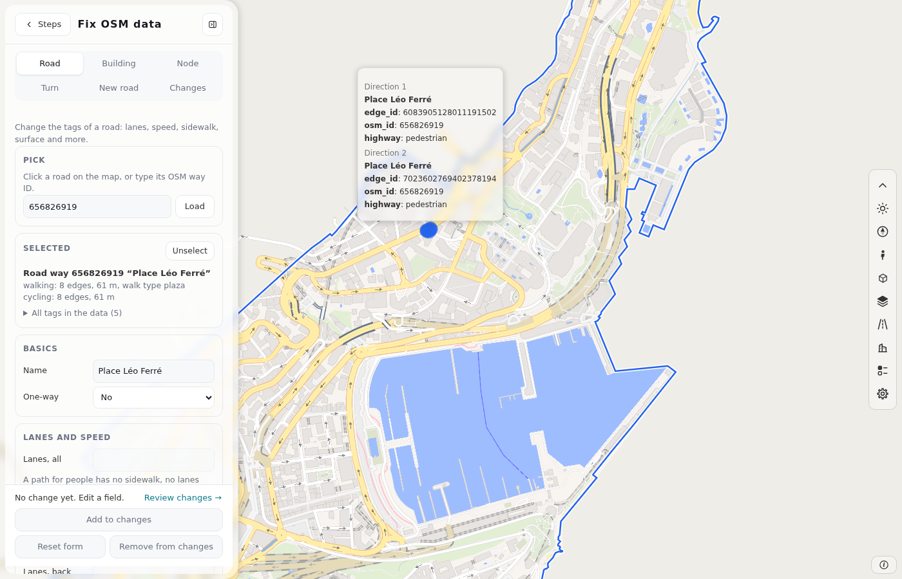

The panel has a header and six tabs:

- **Steps** (top left) closes the panel and shows the steps again. The picks on the map go away, and they come back when you open the panel again.
- **Hide panel** (top right) gives the map the whole width. The button at the corner of the map shows the panel again, with the tab and the picks as they were.
- **Add to changes** (the button at the bottom of a tab) keeps your edits in the list of changes. Until then, an edit is a draft: the tab shows "N changes not added yet". **Reset form** drops the draft. **Remove from changes** takes the rule of this object out of the list.
- **Unselect** (in each tab) takes the picked object out of the tab.

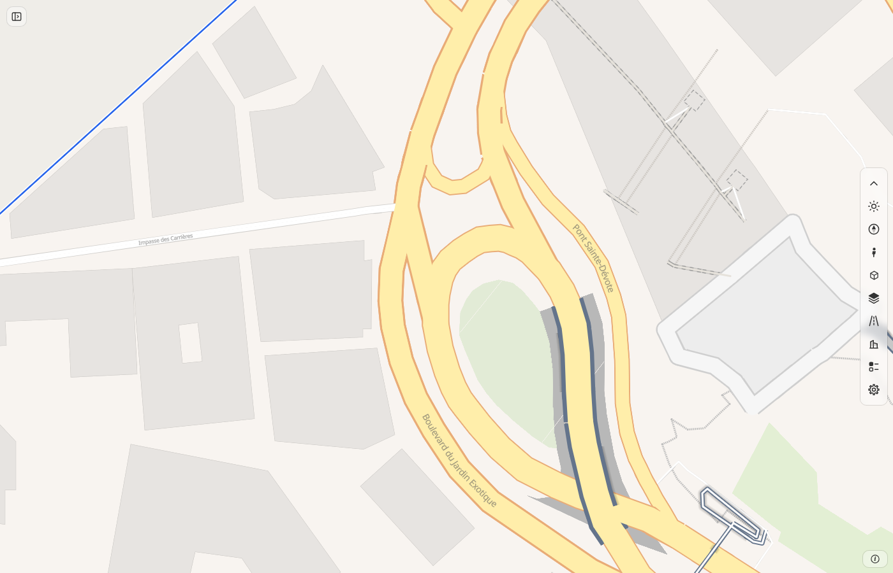

### Road

Click a road on the map, or type its way ID and press **Load**. The form shows the data of the road in groups (Basics, Lanes and speed, Sidewalk, cycleway and crossing, Surface and access, Level). A field that you change gets an amber mark and a ↺ button that takes the change back. **Modes** lets you remove the road from one network (for example, from walking). **Other tags** adds or deletes any tag. **Delete** removes the road from the data.

### Building

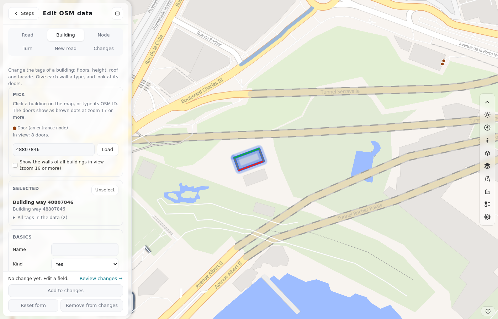

Click a building. The form has the fields of the building (levels, height, roof shape, roof color, materials). Below it:

- **Walls.** The page finds the walls of the building from its outline and gives each wall a type: **front** (green; faces a street), **back** (red), **side** (gray), **party wall** (purple; two buildings share it) or **courtyard wall** (teal; a wall of an inner ring). The map draws each wall in its color and shows its number (`#1`, `#2`, ...), as in the list. The row of a wall has the same color, the length, the street that it faces, and a short note when the type is a guess (see below). Click a row or a wall on the map to select it. **Previous** and **Next** step through the walls. You can change the type of a wall and give it a **Door** (main, service and so on). A door belongs to the wall and has no place on it. Both changes wait for **Add to changes**.
- **Doors.** The doors that OSM has on the outline (nodes with `entrance`), with a kind that you can change.
- A building that is a multipolygon relation has walls for its outer ring and for each courtyard.

How a wall gets its type, in order of strength:

1. A wall with an OSM entrance node is a front wall (`entrance`).
2. The street that the `addr:street` tag names is preferred (`address`).
3. A wall faces a street that it can see: a line from one of three points of the wall reaches the street with no wall in the way. A street of a higher class wins (`street`).
4. A building that sees no street gets the wall that faces the nearest street within 150 m (`inferred`, shown as "guess").
5. A wall that points away from the front wall and faces no street is a back wall. A wall that two buildings share is a party wall.

Check the walls that say "guess" or "no street seen". The method is in [osm-editing.md](osm-editing.md).

### Node

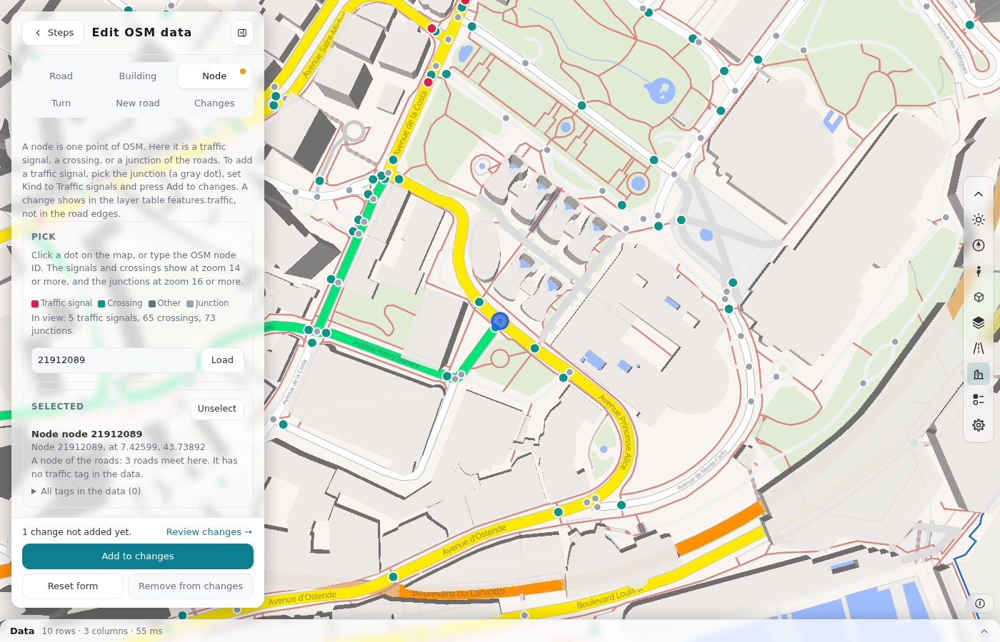

A node is one point of OSM. Here it is a traffic signal, a crossing, a stop sign, a give-way sign, a bus stop, or a junction of roads. The map shows the signals and crossings as dots from zoom 14, and the junctions (gray dots) from zoom 16. Click a dot, or type the node ID.

The **Kind** field offers only the kinds that the node can have, and the reason is under the field: a node must be on a road of the driving network; a traffic signal, a stop sign and a give-way sign need a junction of at least 3 roads; a crossing needs a road of the class residential, service, tertiary, secondary or primary; a motorway or a trunk road takes none of them.

### Turn

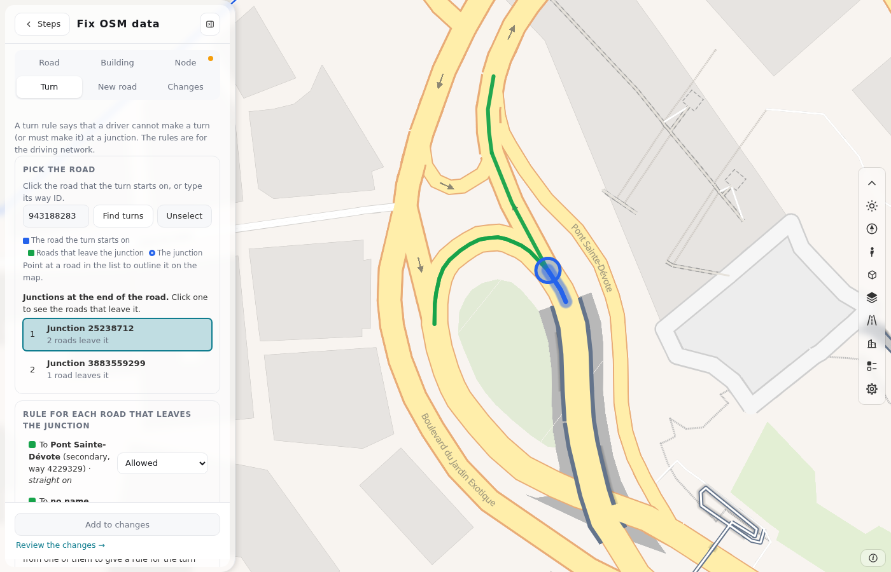

A turn rule says that a driver cannot make a turn (or must make it) at a junction.

1. Click the road that the turn starts on, or type its way ID, and press **Find turns**.
2. The list **Junctions at the end of the road** shows each junction and how many roads leave it. The first one is picked. Click another to pick it.
3. The map shows the road that the turn starts on (blue), the junction (a ring) and the roads that leave it (green). Point at a row, and its road is outlined on the map. Click a row to keep the outline.
4. For each road that leaves, the list offers **Allowed**, **No** and **Only** for the way of that turn (left, right, straight on or U-turn). The page finds the way from the directions of the two roads.
5. Press **Add to changes**. All the rules that you chose are added at once.

The rules are for the driving network. **Roads that arrive at this junction** lists the roads that you can use as the start road.

### New road

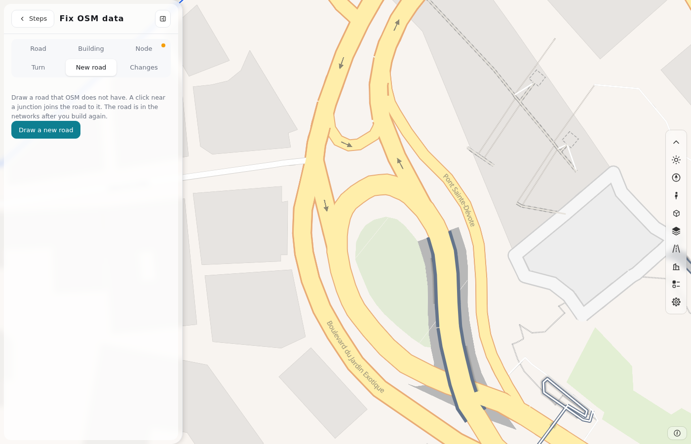

Click points on the map to draw a road that OSM does not have. A click near a junction joins it. Set the kind, the name, the one-way rule and more, then finish. The road is a rule `new_ways` in the fixes file. You can edit a new road again from the **Changes** tab.

### Changes

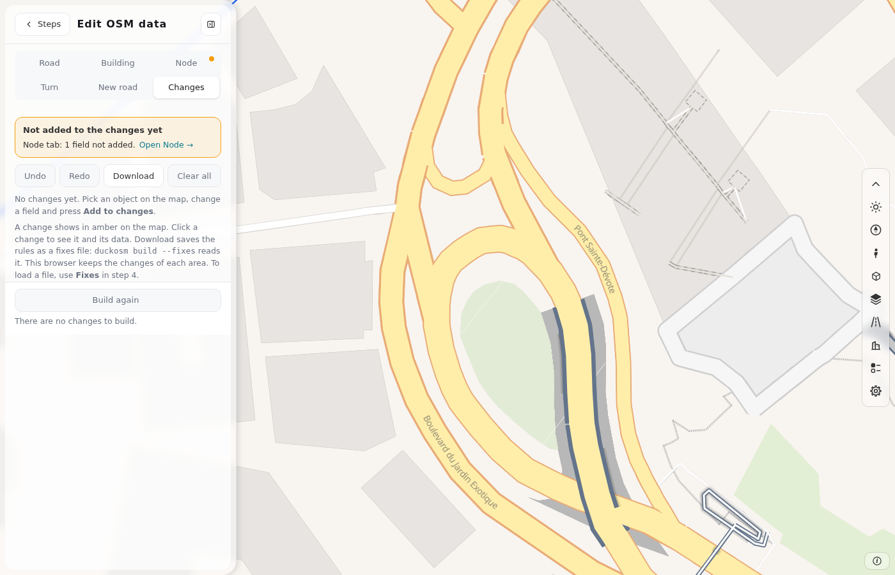

The list of all the rules: roads, buildings, walls, nodes, other objects, turn rules and new roads. Click an item to show it in its tab. The × button takes it out. **Undo** and **Redo** step through your changes. **Download** writes the fixes file. **Clear** removes all the rules. The tab shows the number of changes. **Build** (at the bottom of the panel) builds again with the rules.

### Guards: the lists that limit each other

A choice in one list closes a field, or narrows the list of a field, for another. The reason shows under the field, and **Add to changes** refuses a value that a guard closed. The rules are data in `app/presets.json` (`_guards`). Examples:

| Choice | Effect |
|---|---|
| One-way road: yes | The lanes for each direction are closed. |
| Bridge: yes | The tunnel field is closed (and the other way round). |
| Class motorway or trunk | No sidewalk, no cycleway, no crossing. The surface is paved. |
| Class footway, path, steps | No lanes, no speed limit, no sidewalk. |
| Roof shape: flat | The roof levels are closed. |
| Kind of node: not a crossing or a signal | Crossing, kerb and tactile paving are closed. |
| Kind of node: traffic signals | Only the crossing value `traffic_signals` stays. |

## Step 8: Edit levels

Card 8 opens roadstyle's level editor for the roads that you built: change the level of a road, and see the effect on bridges, tunnels and crossings. The level editor is described in [levels.md](levels.md).

## Step 9: Design

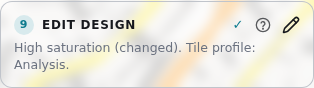

Card 9 sets the look of the map and the profile of the tile files. It is on at all times and does not wait for a build. Push **Edit design**. The panel of the design takes the place of the steps. **Steps** goes back to the steps. **Hide panel** hides the panel on a computer.

A change shows on the map after half a second. The page draws the map again with the new design, as it does when you change the network. The bar at the bottom of the panel says "Drawing the map…" and then "The map shows this design." If the map is not drawn yet, the design shows at the next draw (step 6).

A change that keeps the map's tiles is faster: the page gives the map the new style and keeps its tiles (roadstyle's `LiveMap.setLook`). This is a
change of colours, of the names and arrows, of the base map's colors, or of the road widths up to 1.35 times the widest road (the tiles have that much
room around them). The map draws no tile again, and the live colors on the roads stay. The note under the map then says "a new look on the same tiles"
(Monaco: about 0.7 s, against about 2 s for a new map). 32 of the 33 ready themes do this. A change of the layers, of the base-map theme, or roads
wider than that (the theme Access) changes the tiles, so the page draws the map again.

The panel has five tabs.

| Tab | What it sets |
|---|---|
| **Theme** | Thirty-three ready themes, the name of the design, and **Download**, **Load a file** and **Reset**. |
| **Roads** | The fill and the casing of 14 road classes, the width of 9 groups of classes, and the colors of the dark theme. |
| **Text** | The street names (color, halo, size, first zoom) and the one-way arrows (color, size, first zoom). |
| **Layers** | A switch for each layer, the boundary of the area (line, fill), the ground (transparent or not), the colors of the ground, water, green areas, built-up land, sand, buildings, railways and waterways, and the height of 3D buildings. |
| **Tiles** | The tile profile: zooms, layers, columns, class zooms, extent, buffer, tile limit and tile format. |

### Theme

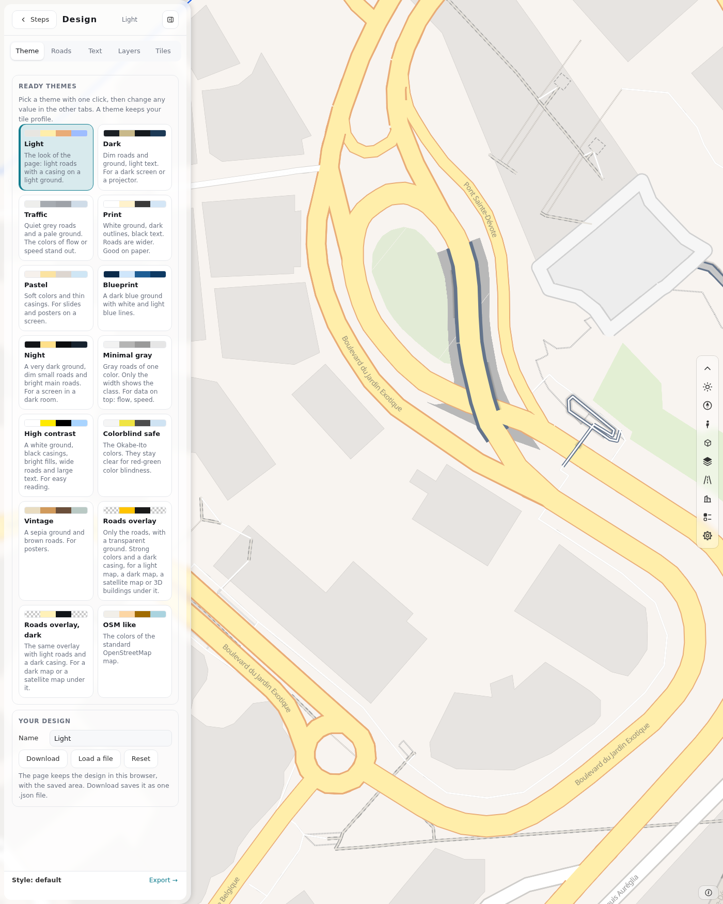

The themes of roadstyle (group "roadstyle") use the real colors of roadstyle's data files (`rust/roadstyle-assets/files/data/`). The road colors are the colors of the files. A class with no casing in a file has its fill as casing. The sand of **Grey** is not in its file: it is the sand of OSM Carto with the transform of the file (saturation 0.12, then 35 percent to white).

A theme is a full set of values: the road colors and widths, the text, the boundary, the base-map colors, the ground and the layers. A theme is one plain object (data) in `app/design.js`. One click on a theme replaces the style. After that, change any value in the other tabs. The theme then shows as "custom". A theme keeps your tile profile.

The list is long, so it has a search field and filter buttons above it. Type words in **Search themes**: a theme shows if its name, its note or its group has all the words (for example, `google` or `dark satellite`). The buttons **All**, **Light**, **Dark**, **Overlay** (the roads overlay themes), **Print**, **Roads only** (the overlay themes and the road palettes), **roadstyle** and **Yours** limit the list. A line under them says how many themes show. The search and a filter work together. **Yours** shows only your saved themes (see below). Each theme has a `group` and a `dark` value in `THEME_DATA` for the filters. Light and Dark are first in the list, and the Roads overlay themes come next.

Each button shows four cells: the ground, a road fill, its casing and the water. A checkerboard cell means that the ground is transparent, or that the layer is off.

| Theme | What it is for |
|---|---|
| **Light (Liberty)** | The look that the page had before the design card: the colors of OpenFreeMap Liberty (roadstyle's theme liberty) with the google paths. |
| **Dark** | Dim roads and ground, light text. For a dark screen or a projector. |
| **Google like** | roadstyle's theme google: a light land, white streets with soft gray edges, yellow main roads, light blue water. |
| **Grey** | roadstyle's theme grey: a quiet, light gray map for data. |
| **roadstyle** | roadstyle's own look: the amber road palette on the OSM Carto base map. |
| **OSM Carto** | roadstyle's theme osm_carto: the colors of the standard OpenStreetMap map. |
| **Amber roads**, **Carto roads**, **High saturation**, **Mono roads** | roadstyle's road palettes amber, carto, highsat and mono. A palette changes only the road colors. The base map of the design that is on now stays. |
| **Traffic** | Quiet gray roads and a pale ground. The colors of flow or speed stand out on it. |
| **Print** | A white ground, dark outlines, wider roads and black text. |
| **Pastel** | Soft colors and thin casings. For slides. |
| **Blueprint** | A dark blue ground with white and light blue lines. |
| **Night** | A very dark ground, dim small roads and bright main roads. For a dark room. |
| **Minimal gray** | Gray roads of one color. Only the width shows the class. For data on top. |
| **High contrast** | A white ground, black casings, bright fills, wide roads and large text. |
| **Colorblind safe** | The Okabe-Ito colors. They stay clear for red-green color blindness. |
| **Vintage** | A sepia ground and brown roads. For posters. |
| **Waze like** | A pale blue-gray ground, white roads with a thin gray casing, blue water and bright main roads. |
| **Transit and bikes** | Gray roads, strong green cycleways and blue footways and paths. For walking and cycling networks. |
| **Neon night** | A black ground and thin neon roads (cyan, magenta, yellow by class). No base-map fill. For traffic flow on top. |
| **Chalkboard** | A dark green-gray ground and thin white chalk lines. No fills. |
| **Topo** | A light green-beige ground, brown roads, strong green areas and blue water. For hills and parks. |
| **Toner** | Pure black and white: thick black roads on a white ground. For printing and photocopies. |
| **Grayscale print** | Gray levels only. For a black-and-white printer. |
| **Simulation view** | A dark gray ground, light gray roads with a clear outline, and the one-way arrows on. Like a traffic simulator. |
| **Accessibility large** | A white ground, very wide roads, large black text with a white halo and yellow main roads. |
| **Emergency** | A pale ground, red main roads, orange secondary roads and large names. For the routes of emergency vehicles. |
| **Roads overlay** | Only the roads, on a transparent ground. Strong colors and a dark casing. See below. |
| **Roads overlay, dark** | The same overlay with light roads. For a dark map or a satellite map under it. |
| **Roads hollow** | Only the outline of each road, in the color of its class, with no fill. |
| **Roads ghost** | Pale roads: the fill at 35 percent and a thin casing at 70 percent. |

There is no theme for the Satellite base map. A theme can hide a layer, but it cannot make the base-map fills partly transparent. Use **Roads overlay** over a satellite map.

### Preview on

The **Preview on** control is in the Theme tab. It changes only the map under the roads: **Checkerboard**, **Blank**, **OpenFreeMap** or **Satellite**. It is the same choice as the base-map box of the bar, and the two always agree: if you pick a base map in the box, the control shows it. A map with a transparent ground (the Roads overlay themes) has no color of its own, so on the Blank base map you see the color of the map container and the theme does not look transparent. For this reason the Blank base map shows a checkerboard under the ground by itself while the ground is transparent. Pick **Blank** to see the plain color, or a base map to see the roads on it. While the ground is transparent and the base map is Blank or the checkerboard, the bar of the panel says: "The ground is transparent: pick a base map in the base-map box to see it through."

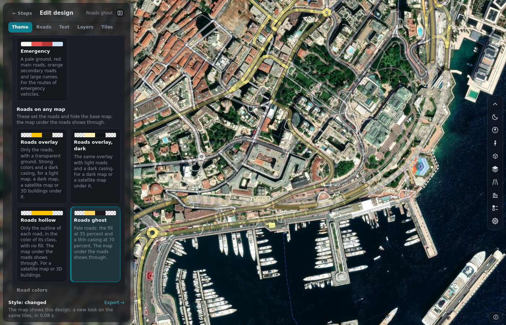

### Your themes

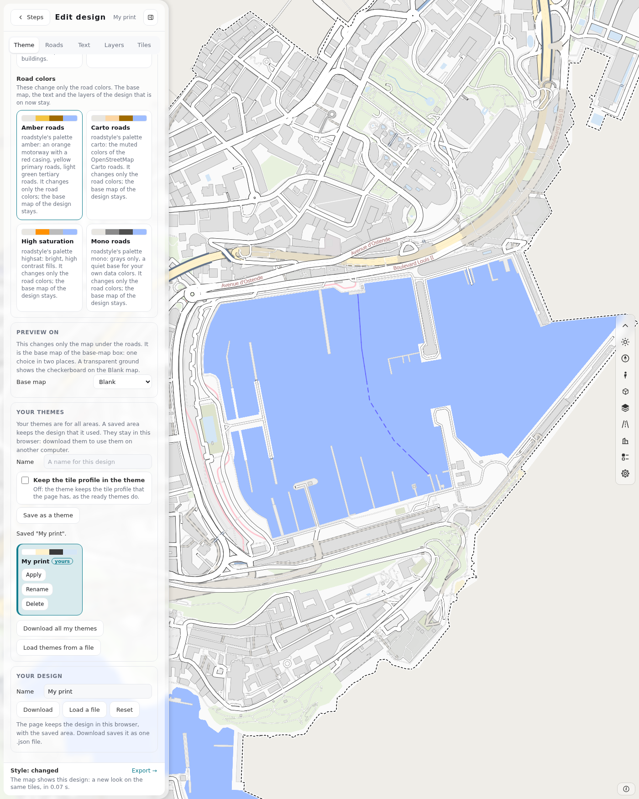

**Your themes** is below the ready themes. It keeps designs that you save with a name, so that you can use them again.

1. Pick a ready theme and change it in the other tabs. The design then shows as **custom**.
2. Type a name in **Your themes** (1 to 40 characters) and push **Save as a theme**. The theme saves the style, the boundary, the ground and the layer switches. The check box **Keep the tile profile in the theme** is off by default, because the ready themes keep the tile profile of the page. Turn it on if the theme must set the profile too.
3. A saved theme has a card with the same four cells as a ready theme and the mark "yours". **Apply** uses the theme at once. **Rename** gives it another name. **Delete** asks for a second push (the button says "Delete?") and then removes the theme.
4. If you change a theme of yours, the design shows as **custom** and the button **Update "Name"** puts the changes into that theme. **Save as a theme** with a new name makes another theme.
5. A name that exists (in capital or small letters) asks "Replace it?". **Replace** keeps the theme and gives it the new design. **Cancel** changes nothing.

**Download all my themes** saves one file, `duckosm-themes.json`, with the list. **Load themes from a file** adds the themes of such a file to your list; a theme with the name of one that you have is replaced. A file that is not a duckOSM themes file does not load, and the page says why. Use the two buttons to move your themes to another computer.

Your themes stay in this browser, in the storage `localStorage` (key `duckosm.themes`). A design is about 4 KB, so a list of themes is small, and the page reads it at once. The themes are for all areas. A saved area keeps the design that it used (`design.json`), not the list.

### The roads overlay

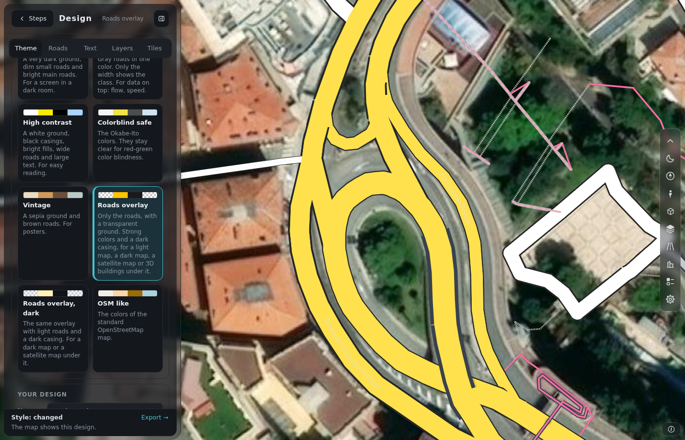

**Roads overlay** and **Roads overlay, dark** show only the roads, the street names and the casings. The fill is at 60 percent and the casing at 85 percent, with the casing as an outline, so the map under the roads shows through them. The ground has alpha 0 (the layer `bg` of the map is transparent, also in the dark theme). The base-map layers (land use, water, buildings, railways and the points) are off. The casing is a little wider and the colors are a little stronger than in Light, because no ground is behind them. Put the overlay on a light map, a dark map, the Satellite base map or a map with 3D buildings. The base-map switch of roadstyle changes the map under the roads, and the ground stays transparent.

**Download** saves the design as one `.design.json` file. **Load a file** reads such a file and draws it. A file that is not a duckOSM design file does not load, and the design stays as it is. **Reset** goes back to the Light style and keeps the tile profile.

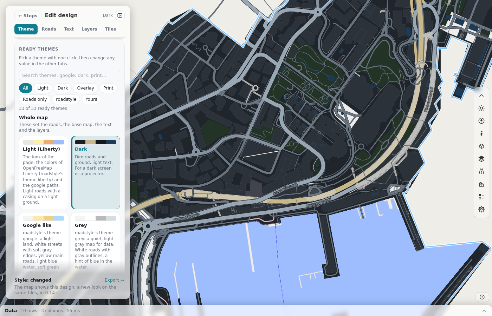

### Roads

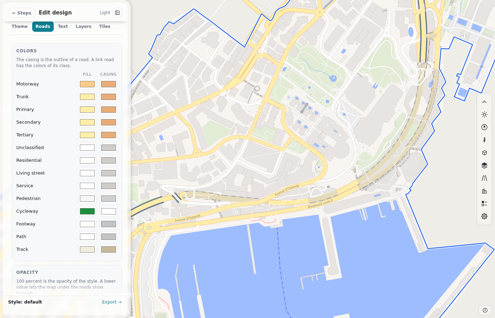

Each class has a color input for the fill and one for the casing. The casing is the outline of the road. A link road has the colors of its class.

A width factor scales the whole width curve of a group. For example, 2 doubles the width of the roads of the group at all zooms. The groups come from roadstyle: motorway and trunk, primary, secondary, tertiary, residential and unclassified, living street, service, pedestrian, and footway, path, cycleway and track.

**Opacity** has two sliders, **Fill opacity** and **Casing opacity** (0 to 100 percent). 100 percent is the opacity of the style. A lower value lets the map under the roads show through: a satellite map or 3D buildings. The switch **Casing as an outline** draws the casing only outside the fill. This matters when the fill is not opaque. Without it, the casing is under the fill, and the road looks dark and muddy over a satellite map, because the casing shows through the fill. With it, the casing has a gap of the width of the fill, so the map shows through the whole fill. The page does this in the paint of roadstyle's road layers (`line-opacity`, and `line-gap-width` for the casing). A change shows at once and draws no new map. The opacity is `design.roads.opacity` (`{fill, casing, outline}`). The opacity is not per class or per group: roadstyle's road layer has one opacity for all classes. A road is drawn in pieces, and where two pieces overlap (a junction, a round end) a fill that is not opaque shows a spot that is a little stronger.

The dark theme of the map does not use the colors of the light theme directly. roadstyle changes each light color to a dark one. The **Dark mode** section sets the range of lightness of that change for the road fill, the casing, the areas and the text (0 is black, 1 is white). It also sets the dark ground.

### Text

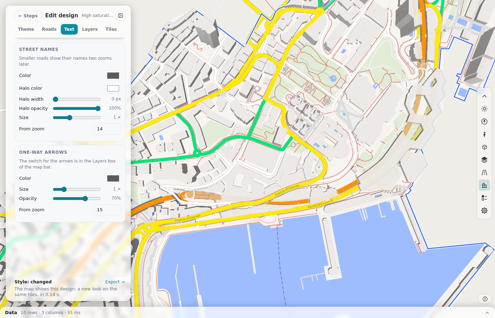

The street names have a color, a halo (a color, a width and an opacity), a size factor and a first zoom. The names of small roads show two zooms after the first zoom. The one-way arrows have a color, an opacity, a size factor and a first zoom. The halo opacity is `design.labels.halo_opacity`, and the arrow opacity is `design.arrows.opacity` (0.7 at the first visit, as in the style). The switch that turns the arrows on or off is in the base-map box of the bar.

### Layers

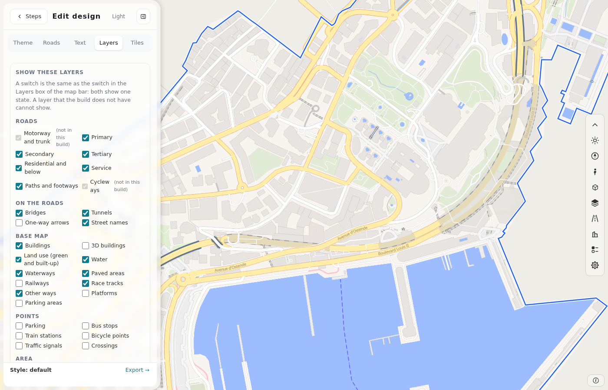

The tab starts with **Show these layers**. Then come **Area boundary**, **Ground**, the colors of the base-map layers (they need step 4 with the base-map layers) and the 3D buildings. One color covers a group of land-use classes: **Green areas** covers forest, wood, grass, park and others, and **Built-up land** covers residential, commercial, industrial and others. The 3D buildings have a height for each floor, a highest building and an opacity.

**Show these layers** has one switch for each layer of the map. A change shows at once, and the page does not draw the map again.

| Section | Switches |
|---|---|
| **Roads** | Motorway and trunk, primary, secondary, tertiary, residential and below, service, paths and footways, cycleways. A link road is in the group of its main road. |
| **On the roads** | Bridges, tunnels, one-way arrows, street names. |
| **Base map** | Buildings, 3D buildings, land use, water, waterways, paved areas, railways, race tracks, other ways, platforms, parking areas. |
| **Points** | Parking, bus stops, train stations, bicycle points, traffic signals, crossings. |
| **Area** | The area boundary. |

A switch is the same as the matching switch of roadstyle (the Layers box and the arrows switch of the map bar). If you change one of them, the other one follows: the design reads roadstyle's events, and the design calls roadstyle's functions (`rsSetOverlay`, `rsSetClasses`, `rsSetBridges`, `rsSetTunnels`, `rsSetArrows`, `rsSetBuildings3D`). A layer that the build does not have shows "(not in this build)" and cannot be switched. At the first visit the arrows, the 3D buildings, the railways and the points are off, as before the card.

**Ground** has the switch **Transparent ground** and an opacity from 0 to 1. With the switch on, the ground of the map has the alpha of the opacity (0 is fully transparent). With the switch off, the ground is opaque.

**Area boundary** is the line around the area that you chose in step 1. It has these fields:

| Field | What it does |
|---|---|
| **Show the boundary** | On by default. Off hides the line, its white casing and the fill. The other fields are then off. |
| **Line color** and **Line width** | A blue line of 2.5 px at the first visit. The width is 0.5 to 6 px. |
| **Line style** | `solid`, `dashed`, `dotted` or `dash-dot`. |
| **Fill color** and **Fill opacity** | The fill of the area. An opacity of 0 gives no fill. |
| **Fill over the roads** | Off by default. Before the roads are drawn, the fill shows. After that, the page hides it, because it changes the colors of the roads. Turn this switch on to keep the fill over the roads. |

The boundary is not part of roadstyle's look. A change shows at once, and the page does not draw the roads again. The four themes have their own boundary: Print has a thin black dashed line and no fill, Dark has a light blue line. **Reset** goes back to the blue line.

The values are in one object, `design.boundary` (`{show, color, width, dash, fill, fillOpacity, fillOnRoads}`), in the design file and in the saved area. The ground is `design.ground` (`{transparent, opacity}`; `groundAlpha(design)` in `app/design.js` gives its alpha). The layers are `design.visible` (one boolean for each key of `VISIBLE_KEYS`). `designPanel.boundary()` gives it, and `BOUNDARY_DASH` in `app/design.js` gives the pattern of each `dash` value. Other modules read these values, for example a picture export.

### Tiles

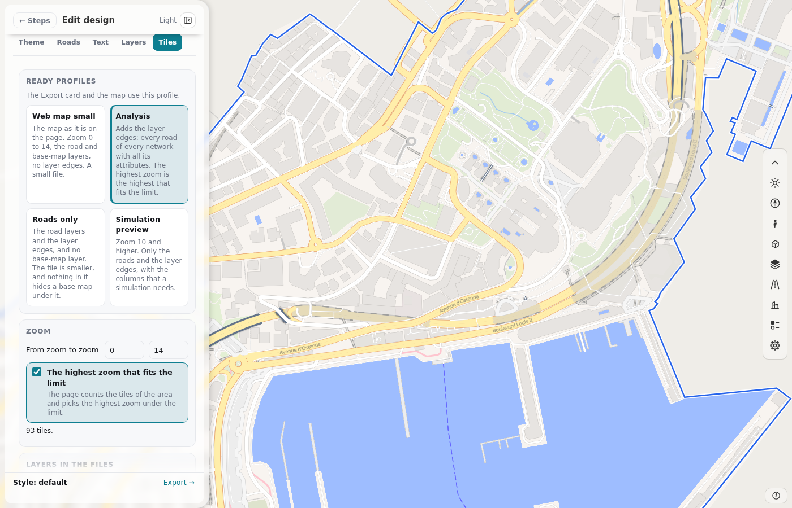

The tile profile is for the tile files of step 10. The map uses its format. Four ready profiles fill the fields:

| Profile | Zoom | Layers | Use |
|---|---|---|---|
| **Web map small** | 0 to 14 | Roads and base map | A small file for a web map. |
| **Analysis** | 0 to the highest zoom under the limit | Roads, base map and the layer `edges` with all columns | Every road of every network, with its attributes. This is the profile at the first visit. |
| **Roads only** | 0 to the highest zoom under the limit | Roads and the layer `edges`, no base-map layer | A smaller file that has nothing that hides a base map under it. |
| **Simulation preview** | 10 to the highest zoom under the limit | Roads and the layer `edges` with 13 columns | The columns that a simulation needs. |

The fields:

- **Zoom** has the lowest and the highest zoom. **The highest zoom that fits the limit** lets the page count the tiles and pick the highest zoom under the limit.
- **Layers in the files** has three switches. **Roads** is roadstyle's road layers (`simple` for the roads, `slots` for the names and the arrows). **Base map** is the base-map layers (`ov0`, `ov1` and more). **Layer edges** is the layer of step 9 with every road of every network.
- **Columns of the layer edges** lists the attributes of a road. `edge_id` is always in the layer. A flag for each network is also always in the layer.
- **Road class start zoom** gives the zoom where a class comes into the layer `edges`. A lower class is left out at a lower zoom, and the file stays small. A class that is not in the list starts at zoom 13.
- **Format of the map** is MLT (smaller) or MVT. It is the same choice as **Map tiles** in step 6. The tile files always hold MVT.
- **Extent** and **Buffer** are in tile units. They are for the layer `edges`. The tiles of the map have the extent 4096.
- **Tile limit** is the largest number of tiles that a file can have (1,000 to 200,000). More tiles take more time and memory. The Export card shows the number of tiles and turns the tile buttons off above the limit.

### How the Export card uses the profile

Card 10 shows the name of the profile, the zoom range and the number of tiles. Its fields are the fields of the profile. If you change **Layer edges**, the zoom or **The highest zoom that fits the limit** in card 10, the profile changes in card 9, and the other way. **Edit the tile profile (step 9)** in card 10 opens the Tiles tab.

### Where the design is kept

- In this browser, as the last design that you used. A new area starts with it.
- With the saved area, as the file `design.json` in the folder of the area. **Open** on a saved area in **Your areas** brings its design back before the map is drawn. A new build of the same area keeps the file.
- In a file that you download. The file has the version of the format (`"format": "duckosm-design"`, `"version": 1`).

The style is written into roadstyle's look (`map/look.json`) and the map worker makes the map and its tiles from that look. The map and the files of step 10 have the same style for this reason. The code is in `app/design.js` (the values, the themes and the profiles) and `app/design_panel.js` (the panel).

## Step 10: Export

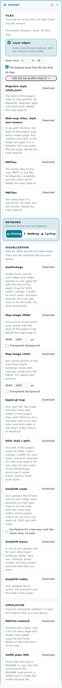

Card 10 gives the network that you built to other software. It is off until a build ends. The files are made in your browser from the tables, and each **Download** button makes one file. The card has four sections: **Tiles**, **Network**, **Visualization** and **Simulation**. In **Network**, pick Driving, Walking or Cycling with the buttons (the section shows when you built more than one network). The network sets the files of **Visualization** and **Simulation**. The tiles do not use it.

| Format | File | What it has |
|---|---|---|
| **PMTiles** | `<area>_z<min>-<max>.pmtiles` | One PMTiles v3 file (gzip MVT tiles, Hilbert order, leaf directories for more than 4,000 tiles). For MapLibre, roadstyle and any static server. |
| **MBTiles** | `<area>_z<min>-<max>.mbtiles` | The same tiles in a SQLite file (`metadata` and `tiles`, rows from the south). For QGIS and tile servers. |
| **GeoPackage** | `<area>_<network>.gpkg` | The tables `roads` (LineString) and `nodes` (Point) in EPSG:4326, with no spatial index. For QGIS and ArcGIS. |
| **GeoJSON roads** | `<area>_<network>_roads.geojson` | One plain `.geojson` file: a LineString for each edge, with `edge_id`, `osm_id`, `source`, `target`, name, class, one-way, lanes, speed and length. Longitude and latitude. kepler.gl, QGIS and web maps open it directly. |
| **GeoJSON nodes** | `<area>_<network>_nodes.geojson` | One plain `.geojson` file of points: the junctions and the ends of the roads, with `node_id`. |
| **MATSim network** | `<area>_<network>_matsim_network.xml` | A `network_v2.dtd` file: a node for each node, and a link for each edge with length (m), free speed (m/s), capacity (vehicles per hour), lanes and mode (`car`, `walk` or `bike`). Coordinates are meters in the UTM zone of the area. |
| **SUMO plain XML** | `<area>_<network>_sumo.zip` | `.nod.xml`, `.edg.xml` and `.con.xml` and a `README.txt` with the `netconvert` command. An edge has its shape, lanes, speed and priority. The connections are the legal turns of the edge graph (turn restrictions applied). |

The tiles are the tiles of the map on the screen, made again by the map worker as MVT. The tile profile of [step 9](#step-9-design) sets what they hold. The card shows the name of the profile and has these fields:

- **Layer edges** (on in the Analysis profile, which is the profile at the first visit). The export has the layer `edges` with every road of every network and the columns of the profile. If the map shows one network, the page switches it to **All** (card 6) and draws it again first. Monaco gives a file of about 5.6 MB with the Analysis profile.
- **Zoom from ... to ...** The lowest and the highest zoom (0 to 18). **The highest zoom that fits the limit** sets the highest zoom to the highest one that keeps the tiles under the limit (zoom 16 at the most). The card shows the number of tiles for the extent of the network. The limit is 40,000 tiles unless you change it in step 10. If the count is higher, the buttons are off. Use fewer zooms or raise the limit.
- The buttons for tiles are off until **Show on map** (step 6) has drawn the map. A tile that has nothing in it is left out.

The fields of the card are the fields of the profile. A change in card 10 shows in card 9, and the other way. The profile also sets the layers (roads, base map, edges), the columns, the zoom where each road class starts, the extent and the buffer.

What a tile has:

| Layer | What it is |
|---|---|
| `edges` | Only with **Layer edges**. One LineString for each piece of a road in the tile, clipped to the tile with a buffer (64 units of 4,096 by default). Each piece has the columns of the profile (all by default): `edge_id`, `osm_id`, `edge_ref`, `source`, `target`, `name`, `highway`, `oneway`, `lanes`, `surface`, `maxspeed_kmh`, `bridge`, `tunnel`, `junction`, `layer`, `service`, `access`, `length_m` and `cost_s`, and a flag for each network that has the edge (`driving`, `walking`, `cycling`). The ids are text. A lower road class starts at a higher zoom. By default: motorway, trunk and primary from zoom 0, secondary from 8, tertiary from 10, unclassified from 11, residential and living street from 12, all other classes from 13. The profile can change these zooms. At a zoom that is equal to or higher than the start zoom of every class, every edge is in the tiles. |
| `simple`, `slots` | roadstyle's layers for drawing the roads (shapes, classes, one-way marks, labels). The map style reads them. They do not carry the attributes of an edge. The profile switch **Roads** keeps or drops them. |
| `ov0`, `ov1`, ... | The base-map layers of the build: water, land use, buildings (with `height`), railways and more. They need a build with **Layers** on. The profile switch **Base map** keeps or drops them. |

The OpenFreeMap background of the page is not in the tiles: it is not ours.

**The check.** After each download, the page reads the file that it made and compares it with the tables. A line under the format says what it found: a green "Checked" line (for example "2,765 roads and 1,719 nodes, the same as the tables"), or a red "Problem" line with the first difference. The checks:

| Format | What the page checks |
|---|---|
| GeoJSON roads and nodes | The number of features, that the file is a FeatureCollection, and that every feature is a LineString (roads) or a Point (nodes). |
| GeoPackage | The number of roads and nodes, the application id and the header of a geometry. |
| MATSim | The number of nodes and links, and that every link joins two nodes of the file. |
| SUMO | The number of nodes, edges and connections, and that every edge joins two nodes of the file. The page does not run `netconvert`. |
| PMTiles | The directories (root and leaf), the number of tiles, the zooms in the header and the layers of the biggest tile. With **Layer edges**, also that all edges of all networks (of the classes that start at or below the highest zoom) are in the tiles of the highest zoom. |
| MBTiles | The number of tiles, the zooms and that a tile is gzip. |

A check is not a test with other software. To test with real tools, open the file in QGIS (GeoPackage, MBTiles, GeoJSON), in a PMTiles viewer or MapLibre (PMTiles), in MATSim, or with `netconvert` (SUMO). `export_e2e.py` runs all the checks on Monaco.

Facts about the files:

- The ids are the `edge_id` and `node_id` values of the tables, as text. They are 64-bit hashes, so a program that reads them as numbers can lose digits.
- The speed is `maxspeed_kmh` when the edge has it. If not, the page uses a default for the class (for example 50 km/h for a secondary road). The lanes default to 1. The capacity is 2,000 vehicles per hour and lane for a motorway, and 800 for a small road.
- SUMO cannot read the three files directly. It needs one network file (`.net.xml`), and `netconvert` (a program that comes with SUMO) makes it from them. To make the network, unpack the `.zip` and run the command of the README in that folder:

```bash
netconvert --node-files area_driving.nod.xml --edge-files area_driving.edg.xml --connection-files area_driving.con.xml -o area_driving.net.xml
```

The page does not run `netconvert`, so the SUMO files are not checked against SUMO here. The simulator adapters with lanes, junction shapes and traffic lights are in the SimReady project.

## The dark theme and the phone


The theme button of the bar changes between light and dark. The page follows the setting of your system at the first visit, and keeps your choice.


On a phone the panel is a sheet at the bottom of the screen: drag its grip to make it taller or shorter. The map has the full width. The panel has no **Hide panel** button on a phone, because the sheet does that job.

## Keys and settings

The gear in the bar opens the settings. Street view and the Google 3D window need a key:

- **Google key.** Save it in the settings. The deployed site has its own key.
- **Mapillary token.** Save it in the settings.

For a test on your own computer, put the keys in `crates/duckosm-wasm/www/local_keys.json` (`{"google": "...", "mapillary": "..."}`). Git ignores this file, and only a page on `localhost` reads it. See [development.md](development.md).

## Limits and things to know

| Topic | Fact |
|---|---|
| Size of the map | 200,000 roads on a computer, 40,000 on a small device. Use `?maxroads=N` to change it. |
| Area from hexagons | At most 500 cells and 5,000 km². |
| Memory | The page needs memory for the area. A large area can fail on a small device. |
| Saved areas | They stay in this browser only. Clear the site data and they go. |
| An old file in the browser | If the page shows a red bar with "the browser may have an old file", press Ctrl+Shift+R once. |
| Data from Overpass | No layers, so no walls and no fixes panel. |

## How the pictures are made

The pictures of this guide come from one script. It builds Monaco in headless Chromium, takes a picture of each part, and writes the files to `docs/img/dashboard/`:

```bash
python crates/duckosm-wasm/www/docs_shots.py
```

Build the page first (see [development.md](development.md)). The Search picture needs the network.
