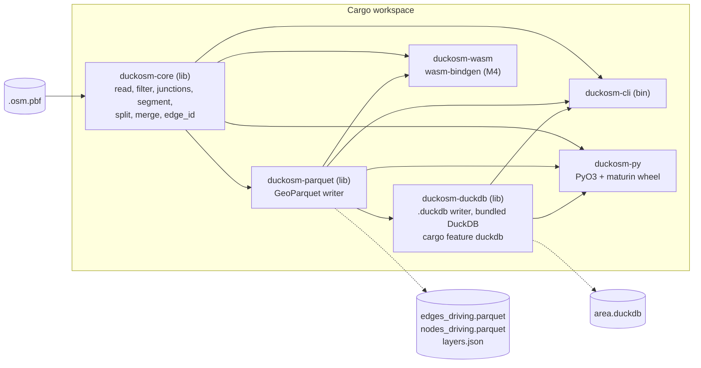

# Design of duckosm-rust

Status: draft for review by Kaveh. Date: 2026-10-21. No Rust code exists yet.

The repository is `duckosm-rust`. It is a Cargo workspace. Its first crate is `duckosm-core`.

This document is based on duckOSM 0.6.0 (git tag `v0.6.0`) and DuckDB 1.5.3. The numbers come from
`monaco.duckdb` in the duckOSM folder, built on 2026-10-21. The experiments in section 5 are in
[tools/edge_id_reference.py](../tools/edge_id_reference.py).

## 1. Goal and non-goals

**Goal.** The first scope is the core. Read an `.osm.pbf` file and write the same road edges and
nodes as duckOSM, with the same `edge_id` values. The Rust program does not need Python or an
installed DuckDB to run. The long-term goal is
larger: move every part of duckOSM that suits Rust to Rust, one part at a time (sections 10 to 12).
Give people three ways to run it:

1. `pip install duckosm-rust` (a wheel with a Python API).
2. One CLI program.
3. Later, a WebAssembly package for the browser.

The CLI and the wheel write a `.duckdb` file by default, with the same tables as duckOSM. They also
write GeoParquet. This needs DuckDB inside the program (section 3). The WebAssembly package has no
DuckDB and writes GeoParquet only.

**Non-goals.**

- A rewrite of duckOSM in one step. Version 0.1 does only the network step. Python duckOSM stays and
  keeps the other parts (GMNS, the exporters, routing, elevation, the `features.*` layers) until
  each part moves (sections 11 and 12).
- A new `edge_id`. Downstream projects (sensor-matching, SonoFlow, fetching-sweden-data) join on it.
- Planet-scale builds. The target is a city, a region or a small country.

## 2. What the Python pipeline does today

`DuckOSM(config).run()` in `src/duckosm/importer.py` runs a list of SQL steps in one DuckDB file.
The next table lists every step and says if the Rust core does it in version 0.1.
The features of version 0.1 are complete after milestone M2. M3 releases them (section 9).

| # | Python step (file) | Rust in 0.1 | Note |
|---|---|---|---|
| 1 | Cut the PBF to the boundary with `osmium` (`importer.py`) | No | The input is a PBF that is already cut. A built-in cut can come later. |
| 2 | Read OSM into `raw.*` with `ST_READOSM` | Yes | Rust keeps only highway ways, the tags it needs, and the nodes of these ways. |
| 3 | Load the boundary, boundary cells | No | |
| 4 | Global junctions (`global_junctions.py`) | Yes | Needed in every mode: a footway that crosses a road cuts the road. |
| 5 | Filter roads per mode (`road_filter.py`): class, access, one-way direction, lanes | Yes | Driving in M1. Walking and cycling in M2. |
| 6 | OSM overrides (`osm_overrides.py`) | No | Open question 5. |
| 7 | Cut ways into edges at junctions, join the node coordinates, compute `length_m` (`graph_simplifier.py`) | Yes | |
| 8 | Split self-loops, same-direction parallel arcs and antiparallel pairs with virtual nodes (`node_id < 0`) | Yes | Needed for a unique `(osm_id, source, target)`. |
| 9 | Merge same-road chains, write `edge_id_map` (`_contract_chains`) | Yes | M2. In Monaco driving this changes no edge. |
| 10 | Add the reverse edge of each two-way way | Yes | |
| 11 | Compute `edge_id` and `edge_ref`, check that they are unique, correct `length_m` of split edges | Yes | |
| 12 | Move private roads, bus-only roads and pedestrian streets to `private_edges` | Yes | A filter on `access` and `highway`. |
| 13 | Component filter (keep the largest connected part) | Yes | Python runs it only when a boundary is set. Rust uses an option. |
| 14 | Connect dangling paths, mark dismount edges | No | The golden build switches `connectivity_rescue` off. |
| 15 | Speeds, travel-time costs, walk and cycle type | No | The Rust output has the raw `maxspeed` text, not `maxspeed_kmh` and `cost_s`. |
| 16 | Turn restrictions, edge graph | No | Turn restrictions need the OSM relations. |
| 17 | H3 cells | No | |
| 18 | Multimodal graph, `features.*`, bus routes, lane profile, drawing order | No | |
| 19 | `edge_id_hash` macros, metadata, time zone, report, maps | No | Python keeps these. |

### Facts that decide if the results are equal

The Rust code must copy these behaviors of the Python code. Some look like faults, but a different
choice gives different `edge_id` values.

- A way tagged `oneway=-1` is turned round in the filter. After that, its first node is its source.
- A road is cut at the global road junctions. A footway or path is cut at every junction of any mode.
- A node without coordinates leaves the node list without an error (an inner join in SQL).
- The split step chooses which arc to split with `length_m` before the length correction in step 11.
  The tie-break is the text order of `refs::VARCHAR`, for example `'[10, 2]'` before `'[2, 3]'`.
  This is text order, not number order.
- The midpoint and the two halves of a split arc come from planar interpolation in degrees (GEOS),
  not from the haversine length. Each half gets `length_m / 2`. Step 11 then corrects the halves
  that are more than 0.1 % wrong.
- `length_m` is a 32-bit float. It is the haversine sum of the vertex distances, with the Earth
  diameter `12742000` m.
- The reverse edge of a one-way way exists only for a bus lane. Its `access` is `bus`.
- `edge_ref` numbers the forward edges of a way by the position of the source node in the original node list. A virtual node comes last.

## 3. Architecture



Later crates join this workspace (section 12).

`duckosm-core` has no file or thread code. It reads from a `Read` value and sends rows to a `Sink`
trait. This lets the same code run in the CLI, in Python and in the browser.

### Crate choices

| Need | Choice | Why |
|---|---|---|
| PBF reader | `osmpbf` 0.3.8 | It streams blocks, so memory stays small. `osmpbfreader` 0.19.1 loads whole objects into a map, which uses more memory. `osmpbf` must use a pure-Rust zlib for WebAssembly. M0 checks this. |
| Geometry | Own functions, plus `geo-types` for the types | Rust needs only haversine, planar interpolation and substring on a line. These are about 100 lines. The `geo` crate adds a large dependency for little use. Tests compare the results with DuckDB. |
| Parquet and Arrow | `parquet` and `arrow-array` (version 60, pinned) | These are the standard crates. They release a new major version often, so the project pins the exact version. |
| GeoParquet | Own code on top of `parquet`: a WKB column and the `geo` metadata key | The format needs only a binary column and one JSON text. The `geoparquet` crate (0.9.0) is still 0.x and changes its API. Revisit it after 1.0. |
| DuckDB output | `duckdb` crate 1.10506.1 with the features `bundled` and `parquet`, in the crate `duckosm-duckdb`, behind the cargo feature `duckdb` | The crate builds DuckDB 1.5 into the program, so the user needs no DuckDB. The first build takes several minutes (it compiles the DuckDB C++ code). The feature is on by default for the CLI and the wheel, and off for WebAssembly. The writer loads the GeoParquet files with DuckDB itself, so the column types are the DuckDB types of duckOSM. |
| CLI | `clap` 4 | The usual choice. |
| Python binding | `pyo3` 0.30 with `maturin` 1.15, `abi3` wheel | One wheel for each system works for all Python 3.9+ versions. The GIL is released during a build. |
| WebAssembly | `wasm-bindgen` | M4. |
| Parallel work | `rayon`, behind a feature | Off for WebAssembly. |
| Hash | Own module, no dependency | About 25 lines. See section 5. |

Versions come from crates.io on 2026-10-21.

### Output

The CLI and the wheel write both formats by default. `--format geoparquet` or `--format duckdb`
chooses one. The WebAssembly build has no `duckdb` feature and writes GeoParquet only.

**GeoParquet.** For each mode the Rust core writes files with the same names as
`duckosm export-gis -f geoparquet`: `edges_<mode>.parquet`, `nodes_<mode>.parquet` and
`private_edges_<mode>.parquet`. `layers.json` is not written yet. roadstyle, mapstyle and the GeoLibre
plugin can then read the folder.

**DuckDB.** The file `<name>.duckdb` has the tables of duckOSM, with the same column types. Version 0.1
writes this part of what duckOSM writes today (checked in `monaco.duckdb` of 2026-10-21):

| duckOSM today | Version 0.1 writes |
|---|---|
| `<mode>.edges` | Yes. Columns `edge_id`, `edge_ref`, `source`, `target`, `osm_id`, `highway`, `name`, `oneway`, `lanes`, `surface`, `access`, `junction`, `layer`, `bridge`, `tunnel`, `service`, `refs`, `geometry`, `is_reverse`, `length_m`. It also has `maxspeed` (text) in place of `maxspeed_kmh`. |
| `edges`: `maxspeed_kmh`, `cost_s`, `from_cell`, `to_cell`, `lca_res` | No. Speeds, costs and H3 are not ported. |
| `<mode>.nodes` | Yes. `node_id` and `geom`. The column `h3_cell` is not written. |
| `<mode>.private_edges` | Yes. |
| `main.edge_id_hash`, `main.edge_id_hash_v1` (macros) | Yes. The same SQL as `edge_id.py`. They call the `hash()` of the DuckDB in the file, so they agree with the ids only for DuckDB 1.3 and later (section 5). |
| `edge_graph`, `turn_*`, `lane_profile`, `edge_id_map`, `virtual_nodes`, `way_nodes`, `ways` | No. |
| `main.global_junctions`, `main.boundary`, `main.visualization_metadata`, `raw.*`, `features.*`, `bus.*`, `mm.*`, `visualization.*` | No. |

Python duckOSM can read the file and continue with the steps that are not ported. The DuckDB in the
program can be newer than the DuckDB in the Python environment of the user. Today the program has
DuckDB 1.5.6 (crate 1.10506.1) and duckOSM has 1.5.3. The file written by 1.5.6 opens in 1.5.3. This
is checked only for these two versions. Open question 10.

Common to both formats:

- Edge columns have the types of the DuckDB `edges` table. `geometry` is WKB in longitude and
  latitude (EPSG:4326).
- The rows are sorted by `edge_id` and `node_id`. Two runs give identical files.
- `refs` is a list column. `export-gis` does not write it. Rust writes it by default, because the
  tests need it. The option `--no-refs` removes it. (Not built yet.)

## 4. Python API plan

The names follow duckOSM. The keyword names are the config keys of duckOSM.

```python
import duckosm_rust as dr

res = dr.build("monaco.osm.pbf", "out/", modes=["driving", "walking"], formats=["duckdb", "geoparquet"],
               merge_segments=True, global_junctions=True, keep_largest_component=True)
res.counts          # {"driving": {"edges": 2765, "nodes": 1719}, ...}
res.files           # {"duckdb": "out/monaco.duckdb", "edges_driving": "out/edges_driving.parquet", ...}

dr.build_from_config("config/sample_monaco.yaml")   # a subset of the config keys
dr.edge_id_hash(osm_id, source, target)             # same name and result as duckosm.edge_id_hash
```

- A config key that the Rust core does not support is an error. It is never ignored.
- Python duckOSM can later call this API with a config option `engine: rust`. Rust then builds the
  network and Python continues the other steps in DuckDB (section 12).

## 5. The edge_id problem

duckOSM defines `edge_id = (hash(osm_id, source, target) >> 1)::BIGINT` with the DuckDB function
`hash()`. A virtual node gets `-(hash(osm_id, source, refs::VARCHAR) >> 2)`. The docs say that `hash()`
is internal to DuckDB and can change in a new **major** version. The code pins `duckdb>=1.0.0,<2`.

### What the experiments show

DuckDB 1.5.3, 2026-10-21. The script is `tools/edge_id_reference.py`.

1. **`edge_id` is a pure function of three integers.** All 25,641 edges in Monaco (driving 2,765,
   walking 11,752, cycling 11,124) match the formula. No `is_reverse` and no row number are in it.
2. **The hash can be written in 25 lines.** For `BIGINT` arguments, DuckDB 1.5.3 computes
   `mix(x)`, then combines the next argument with `((h ^ (h >> 32)) * C) ^ mix(y)`.
   `mix` is `x ^= x >> 32; x *= C; x ^= x >> 32; x *= C; x ^= x >> 32` and
   `C = 0xd6e8feb86659fd93`. A negative integer is read as an unsigned 64-bit value.
   2,000 random triples, including the full 64-bit range, give no difference.
3. **The text hash can be written too.** For a `VARCHAR`, the start value is
   `0xe17a1465 ^ (length * 0xc6a4a7935bd1e995)`. For each 8-byte word (little endian, padded with
   zero bytes): `h = (h ^ word) * C`. The end is `mix(h)`. 2,000 random strings, and the
   virtual-node form `(osm_id, source, refs::VARCHAR)`, give no difference.
4. **The result is not stable across DuckDB versions, even minor versions.**

   | DuckDB | `hash(1,2,3)` as BIGINT | `hash('[1, 2, 3]')` |
   |---|---|---|
   | 1.0.0 and 1.1.3 | `17668602753667955124` | `10944178924961040006` |
   | 1.2.2 | `12722334483198565868` | `10944178924961040006` |
   | 1.3.2, 1.4.4, 1.5.3 | `12722334483198565868` | `12537961803640074991` |

   The integer hash changed in 1.2. The text hash changed in 1.3. The pin `<2` does not protect the
   ids. A database that was built with DuckDB 1.0 or 1.1 has other `edge_id` values than one built
   with 1.5.3. Edges next to a virtual node also differ in 1.2.

### Options

| Option | What it means | For | Against |
|---|---|---|---|
| A. Freeze v2 as a written spec | Rust implements the hash above. The spec has test vectors from DuckDB. | Same ids as today, so no downstream change. No dependency on DuckDB. Easy to test. | The text hash has an odd rule that is only a copy of DuckDB. |
| B. New v3 hash plus a crosswalk | Define a new id, for example XXH3 over fixed bytes. Write a table `v2 -> v3`. | A clean spec. | Every downstream project must re-match. Rust can write the crosswalk, but no gain today. |
| C. Call DuckDB from Rust | Link the DuckDB library to compute `hash()`. | Always equal to DuckDB. | Breaks the aim: no DuckDB in the wheel, and it does not work in WebAssembly. |

### Recommendation: option A

1. Freeze v2 as the spec "DuckDB 1.3 and later". Keep the reference in `tools/edge_id_reference.py`
   and write test vectors from DuckDB into `tests/vectors/edge_id.json`.
2. Run a check against DuckDB 1.3, 1.4 and 1.5 in the test suite. A new DuckDB version that changes
   `hash()` then fails a test and does not change ids in silence.
3. Do not define v3 now. If DuckDB changes `hash()` again, duckOSM can keep v2 by calling the
   reference function instead of `hash()`. A v3 is then a free choice and not an emergency.
4. Ask Kaveh if any database that downstream projects use came from DuckDB older than 1.2.
   Open question 3.

## 6. Test plan

Rule: a skipped test is not a pass.

1. **Hash vectors.** The Rust `edge_id` module gives the values in `tests/vectors/edge_id.json`.
   The script makes the file with DuckDB, so a change in DuckDB shows up as a diff.
2. **Golden Monaco.** `tools/make_golden.py` runs duckOSM `v0.6.0` with DuckDB 1.5.3 on the cut
   Monaco PBF (about 600 KB). The config is in `tests/golden/`: no `osm_overrides`,
   `connectivity_rescue: false`, `merge_segments` on, and a second run with it off. The script
   writes one Parquet file for each mode, sorted by `edge_id`. Three modes need about 1.5 MB
   (measured with zstd compression), so the files go into the repository.
3. **Compare every row.** The test joins the Rust output and the golden file on `edge_id`.
   - The set of `edge_id` values must be equal. This is the first milestone.
   - `source`, `target`, `osm_id`, `is_reverse`, `oneway`, `highway`, `name`, `lanes`, `surface`,
     `access`, `junction`, `layer`, `bridge`, `tunnel`, `service`, `refs` and `edge_ref` must be equal.
   - `length_m` must differ by less than 1e-6 of its value. The value is a 32-bit float.
   - Every vertex must differ by less than 1e-9 degrees.
   - On failure the test prints the first 20 different rows.
4. **Small fixtures.** Hand-made OSM files test each rule of section 2: `oneway=-1`, a self-loop, a
   figure-8 way, an antiparallel pair, a node without coordinates, a footway that crosses a road.
   Each fixture has an expected result that is written down in the test.
5. **Invariants on any input.** `(osm_id, source, target)` is unique. Each edge geometry starts and
   ends at the coordinates of its nodes. The sum of the edge lengths of a way equals the length of the way, within 0.1 %.
6. **Local goldens.** Larger areas (Tartu has virtual nodes, Estonia is a scale test) are built with
   the same script. They stay in `tests/local/`, which git ignores.

## 7. Memory and streaming

Reference size: the Estonia database has 13,189,432 nodes, 1,633,374 ways, 186,080 driving ways and
738,655 driving edges.

The build reads the file in passes and never loads the whole file:

1. **Pass 1, ways.** Keep the highway ways with only the tags the filters use. Store the node lists
   in one array. Count how often each node is used. This gives the junctions.
2. **Pass 2, nodes.** Keep the coordinates of the nodes that a kept way uses. Each entry is 16 bytes
   (node id and two 32-bit coordinates). The upper bound for Estonia is 13.2 M x 16 B = 211 MB.
3. **Pass 3, edges.** Cut, split and measure each way on its own. This part is parallel.
   Only the merge step and the component filter need all edges together. 739 K edges fit in memory.
4. **Write.** Write Parquet in row groups of 64 K rows.

Targets for M3, to be measured: Estonia in less than 2 GB of memory. The time target is open until
the first measurement.

**WebAssembly.** One tab has at most 4 GB of address space, so the target is a city or a small
region. The code uses one thread (no `rayon`) and no C libraries. The `parquet` crate must use a
compression that is pure Rust. The input comes from a `Read` value over data from JavaScript.
Checked on 2026-10-21 (`cargo build --target wasm32-unknown-unknown`, compile only, nothing run in a browser):

- `duckosm-core` without the `pbf` feature builds.
- `duckosm-core` with `osmpbf` builds (pure-Rust zlib `miniz_oxide`). But `pbf.rs` today reads a file path
  and uses `rayon`, so it cannot run in the browser. A reader for a `Read` value, without threads, is
  still to write.
- `duckosm-parquet` builds with `--no-default-features --features snap`. The default `zstd` feature
  needs a C compiler for WebAssembly (`clang`) and fails, so the WebAssembly build uses Snappy.
- Not checked: the `.duckdb` writer (it has no WebAssembly build), `wasm-bindgen`, the size of the module.

## 8. Risks

| Risk | Effect | Action |
|---|---|---|
| DuckDB changes `hash()` again | New builds of Python duckOSM get other ids than Rust | Section 5: tests against DuckDB 1.3 to 1.5, and a spec. |
| Float and geometry differences between Rust and GEOS | A near-tie in a split choice can change an `edge_id` | Same formulas, same 32-bit rounding, tests on Monaco and Tartu. |
| Python duckOSM changes after v0.6.0 | Golden files go out of date | Pin the tag. Make the golden files again at each duckOSM release. A difference needs a decision about which side is right. |
| Python order is not defined for ties (`row_number()` over equal keys) | A golden file can change between runs | Check in M0: build Monaco twice and compare. |
| The two engines drift | Different results in time | Golden tests in both repositories. |
| A crate does not build for WebAssembly | M4 slips | Spike in M0. |
| `arrow` and `parquet` release a new major version often | Build breaks on update | Pin exact versions. Update on purpose. |
| The bundled DuckDB makes the build slow and the program large | The first build takes several minutes. The release program is 56 MB with DuckDB and 7.9 MB without it. | The `duckdb` feature is optional. A user who needs only GeoParquet builds without it. |
| The name contains "duck" | The DuckDB trademark question for duckOSM can apply here too | Open question 2. |
| One maintainer | Scope grows | Keep the non-goals. Ship M3 before M4. |

## 9. Milestones

| M | Content | Exit criteria |
|---|---|---|
| M0 | Setup and spike. Rust installed. Cargo workspace. `edge_id` module. Golden files. A CLI that builds the driving network of one PBF and writes `.duckdb` and GeoParquet. | `cargo test` passes the hash vectors and the Monaco golden test. **Done on 2026-10-21.** The Python output is the same on each run (two golden builds of Monaco: 0 rows differ). The build for `wasm32-unknown-unknown` is checked for compile only (section 7). |
| M1 | Monaco, driving. All steps in the table that are marked "Yes", for driving, without `merge_segments`. | All 2,765 `edge_id` values equal the golden file. All columns in section 6 pass. GeoPandas and DuckDB read the output. **Reached in the spike** for the output in `.duckdb` and GeoParquet (see [benchmark.md](benchmark.md) for the speed; only Monaco is tested). |
| M2 | Walking and cycling. `merge_segments` and `edge_id_map`. `lanes`. `private_edges`. | The same checks pass for the three modes, with `merge_segments` on and off. Tartu passes as a local golden. |
| M3 | Release 0.1.0. CLI, Python wheel, config subset, `layers.json`. | A fresh virtual environment runs `pip install` and builds Monaco with an equal result. The CLI binary does the same. The Estonia numbers are written down. Wheels build for Linux, macOS and Windows. |
| M4 | WebAssembly and large areas. | A browser page turns a city PBF into GeoParquet. Estonia meets the targets. Optional: speeds and costs, turn restrictions. |

## 10. Long-term vision

Kaveh wants more than the core. Over time, every part of duckOSM that suits Rust moves to Rust.
Python duckOSM then becomes a thin layer: the CLI, the config, and the parts that use Python libraries.

The reasons are speed, one install without DuckDB, and the same code in the browser. Three things do
not change: the tables and the `edge_id` values, the Python API, and the config keys.

A part suits Rust when it is pure CPU work on a large amount of data, and has few Python library
calls. A part stays in Python when it is glue to an external tool or a Python library.

## 11. Which parts move to Rust

Ratings: **Now** (in version 0.1), **Later** (suits Rust, in the listed order) and **Keep** (stays in
Python). Line counts come from `src/duckosm` in duckOSM 0.6.0. The order of the "Later" rows is a
proposal: high gain and low effort first.

| Part (Python files) | Lines | Rating | Why |
|---|---|---|---|
| Network build: road filter, global junctions, graph simplifier, edge_id, private split, component filter (`processors/`) | about 1,500 | **Now** | Pure CPU. Large data. It is the main cost of a build. Section 2. |
| GeoParquet output (part of `gis.py`) | small | **Now** | Rust writes it itself. |
| Speeds, costs, walk and cycle type, dismount, lane profile (`processors/`) | about 450 | **Later, 1st** | Rules for one edge at a time. They need only the tags that Rust already reads. |
| Turn restrictions, edge graph (`processors/restrictions.py`, `edge_graph.py`) | about 440 | **Later, 2nd** | Pure CPU. The edge graph is large. Needs the OSM relations. |
| Dangling-path connector, H3 cells (`path_connector.py`, `h3_indexer.py`, `utils/h3_calc.py`) | about 320 | **Later, 3rd** | Pure CPU. A Rust H3 crate exists (`h3o`). |
| Routing: shortest path, point routing, lane routing, directions | about 1,100 | **Later, 4th** | Graph search is a good fit for Rust and gives a large speed gain. The export to networkx stays in Python, because networkx is a Python library. |
| GMNS and crossings (`gmns.py`, `crossings.py`, `gmns_sumo.py`, `gmns_check.py`) | about 2,900 | **Later, 5th** | Large, CPU heavy, and uses shapely and numpy today. The lane rules still change, so port a table only when its rules are stable. |
| Base-map layers `features.*` (`features/`), bus routes (`bus.py`), multimodal graph (`processors/multimodal.py`) | about 1,100 | **Later, 6th** | Data heavy. The layers need polygons built from OSM relations. DuckDB spatial and GDAL do this today. This is the largest piece of new work. |
| XML exporters: MATSim, OpenDrive, Lanelet2, railML | about 900 | **Later, 7th** | They only write XML from tables. Easy, but the gain is small. Port when a user asks. |
| SUMO export (`sumo.py`, `sumo_compare.py`) | about 700 | **Keep** | Uses `sumolib` and the external `netconvert`. |
| GeoPackage and shapefile export, GIS check (`gis.py`, `gis_debug.py`) | about 900 | **Keep** | GDAL (`ogr2ogr`) and GeoPandas do the work. |
| Elevation (`elevation.py`) | about 400 | **Keep** | Uses rasterio, pyproj and GDAL. Check again when a Rust GeoTIFF reader is good enough. |
| Area and boundary: name search, boundary lookup, clip from a parent database (`area.py`, `admin.py`, `extract.py`) | about 520 | **Keep** | Glue to `ogr2ogr`, the Nominatim web service and DuckDB. A polygon cut of the PBF can move later, so `osmium` is not needed. |
| Maps and drawing order (`viz.py`, `levels.py`, `levels_edit.py`, `route_map.py`, `gmns_viewer.py`) | about 900 | **Keep** | They call roadstyle and mapstyle, which are Python libraries. |
| CLI, config, validation, report, query, GTFS (`cli.py`, `config.py`, `validate.py`, `report.py`, `query.py`, `gtfs.py`) | about 2,000 | **Keep** | Thin glue (click, YAML, pandas). The Rust CLI has only the ported parts. Rust reads the same config keys. |

## 12. Migration method

The method is the strangler pattern: the new code grows around the old code and replaces it part by part.

1. **One crate for each part.** The Cargo workspace gets a new crate when a part moves. For example,
   `duckosm-core` (network), then crates for attributes, restrictions, routing and GMNS. The crate names
   are examples. One Python wheel holds all crates in one module.
2. **Tables are the interface.** Every part reads and writes tables (Parquet or Arrow), not DuckDB
   connections. Python reads the Rust output into DuckDB with `read_parquet` and continues. A part can
   then be Rust or Python, and the other parts do not notice.
3. **Python duckOSM keeps its API.** The CLI, the config and the function names stay. For each moved
   part, a config option `engine: rust` (or `python`) chooses the code. The default stays `python`
   until the Rust part has passed the golden tests in two duckOSM releases.
4. **A design document first.** Each part gets a short design document and the approval of Kaveh before code.
5. **A golden test for each step.** The Python output is the reference. A step is done when the Rust
   output is equal on Monaco and on one more area (section 6). A difference needs a decision about
   which side is right. The decision goes into `docs/`.
6. **The ids never change.** `edge_id` and the other keys stay as they are.
7. **The Python code stays as the reference** until the next release after the default changes. Then
   Kaveh decides if the code is removed (open question 9).

## 13. Repository name

Decision (Kaveh, 2026-10-21): the repository is `duckosm-rust`.

- The repository is a workspace that holds many crates (section 12). Its name must not be the name of one crate.
- The first crate keeps the name `duckosm-core`.
- The name `duckosm-rs` is not used. In the projects of Kaveh, `rs` means roadstyle
  (`rs.render_edges`, `window.rs*`).

## 14. Open questions for Kaveh

1. ~~Can I install Rust?~~ Decided by Kaveh on 2026-10-21: yes, with `rustup` at user level. Done (Rust 1.99.1). See [development.md](development.md).
2. What are the names of the PyPI package, the Python module and the CLI program? The proposal is
   `duckosm-rust` for the package and the CLI, and `duckosm_rust` for the module. The name has
   "duck" in it. The PyPI release of duckOSM waits for the DuckDB trademark reply, so this can apply.
3. Do you accept option A for `edge_id` (section 5)? Are there databases, used by sensor-matching,
   SonoFlow or fetching-sweden-data, that DuckDB older than 1.2 built? Their ids are different.
4. Is version 0.1 without speeds, costs, turn restrictions, the edge graph and connector edges
   acceptable? Which of these comes first after 0.1?
5. OSM overrides change ways before the graph is built. Can the Rust core read the YAML file for the
   way rules, or must Python apply them to the PBF first?
6. Is the strangler method in section 12 right: Python duckOSM calls the Rust wheel part by part,
   with `engine: rust` as the switch? Or do you want two separate tools?
7. Cut to the boundary: keep `osmium` outside, or add a polygon cut to the Rust core in M3 or M4?
8. Large areas are not tested yet. Which PBF is the scale test, and when do you want it? An Estonia PBF
   is on disk (`osm-traffic-enrichment/map/estonia-latest.osm.pbf`, 121 MB).

9. Is the order of the "Later" parts in section 11 right? After a part moves, do you delete its
   Python code or keep it as the reference?
10. Which DuckDB version should the `.duckdb` file have? The program has DuckDB 1.5.6, duckOSM has
    1.5.3. A file from a newer DuckDB may not open in an older one. Do you want to pin the crate to
    the DuckDB version of duckOSM?

## Terms

- **PBF**: the binary file format of OpenStreetMap data.
- **GeoParquet**: a column file format for geodata. It is a Parquet file with a `geo` metadata key.
- **WKB**: well-known binary, a byte format for geometry.
- **Crate**: a Rust package. A **workspace** holds more than one crate.
- **Wheel**: a Python package file that you install with `pip`. **PyO3** and **maturin** build it.
- **WebAssembly (WASM)**: code that runs in the browser.
- **Virtual node**: a node with `node_id < 0` that duckOSM adds in the middle of an edge to make
  `(osm_id, source, target)` unique.
- **Strangler pattern**: a way to replace old code. New code takes over one part at a time, and the old code stays until the last part has moved.
- **Golden file**: a saved output of the Python duckOSM. Tests compare the Rust output with it.
