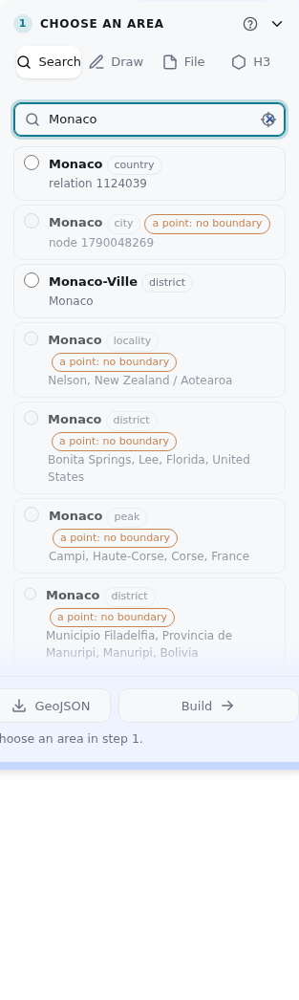
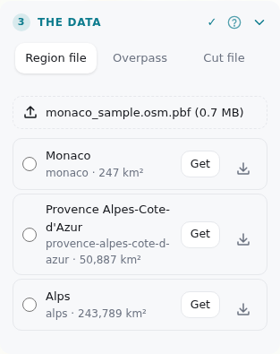
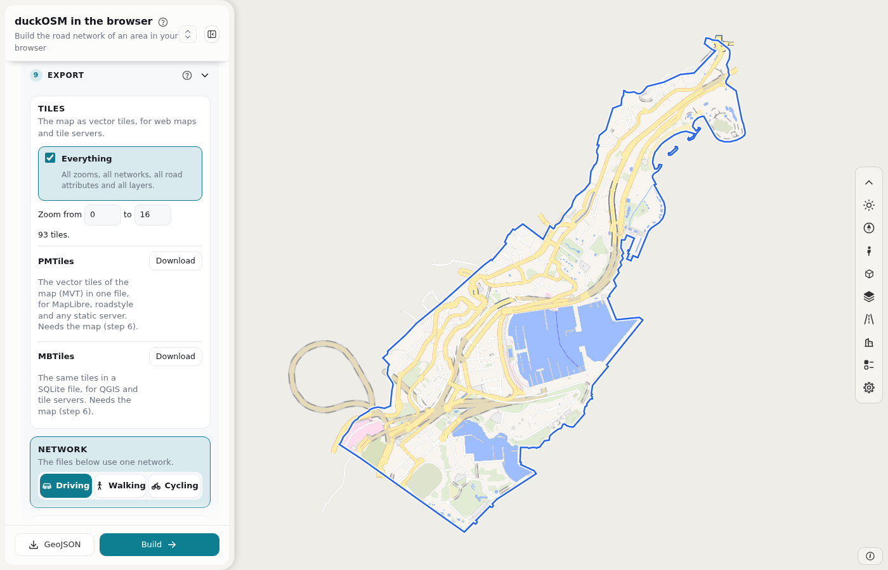

# Your first map

This procedure makes a map of Monaco in the browser. It takes about five minutes. Each step names the page of the manual that has the details.

1. Open <https://khoshkhah.github.io/duckosm-studio/>. If the page loads a second time, wait. This is normal (see [When the page does not work](troubleshooting.md)).
2. In step 1, type `Monaco` in **Search**. Click the match for Monaco. The map shows the boundary. ([Steps 1 and 2](manual/area.md))

    

3. In step 3, under **Region file**, press **Get** for the Geofabrik file that covers the area. The page keeps the file in your browser. The next time, the file has **Use** in place of **Get**. You can also select an `.osm.pbf` file that you have. ([Steps 3 and 4](manual/build.md))

    

4. In step 4, keep the networks that you need. **Driving**, **Walking** and **Cycling** are on by default. Press **Build**.
5. Look at the map. Monaco has fewer than 20,000 roads, so the page draws them by itself after the build. For a larger area, press **Show on map** in step 6. ([Steps 5 and 6](manual/result.md))

    

6. In step 5, press **.zip** to download the tables. **.duckdb** gives the same tables in one DuckDB database.

The page saves the build in your browser. When you come back, **Your areas** lists it. **Open** loads it with no new build. ([The page](dashboard.md#your-areas))

## Next

| Task | Where |
|---|---|
| See the whole work on one picture | [The editing cycle](manual/cycle.md) |
| Choose an area with a drawing, a GeoJSON file or H3 hexagons | [Steps 1 and 2](manual/area.md) |
| Build from Overpass or from a file that is already cut | [Steps 3 and 4](manual/build.md) |
| Change a road, a building, a node or a turn rule, or add a new road, then build again | [Step 7](manual/edit-osm.md) |
| Fix the drawing order of bridges and tunnels | [Step 8](manual/edit-levels.md) |
| Change the colors and the width of the roads | [Step 9](manual/edit-design.md) |
| Give the network to QGIS, MATSim, SUMO or a tile server | [Step 10](manual/export.md) |
| Know what each table holds | [The tables](manual/tables.md) |
| Query the tables with SQL, or ask a question in words | [Ask and query the data](manual/ask.md) |
| Build the same area from a script | [Command line and Python](cli.md) |
