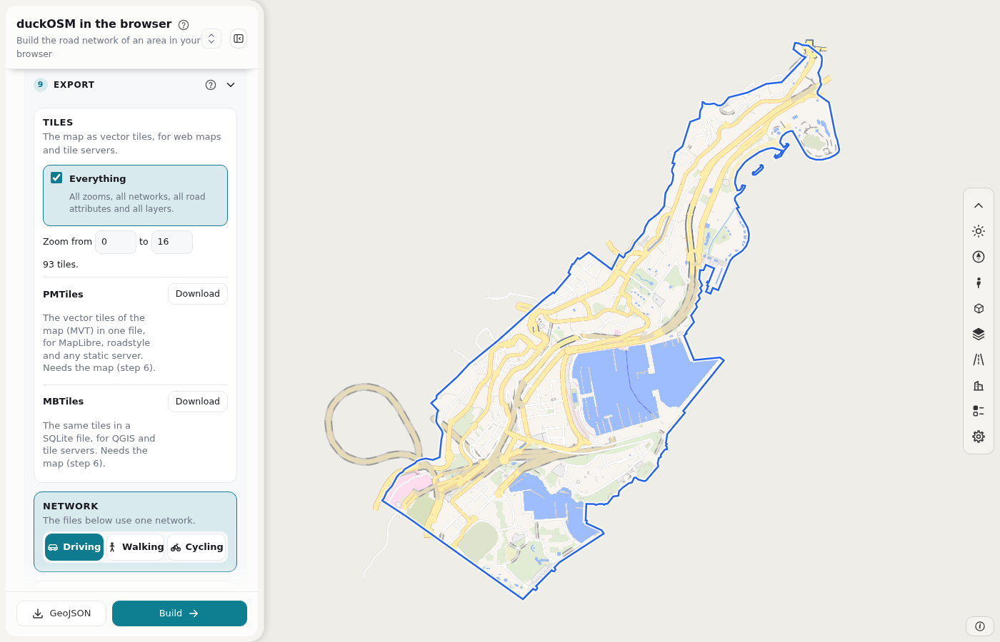

---
hide:
  - navigation
  - toc
---

# duckOSM Studio

**A portal that turns OpenStreetMap data into a routable road network, in your browser.**

You choose an area on a map. The portal builds the driving, walking and cycling networks. You look at the roads, fix the errors in the OSM data, build again, and export the result to the software that you use. No server receives your data.

[Open duckOSM Studio](https://khoshkhah.github.io/duckosm-studio/){ .md-button .md-button--primary }
[Make your first map](first_map.md){ .md-button }
[View on GitHub](https://github.com/Khoshkhah/duckosm-studio){ .md-button }

## What is important in it

- **A routable network from OSM data.** The raw data has no junctions, no directions and no travel times. The build cuts the ways at the junctions, sets the length, the speed and the travel time of each edge, and applies the turn restrictions.
- **A stable `edge_id` for each edge.** The `edge_id` is a hash of the OSM way and the two end nodes. The same road has the same `edge_id` in every build. Other projects join their data on it.
- **The same result as [duckOSM](https://github.com/Khoshkhah/duckOSM) 0.6.0.** Every row of every table is equal to the output of duckOSM.
- **A fix loop.** You can change the OSM data in the portal and build again. The tables, the map and the exports have your fixes.

## Advantages

| Advantage | What it means for you |
|---|---|
| Nothing to install | Open a page. The build runs in your browser. Your area and your data stay on your computer. |
| Fast | Estonia takes 19 seconds and 1.5 GB ([benchmark](https://github.com/Khoshkhah/duckosm-studio/blob/main/docs/benchmark.md)). duckOSM in Python takes 1,545 seconds and 10 GB. |
| One result everywhere | The page, the command line and Python run the same Rust code. They give the same tables. |
| Three networks in one build | Driving, walking and cycling, with the edge graph and the turn restrictions. |
| Fix the data | Change a road, a building, a node or a turn rule. Draw a new road. Build again. |
| A clear map | The roads have the style of roadstyle: outlines, bridges and tunnels. 33 ready themes. |
| Export to your tools | PMTiles, MBTiles, GeoPackage, GeoJSON, kepler.gl, MATSim and SUMO. |
| Your work stays | The page saves each build in your browser. **Open** loads it with no new build. |

## Read the manual

| Page | What it tells you |
|---|---|
| [The editing cycle](manual/cycle.md) | The whole work on one picture. |
| [The page](dashboard.md) | The map, the panel and the bar of tools. |
| [Steps 1 and 2](manual/area.md) | Choose the area. |
| [Steps 3 and 4](manual/build.md) | Give the data. Build. |
| [Steps 5 and 6](manual/result.md) | Read the result. Show the map. |
| [Step 7: Edit OSM data](manual/edit-osm.md) | Fix roads, buildings, nodes and turns. |
| [The fixes file (YAML)](manual/fixes-file.md) | Every key of the YAML file of your fixes, the order in which the build applies them, and a full example. |
| [Step 8: Edit levels](manual/edit-levels.md) | Fix bridges and tunnels. |
| [Step 9: Edit design](manual/edit-design.md) | Set the look of the map and the tiles. |
| [Step 10: Export](manual/export.md) | The formats and the files. |
| [The tables](manual/tables.md) | What each table is for. |

## Command line and Python

For a script, a server or Python code, use [duckOSM](cli.md). It uses the same Rust engine as the page.

[Concepts](concepts.md) explains the words: area, network, edge and `edge_id`. [Columns of the tables](output-tables.md) lists every column.
