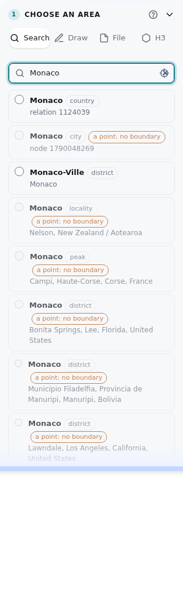
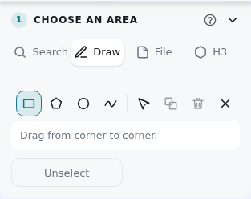
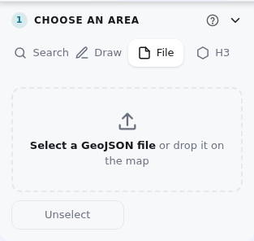
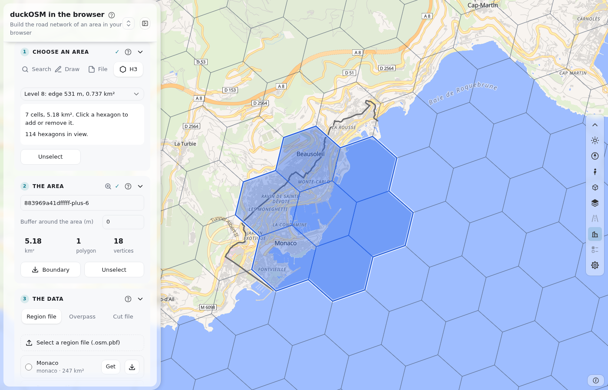
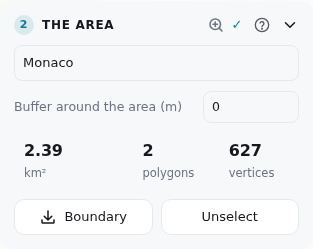
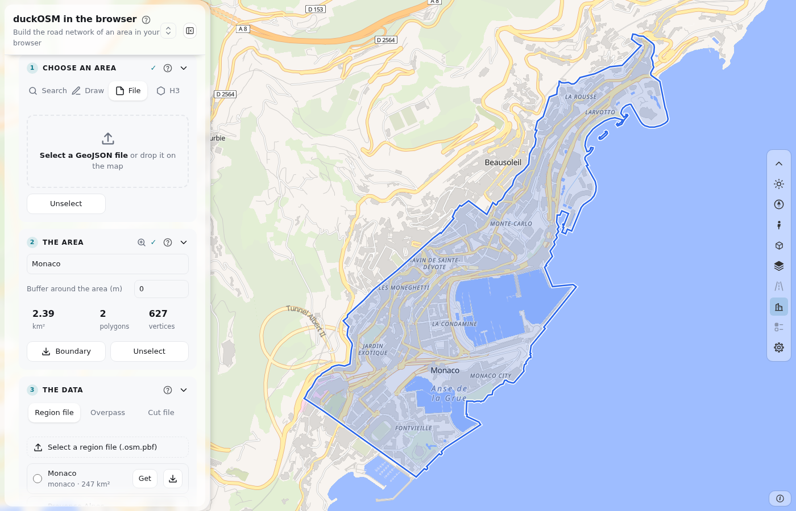

# Steps 1 and 2: The area

The area is the part of the world that you build. In step 1 you make its shape. In step 2 you name it and add a buffer. Step 1 has four tabs. Each tab makes the same thing: a GeoJSON shape.

## Step 1: Choose an area

### Search

1. Type a city, a region or a country. The page lists up to 10 matches.
2. Click a match. The page draws its boundary and zooms to it.
3. To remove the area, click the match again, or press **Unselect**.

Also in the box:

- **An H3 cell ID.** Type one ID, or more than one, separated by spaces or commas. The cells must have one level from 5 to 10. The page makes the area from the cells.
- **What is here?** Press the target button. Then click the map. The page lists the areas around the point.

The match comes from photon.komoot.io, and its boundary comes from Nominatim. If Nominatim fails, press **use the box of the place**. The page then makes the area from the box.

### Draw

Pick a tool. Then draw on the map.

| Tool | Key | How |
|---|---|---|
| Rectangle | R | Drag from corner to corner. |
| Polygon | P | Click each corner. Press **Enter** to close the shape. |
| Circle | C | Drag from the center out. |
| Freehand | F | Drag around the area. |

**Merge** joins shapes that overlap. **Delete** removes the selected shape. The cross removes all shapes. You can move the corners of a shape. More than one shape makes a multi-polygon.

### File

Select a GeoJSON file, or drop it on the map. The page takes every polygon in the file. The file can be a FeatureCollection, a Feature or a geometry. If the file has no polygon, the page says so.

### H3

The area is the union of hexagons of the [H3](https://h3geo.org) grid.

1. Choose the level, from 5 to 10. The list shows the size of one cell.
2. Click a hexagon on the map to add it. Click it again to remove it.
3. Press **Unselect** to remove all hexagons.

If the view has too many hexagons, the grid goes off. Zoom in to see it again. The area can have 500 cells and 5,000 km² at most. A change of level removes the cells.

## Step 2: The area

| Part | What it does |
|---|---|
| **Name** | The name of your files and of the saved area. For hexagons, the page suggests the ID of the first cell. A name that you type stays. |
| **Buffer around the area (m)** | Grows the area on all sides, from 0 to 50,000 m. The cut and the downloads use the grown area. |
| The three numbers | The size in km², the number of polygons and the number of vertices. |
| **Boundary** | Downloads the area, with its buffer, as `boundary.geojson`. The CLI reads it with `--boundary`. |
| **Unselect** | Removes the area, so that you can choose another one. |
| The magnifier | Moves the map to the area. |

The area shows on the map in blue:

## Next

[Steps 3 and 4](build.md) give the data and build the network.
