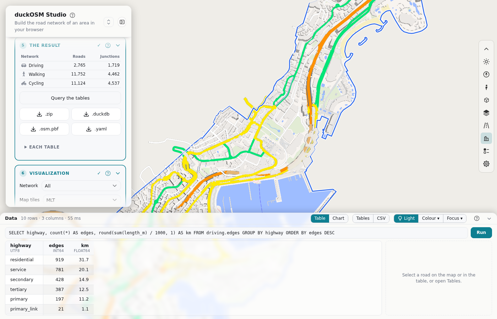
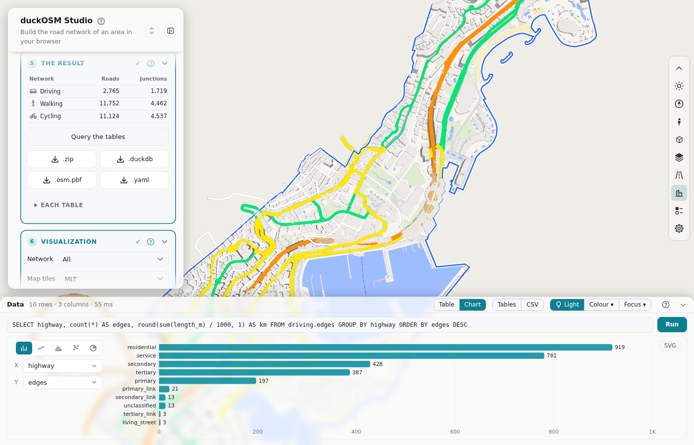
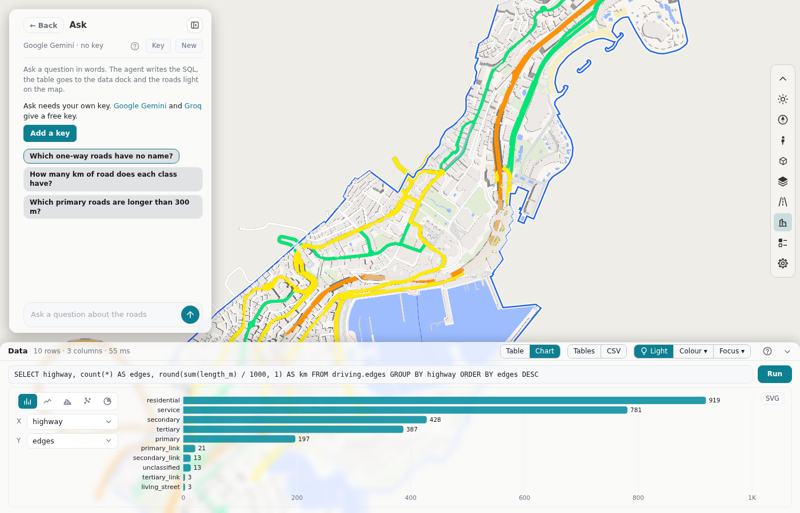

# Ask and query the data

After a build, you can look at the tables in the page with no download:

- **Query the tables** (card 5): write SQL.
- **Ask the data** (the card after step 6): write a question in words. An AI service writes the SQL.

The roads of the result light on the map.

## Query the tables

1. Build an area (step 4).
2. In card 5, click **Query the tables**. The data dock opens under the map.
3. Write your query in the SQL line.
4. Press **Ctrl+Enter**, or click **Run**.



Write the name of a table with its network, for example `driving.edges`. **Tables** in the dock lists all the tables ([The tables](tables.md)).

```sql
-- the one-way roads that have no name
SELECT edge_id, highway, length_m FROM driving.edges WHERE oneway AND name IS NULL;
```

Only one `SELECT` or `WITH` statement runs. The dock refuses a statement that changes the tables or reads a file.

| In the dock | What it does |
|---|---|
| The table | Shows the first 1,000 rows. Click a header to sort. |
| A row | Selects its road on the map and zooms to it. |
| **CSV** | Downloads all the rows (at most 1,000,000). |
| **Light** | Turns the light of the roads off and on. |
| **Table \| Chart** | Shows the result as a chart. **SVG** downloads the chart. |
| **Colour ▾** | Gives one color to the roads for each value of a text column. |
| **Focus ▾** | Keeps the roads of the table. The other roads fade or hide. |



## Ask the data



1. Get a free key from an AI service, for example [Google Gemini](https://aistudio.google.com/apikey) or [Groq](https://console.groq.com/keys).
2. Click the card **Ask the data**.
3. Click **Key**, select the service, paste the key and click **Save**.
4. Write a question, for example "Which primary roads are longer than 300 m?". Press **Enter**.

Each answer shows its SQL. **Show** puts the table of the answer in the data dock again. **New** starts a new conversation. If the service is busy, try again in a minute or select another service.

### Your key and your data

- The key stays in your browser. The page sends it only to the service that you selected.
- Other pages on `khoshkhah.github.io` can read the key. Use a key with a spending limit. **Clear** in the key form removes the key.
- Ask sends your question, the conversation, the names of the tables and columns, and at most 30 rows of each result to the AI service.
- An AI service can be wrong. Look at the table and at the SQL.

## Next

- [Columns of the tables](../output-tables.md) tells what each column holds.
- To use the tables in your own tools, download the **.duckdb** file ([step 5](result.md#the-downloads)).
