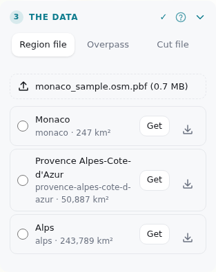
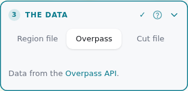
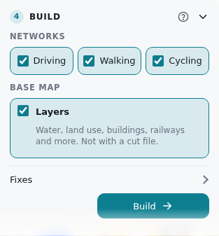
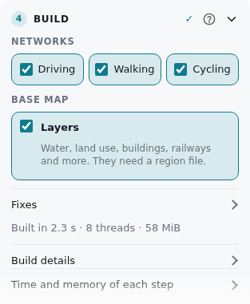

# Steps 3 and 4: Data and build

In step 3, you choose the OSM data. In step 4, you build the network in your browser.

## Step 3: Choose the data

| Tab | Use it when |
|---|---|
| **Region file** | You have an `.osm.pbf` file of a country or a region, or you want one from Geofabrik. |
| **Overpass** | The area is small and you have no file. |
| **Cut file** | You have an `.osm.pbf` file that is already cut to the area. This file gives no layers. |

### Get a region file

The tab lists the [Geofabrik](https://download.geofabrik.de) files that cover your area.

1. Press **Get** on a row. The page downloads the file and keeps it in your browser.
2. On the next visit, press **Use** on a row that says **kept**.

To remove a kept file, press **Delete** under the list.

### Use Overpass

The page gets the data from the [Overpass API](https://wiki.openstreetmap.org/wiki/Overpass_API). A large area can fail, because the servers limit the answer.

## Step 4: Build

1. Select the **Networks**: driving, walking, cycling or more than one.
2. To get a base map, select **Layers**. Step 7 also needs the layers for walls and doors.
3. Optional: select a **Fixes** file (`.yaml`). [The fixes file](fixes-file.md) gives its format.
4. Press **Build**.

When the build ends, the card shows the time and the memory:

Open **Build details** or **Time and memory of each step** for more. A large area can fail on a small device. [The limits](../troubleshooting.md) have the numbers.

Each network gets its own `edges`, `nodes` and `edge_graph` tables. [The tables](tables.md) and [the roads](roads.md) explain them.

## Next

[Steps 5 and 6](result.md) show the result.
