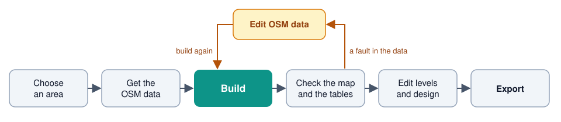
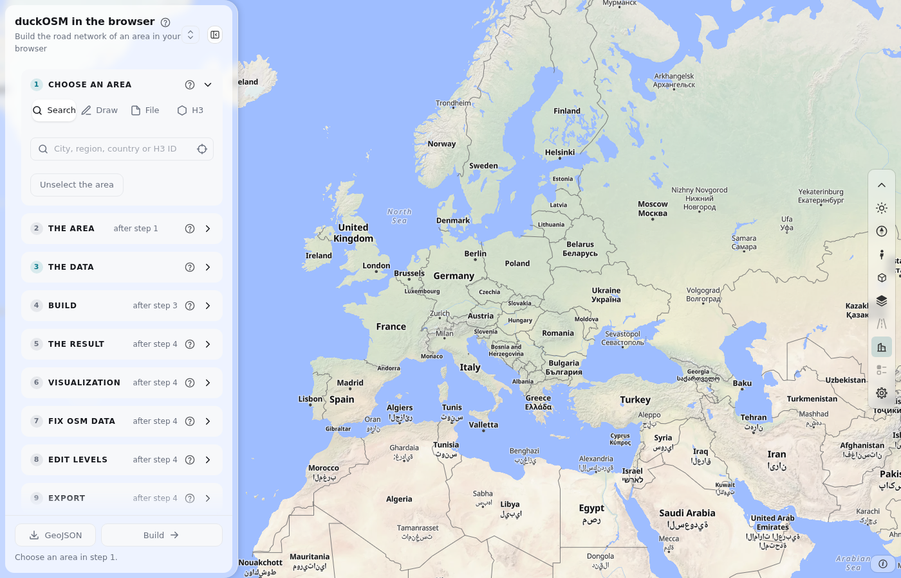

# The editing cycle

Build the road network of an area. Fix the OpenStreetMap (OSM) data. Build again. Export.

## The steps

| Card | You do |
|---|---|
| 1 Choose an area | Search, draw, load a GeoJSON file, or pick H3 hexagons. |
| 2 The area | Type a name. Add a buffer if necessary. |
| 3 The data | Select a region file, ask Overpass, or select a cut file. |
| 4 Build | Choose the networks. Press **Build**. |
| 5 The result | Download the tables. |
| 6 Visualization | See the roads on the map. |
| 7 Edit OSM data | Click a road, a building or a node. Change it. |
| 8 Edit levels | Pick two roads. Say which one is on top. |
| 9 Edit design | Choose a theme. Change colors and widths. |
| 10 Export | Press **Download** for a format. |

## Fix the data and build again

The page keeps your step 7 changes as a list. The tables do not change until the next build.

1. Look at the map and the tables.
2. Find an error.
3. Add a change in step 7.
4. Press **Build**.
5. Do this again until the map and the tables are correct.

The changes stay in your browser. You can download them as a `.yaml` file.

## The files

| File | Step | What it holds |
|---|---|---|
| `boundary.geojson` | 2 | The shape of the area. |
| `<name>.zip` | 5 | All tables as Parquet files. |
| `<name>.duckdb` | 5 | All tables in one DuckDB file. |
| `<name>.osm.pbf` | 5 | The OSM data of the area. |
| `fixes.yaml` | 5 or 7 | Your changes to the OSM data. |
| `edits.csv` | 8 | Your changes to the drawing order. |
| `<name>.design.json` | 9 | The look of the map and the tile profile. |
| [Export formats](export.md) | 10 | The network for other software. |

## Next

- [The page](../dashboard.md): the parts of the window.
- [Steps 1 and 2](area.md): choose an area.
