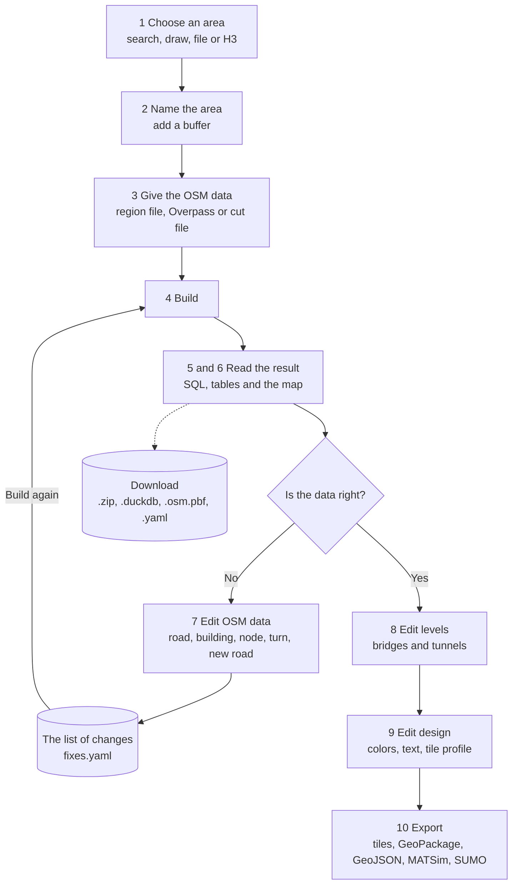

# The editing cycle

You choose an area, build its road network, find the errors in the OpenStreetMap (OSM) data, fix them, build again, and export. The page has one card for each step. This page shows the whole cycle on one picture.

## The steps

| Step | You do | You get |
|---|---|---|
| 1 Choose an area | Search for a place, draw it, load a GeoJSON file, or pick H3 hexagons. | A shape on the map. |
| 2 The area | Type a name. Add a buffer if you want one. | The name of all your files. |
| 3 The data | Select a region file, ask Overpass, or select a cut file. | The OSM data of the area. |
| 4 Build | Choose the networks and press **Build**. | The tables of the networks. |
| 5 The result | Run SQL. Download the tables. | Answers, and the files of the tables. |
| 6 Visualization | Press **Show on map**. | The roads on the map. |
| 7 Edit OSM data | Click a road, a building or a node. Change it. | A list of changes. |
| 8 Edit levels | Pick two roads. Say which one is on top. | The right drawing order for bridges and tunnels. |
| 9 Edit design | Choose a theme. Change colors and widths. | The look of the map and of the tiles. |
| 10 Export | Press **Download** for a format. | A file for other software. |

## The loop in the middle

A change in step 7 does not change the tables at once. The page keeps your changes as a list of rules. When you press **Build** again, the build applies the rules to the OSM data. Then the tables, the map and the exports have the fixed data.

Do this loop until the map and the tables are right:

1. Look at the map and the tables.
2. Find an error.
3. Add a change in step 7.
4. Build again.

The changes stay in your browser. You can download them as a `.yaml` file and use the file in a later build.

## The files of the cycle

| File | From | Use |
|---|---|---|
| `boundary.geojson` | Step 2 | The shape of the area. duckOSM reads it with `--boundary`. |
| `<name>.zip` | Step 5 | All tables as Parquet files. |
| `<name>.duckdb` | Step 5 | All tables in one DuckDB file. |
| `<name>.osm.pbf` | Step 5 | The OSM data of the area, cut from the region file. |
| `fixes.yaml` | Step 5 or step 7 | Your changes to the OSM data. |
| `edits.csv` | Step 8 | Your changes to the drawing order. |
| `<name>.design.json` | Step 9 | The look of the map and the tile profile. |
| PMTiles, MBTiles, GeoPackage, GeoJSON, MATSim, SUMO | Step 10 | The network in the format of other software. |

[The export page](export.md) tells you what each format is for.

## Next

- [The page](../dashboard.md) shows the three parts of the window.
- [Steps 1 and 2](area.md) start the cycle.
