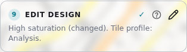
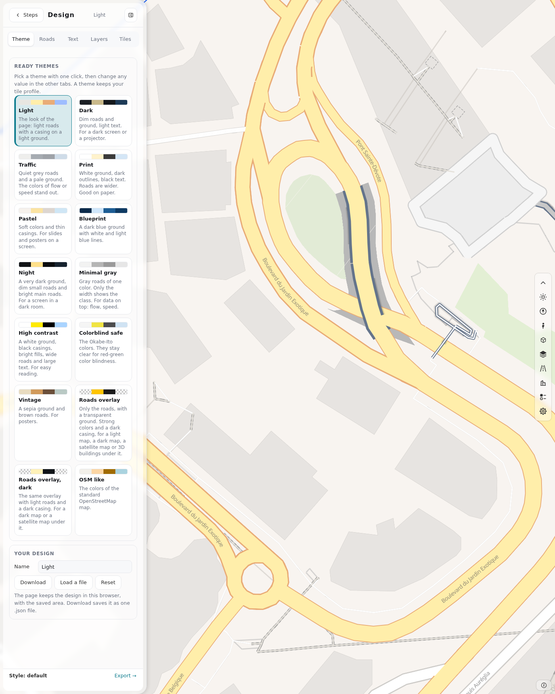
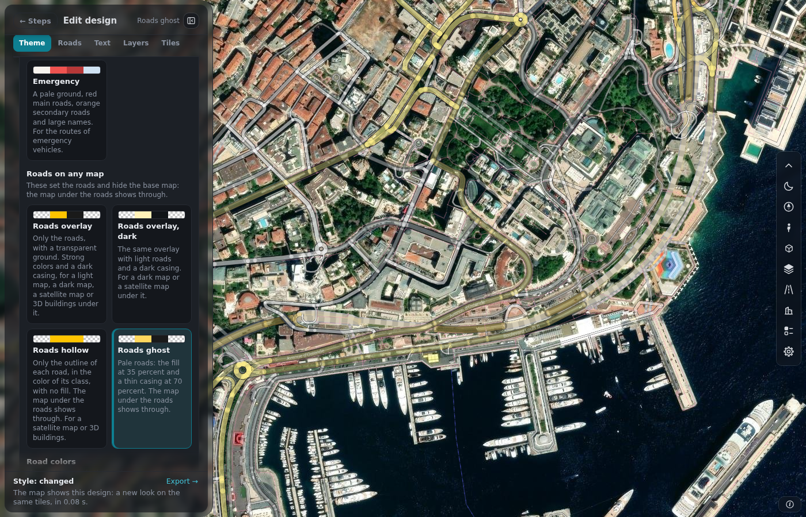
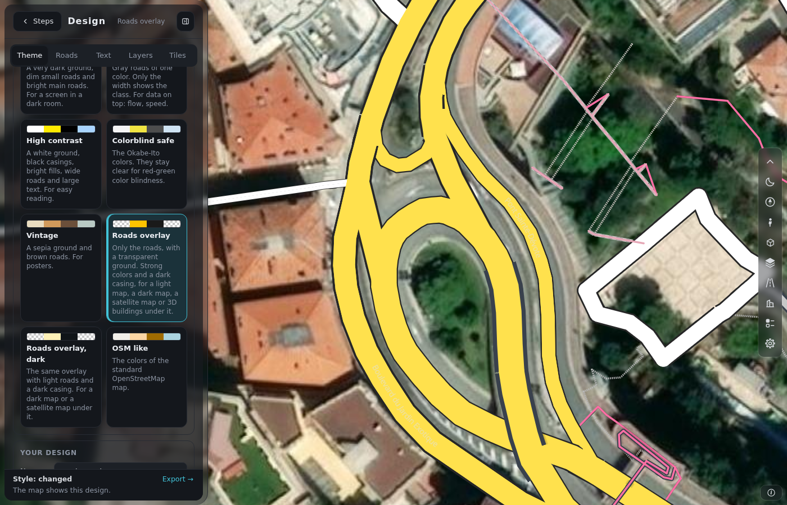
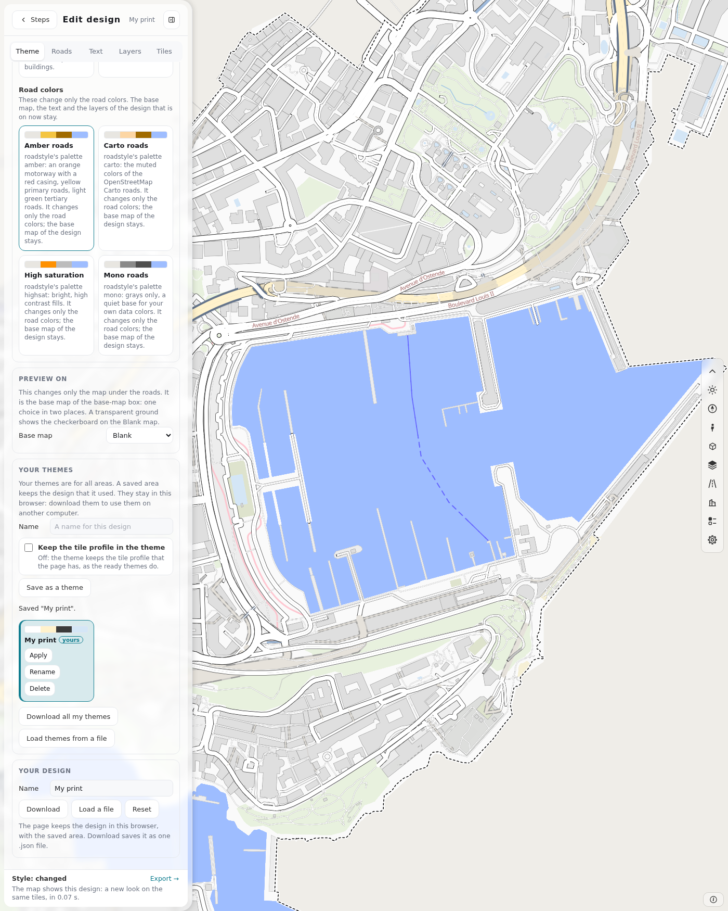
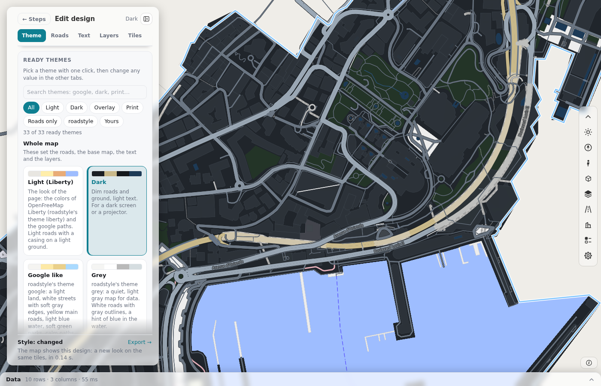
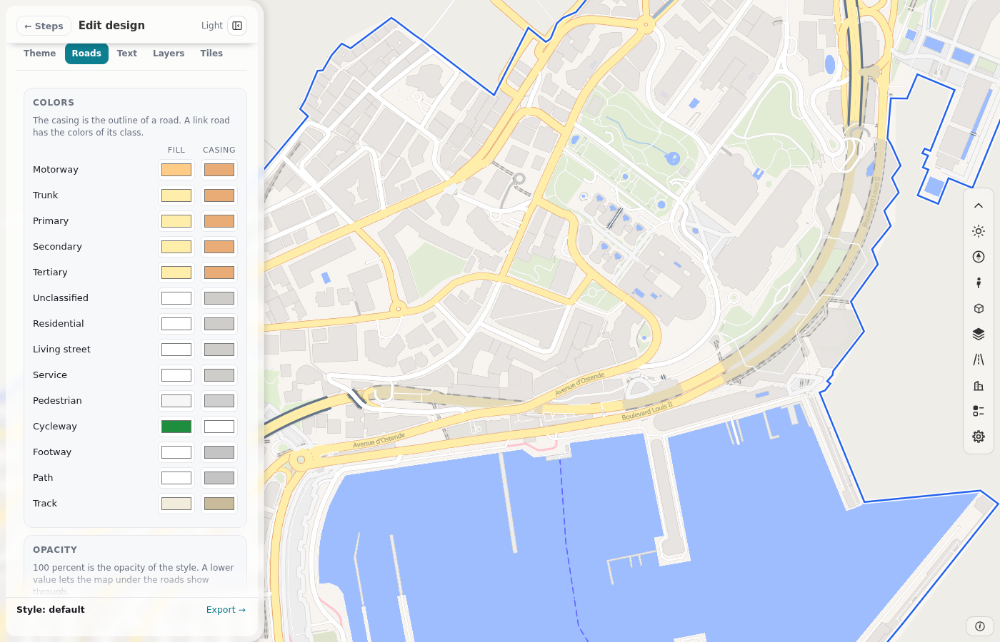
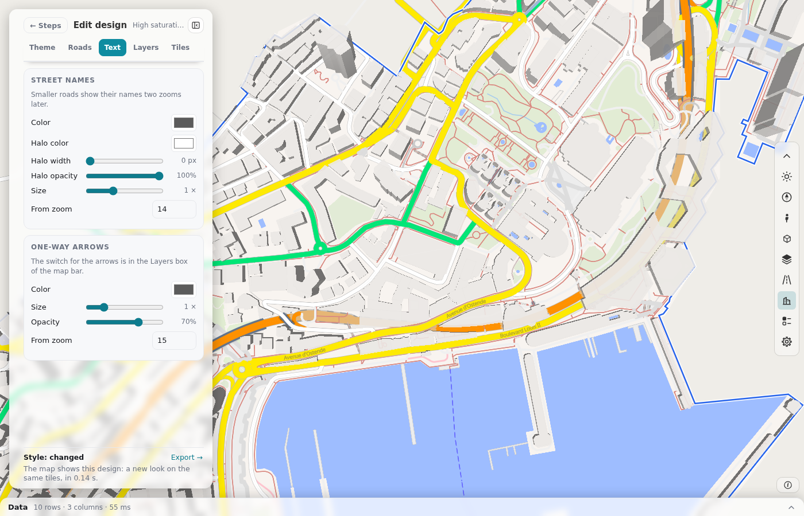
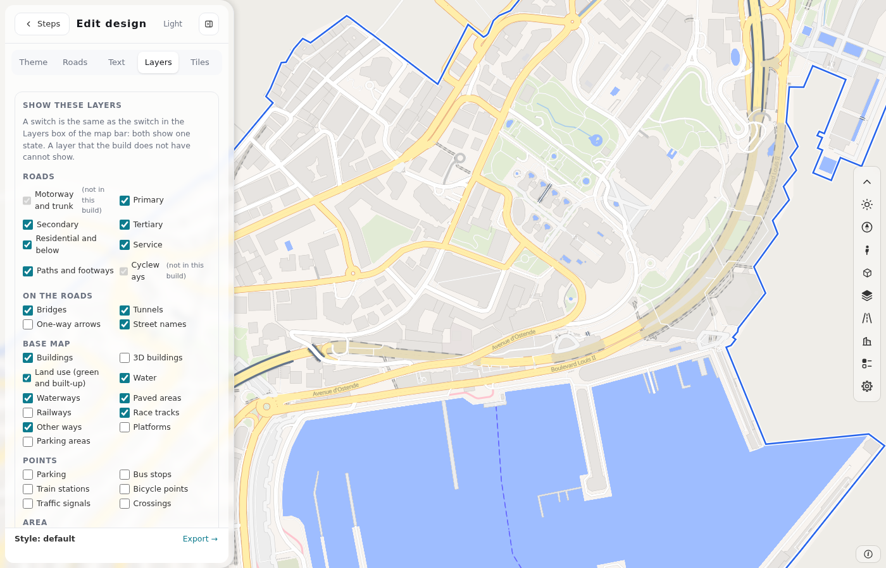
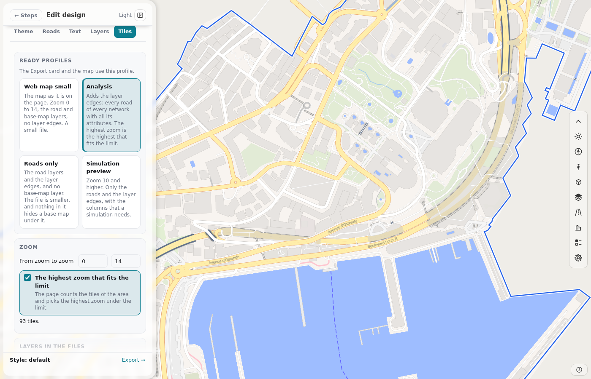

# Step 9: Edit design

Card 9 sets the look of the map and the profile of the tile files. It is on at all times. It does not wait for a build. Click the card to open the panel. The panel takes the place of the steps.

<!-- retake: after roadstyle #40 (Edit design moves into roadstyle) -->

The line under the title is the name of the design and the name of the tile profile. **Steps** goes back to the steps. **Hide panel** gives the map the whole width.

A change shows on the map after half a second. The bar at the bottom of the panel says "Drawing the map..." and then "The map shows this design." If the map is not drawn yet, the design shows at the next draw (step 6).

Most changes keep the tiles of the map, so they are fast. A new theme of Monaco takes about 0.7 seconds, and a new map takes about 2 seconds. A change of the layers, of the base-map theme, or a design of your own with wider roads makes new tiles.

## The five tabs

| Tab | What it sets |
|---|---|
| **Theme** | 33 ready themes, your own themes, the name of the design, **Download**, **Load a file** and **Reset**. |
| **Roads** | The fill and the casing of 14 road classes, the width of 9 groups, the opacity and the dark colors. |
| **Text** | The street names and the one-way arrows. |
| **Layers** | A switch for each layer, the boundary of the area, the ground, the colors of the base map and the 3D buildings. |
| **Tiles** | The tile profile: zooms, layers, columns, extent, buffer, tile limit and tile format. |

## Theme

<!-- retake: after roadstyle #40 (Edit design moves into roadstyle) -->

A theme is a full set of values: the colors and widths of the roads, the text, the boundary, the colors of the base map, the ground and the layers. One click on a theme replaces the style. After that, you can change any value in the other tabs. The design then shows as "custom". A theme keeps your tile profile.

Each theme button shows four cells: the ground, a road fill, its casing and the water. A checkerboard cell means that the ground is transparent, or that the layer is off.

To find a theme, type words in **Search themes**. Or press a filter: **All**, **Light**, **Dark**, **Overlay**, **Print**, **Roads only**, **roadstyle** or **Yours**.

| Group | Examples | Use |
|---|---|---|
| Light and dark | Light (Liberty), Dark, Night | The look of the page itself. |
| roadstyle | Google like, Grey, roadstyle, OSM Carto | The base-map themes of roadstyle. |
| Road palettes | Amber roads, Carto roads, High saturation, Mono roads | A palette changes only the road colors. |
| For data on top | Traffic, Minimal gray, Neon night, Simulation view | Quiet roads, so that flow or speed colors stand out. |
| For print | Print, Toner, Grayscale print, Blueprint, Vintage | A white or sepia ground, and dark lines. |
| Accessibility | High contrast, Colorblind safe, Accessibility large | Clear colors, and wide roads with large text. |
| Overlay | Roads overlay, Roads overlay (dark), Roads hollow, Roads ghost | Only the roads, on a transparent ground. |

### Preview on

**Preview on** changes only the map under the roads: **Checkerboard**, **Blank**, **OpenFreeMap** or **Satellite**. It is the same choice as the base-map box of the bar. A transparent ground shows the color of the map container on the Blank base map. Pick a base map to see the roads on it.

<!-- retake: after roadstyle #40 (Edit design moves into roadstyle) -->

### The roads overlay

<!-- retake: after roadstyle #40 (Edit design moves into roadstyle) -->

**Roads overlay** shows only the roads, the street names and the casings. The fill has 60 percent opacity and the casing has 85 percent, so the map under the roads shows through. Put the overlay on a light map, a dark map, the satellite map, or a map with 3D buildings.

### Your themes

<!-- retake: after roadstyle #40 (Edit design moves into roadstyle) -->

1. Pick a ready theme. Change it in the other tabs.
2. Type a name in **Your themes** (1 to 40 characters). Press **Save as a theme**.
3. The new theme has a card with the mark "yours". **Apply** uses it. **Rename** gives it another name. **Delete** asks for a second push.
4. If you change a theme of yours, press **Update "Name"** to put the changes into it.
5. A name that exists asks "Replace it?".

The check box **Keep the tile profile in the theme** is off by default. Turn it on if the theme must set the profile too.

**Download all my themes** saves `duckosm-themes.json`. **Load themes from a file** adds the themes of such a file. Use these two buttons to move your themes to another computer. The themes stay in this browser, for all areas.

**Download** saves the design as one `.design.json` file. **Load a file** reads such a file. **Reset** goes back to the Light style and keeps the tile profile.

<!-- retake: after roadstyle #40 (Edit design moves into roadstyle) -->

## Roads

<!-- retake: after roadstyle #40 (Edit design moves into roadstyle) -->

- **Colors.** Each of the 14 classes has a color for the fill and one for the casing. The other classes keep the colors of the theme. The casing is the outline of the road. A link road has the colors of its class.
- **Width.** A factor scales the width of a group at all zooms. A factor of 2 doubles the width. The groups are: motorway and trunk, primary, secondary, tertiary, residential and unclassified, living street, service, pedestrian, and footway, path, cycleway and track.

[The roads on the map](roads.md#the-roads-on-the-map) lists the classes of each group and the first zoom of each class.
- **Opacity.** **Fill opacity** and **Casing opacity** go from 0 to 100 percent. A lower value lets the map under the roads show through.
- **Casing as an outline.** The casing is drawn only outside the fill. Turn it on when the fill is not opaque. Without it, the road looks dark over a satellite map.
- **Dark mode.** The dark theme does not use the light colors directly. This section sets the range of lightness of the dark colors (0 is black, 1 is white).

## Text

<!-- retake: after roadstyle #40 (Edit design moves into roadstyle) -->

- **Street names.** Color, halo (color, width and opacity), size and first zoom. The names of small roads show two zooms after the first zoom.
- **One-way arrows.** Color, opacity, size and first zoom. The switch that turns the arrows on is in the base-map box.

## Layers

<!-- retake: after roadstyle #40 (Edit design moves into roadstyle) -->

The tab has these parts:

- **Show these layers.** One switch for each layer: the road groups, bridges, tunnels, arrows, names, buildings, land use, water, railways, points and the area boundary. A change shows at once.
- **Area boundary.** The line around your area. Set its color, width and style (solid, dashed, dotted or dash-dot), and its fill. The switch **Fill over the roads** is off by default.
- **Ground.** The switch **Transparent ground** and an opacity from 0 to 1.
- **Base-map colors.** One color for each group: **Green areas** (forest, grass, park), **Built-up land** (residential, commercial, industrial), water, sand, buildings, railways and waterways.
- **3D buildings.** The height of a floor, the highest building and the opacity.

A layer that the build does not have shows "(not in this build)" and you cannot switch it.

## Tiles

<!-- retake: after roadstyle #40 (Edit design moves into roadstyle) -->

The tile profile sets what the tile files of [step 10](export.md) hold. Four ready profiles fill the fields:

| Profile | Zoom | Layers | Use |
|---|---|---|---|
| **Web map small** | 0 to 14 | Roads and base map | A small file for a web map. |
| **Analysis** | 0 to the highest zoom under the limit | Roads, base map and the layer `edges` with all columns | Every road of every network, with its data. This is the profile at the first visit. |
| **Roads only** | 0 to the highest zoom under the limit | Roads and the layer `edges` | A file with nothing that hides a base map under it. |
| **Simulation preview** | 10 to the highest zoom under the limit | Roads and the layer `edges` with 13 columns | The columns that a simulation needs. |

The fields:

- **Zoom.** The lowest and the highest zoom. **The highest zoom that fits the limit** counts the tiles and picks the highest zoom under the limit.
- **Layers in the files.** **Roads** (the drawing layers of roadstyle), **Base map** (water, land use, buildings and more) and **Layer edges** (every road of every network, with its data).
- **Columns of the layer edges.** The data of a road. `edge_id` is always in the layer.
- **Road class start zoom.** The zoom where a class comes into the layer `edges`. A lower class starts at a higher zoom, so the file stays small.
- **Format of the map.** MLT (smaller) or MVT. It is the same choice as **Map tiles** in step 6. The tile files always hold MVT.
- **Extent** and **Buffer.** In tile units, for the layer `edges`.
- **Tile limit.** The largest number of tiles of a file, from 1,000 to 200,000. More tiles take more time and memory.

## Where the design is kept

- In this browser, as the last design that you used. A new area starts with it.
- With the saved area, as the file `design.json`. **Open** in **Your areas** brings the design back.
- In a `.design.json` file that you download.

## Next

Go to [step 10](export.md) to give the network and the tiles to other software.
