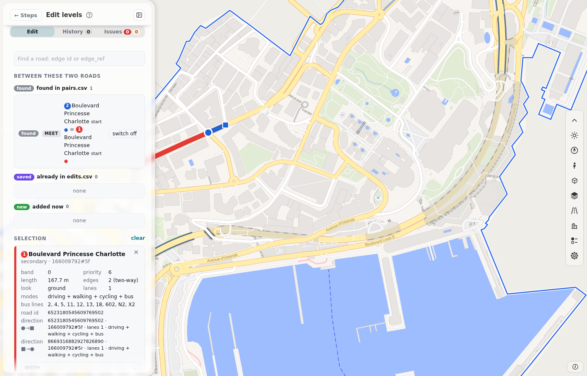

# Step 8: Edit levels

Card 8 opens roadstyle's level editor for the roads that you built. Use it when two roads cross or meet on the map and the wrong road is on top. The editor is a panel. It takes the place of the steps.

## What a level is

Each edge has two numbers: one for its outline (the casing) and one for its road (the fill). Zero is the ground. A bridge has a higher number than the road under it. The map draws the numbers in order, lowest first. At each number, the page draws all outlines first and then all roads. So two roads that meet merge with no ring between them.

A solver finds the numbers when you build. The default method uses the tags `bridge`, `tunnel`, `layer` and the road class. The solver finds the right order in most places. Use the editor for the other places. [levels.md](https://github.com/Khoshkhah/duckosm-studio/blob/main/docs/levels.md) has the method of the solver.

## Pick two roads

1. Click a road on the map. It is **road 1** (red). Or type an `edge_id` or an `edge_ref` in the box **Find a road**.
2. Click a second road. It is **road 2** (blue). The panel shows every pair of the two roads that the build found.
3. Use the boxes of the modes (driving, walking, cycling) to show the roads of one network only.

## Add a rule

A rule says how two roads meet. Choose one kind:

| Rule | What it says |
|---|---|
| **Order** | Whose fill is on top where the two roads meet. |
| **Stack** | One road is over the other. Pick the parts of its casing: the whole road, the start head, the main part or the end head. |
| **Meet on top** | Join two ends. |

Press **Add to the list**. Before it adds the rule, the page tells you if the rule is already there, or if it makes a loop with other rules. A loop is A over B, B over C and C over A. No numbers can keep a loop.

You can also:

- **Switch off** a pair that the build found. To replace a found stack, switch off its rows. Then add your own parts.
- Change the **cap** of the end of a road (round, square or flat) and the length of its **head**. These changes need no new solve.

## The tabs

| Tab | What it shows |
|---|---|
| **Edit** | The two picked roads, their rules and the parts of the casing. |
| **History** | The changes that you made. **Added now** are the changes of this session. The older changes were in `edits.csv` before. Click a row to see its two roads. Delete puts a row in the list to apply. |
| **Issues** | What the solver did not keep. **Given up by the solver** are the crossings that it gave up. **Near** are the warnings for roads that only come near. **Order wishes not kept** are the wishes that lost. |

## Apply

The apply bar at the bottom of the panel has these buttons:

| Button | What it does |
|---|---|
| **Apply and solve** | Solves all waiting changes together and draws again the roads that changed. If the solver refuses them, the page saves nothing. |
| **Discard** | Drops the changes and goes back to the steps. |
| **Stay** | Closes the question and keeps the panel open. |
| **Download edits.csv** | Saves your rules as a file. |

## Where your changes go

- With a saved area, the page keeps your rules in the area, in the browser. The next visit has them.
- Without a saved area, the rules stay only until you close the page. Press **Download edits.csv** to keep them.
- The page puts the rules in the tables `level_edits`, `level_heads` and `level_caps`. [The tables](tables.md) explains them.
- The result is the table `visualization.edge_levels`. The map and the tiles use it.

## Next

Go to [step 9](edit-design.md) to set the look of the map, or to [step 10](export.md) to export.
