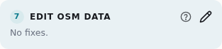
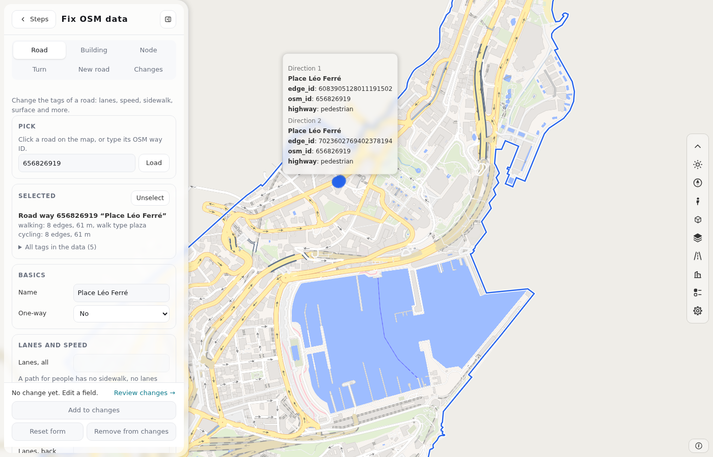
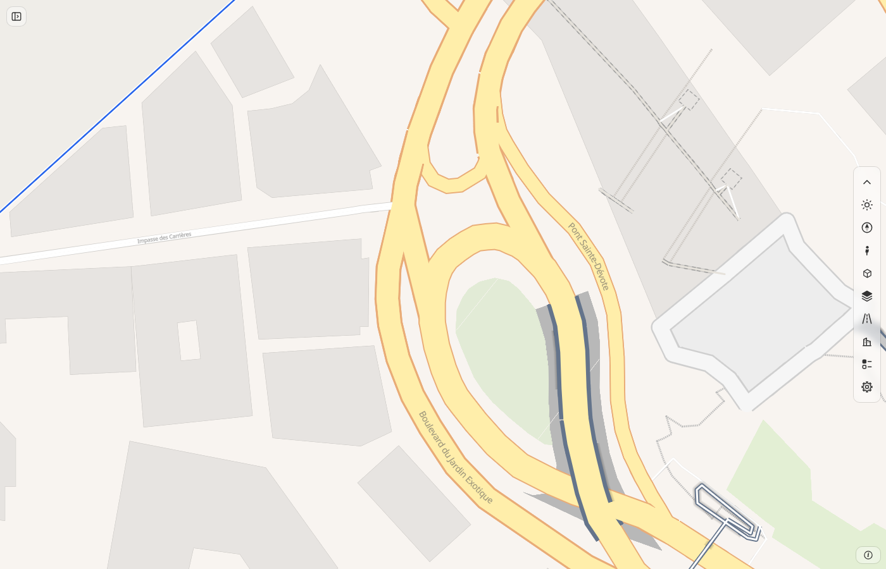
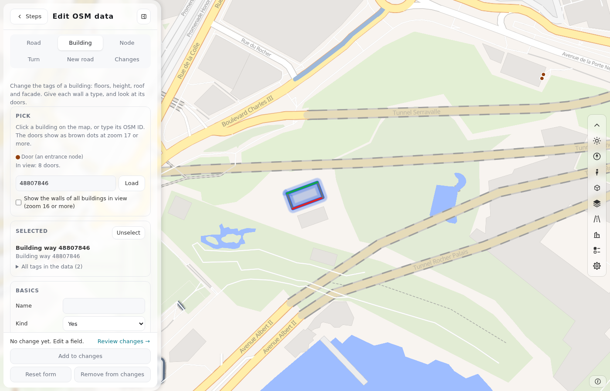
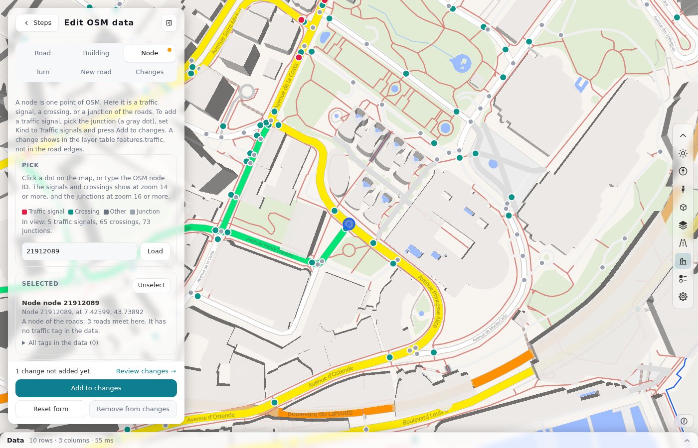
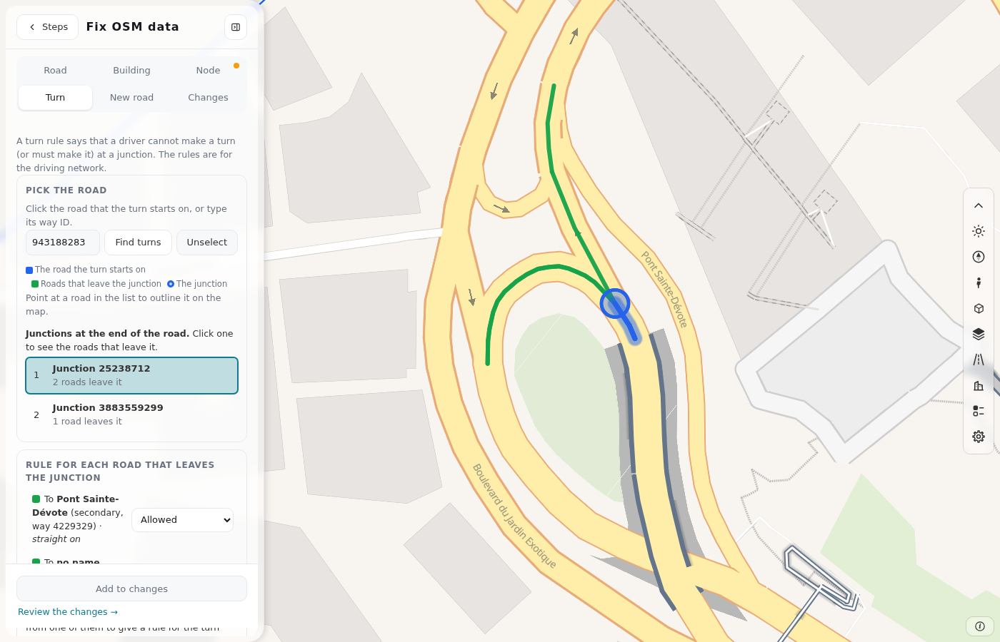
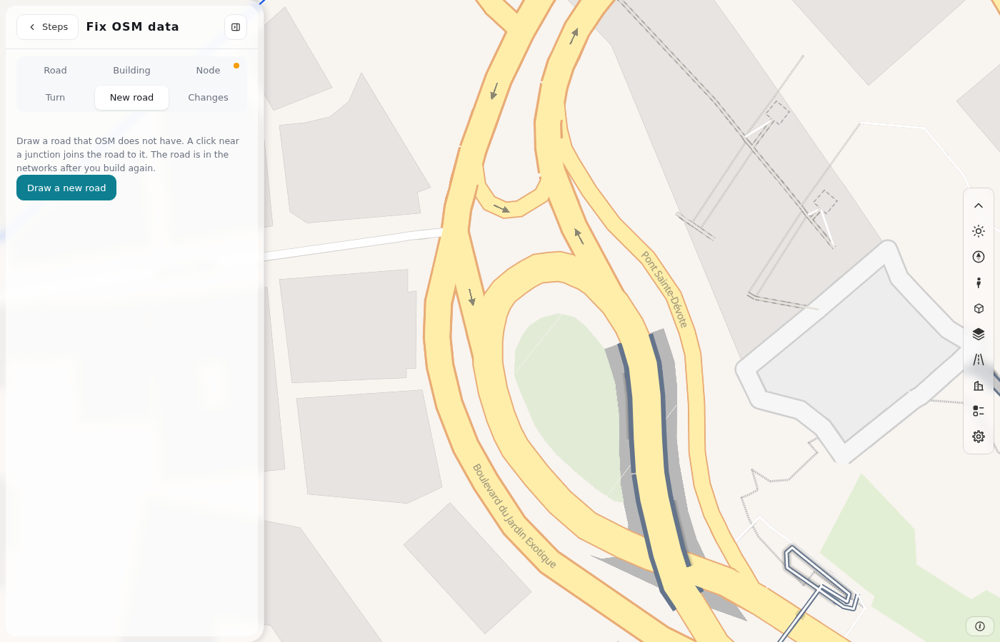
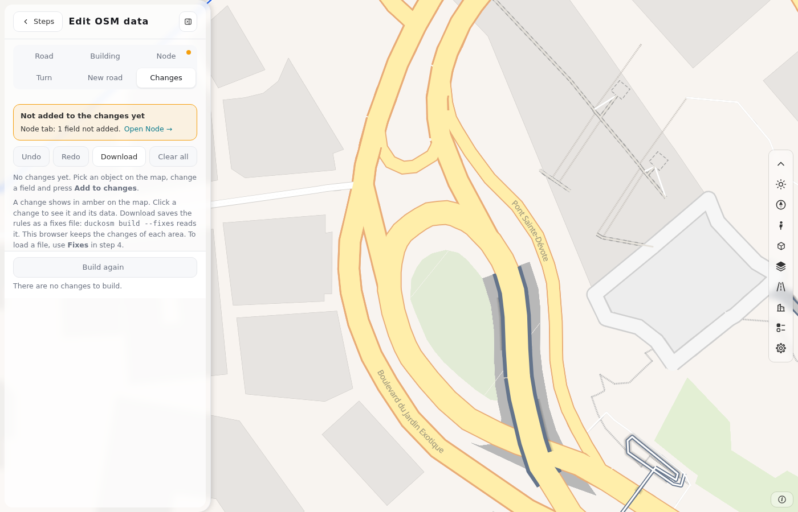

# Step 7: Edit OSM data

Use card 7 to fix errors in the OSM data of your area. Each fix is a rule in a list of changes. A rule changes nothing until you build again. [The editing cycle](cycle.md) shows where this step is.

The card is gray until you build. To edit walls and doors, build with **Layers** on.

## Use the panel

The panel has six tabs. The bar at the bottom of each tab has these buttons:

| Button | What it does |
|---|---|
| **Add to changes** | Adds your edit to the list of changes. Until you press it, the edit is a draft. |
| **Reset form** | Removes the draft. |
| **Remove from changes** | Removes the rule of this object from the list. |
| **Unselect** | Removes the picked object from the tab. |
| **Review changes** | Opens the tab **Changes**. |

To undo a change in a field, press ↺. To close the panel, press **Steps** or **Hide panel**.

### An object that is already in your changes

If the object that you pick already has a rule in your changes, a box shows over the form:

- **Edit it** opens the form with the values of the rule.
- **Delete it** removes the rule. To get it back, press **Undo** in the tab **Changes**.

If a file has two or more rules for one object, **Edit it** joins them into one rule.

## Fix a road

1. Click a road on the map, or type its way ID and press **Load**.
2. Change the fields of the form.
3. Press **Add to changes**.

Use **Modes** to remove the road from one network, **Other tags** to add or delete a tag, and **Delete** to remove the road. [The roads](roads.md) tells you how the tags set the network, the speed and the lanes.

## Fix a building

1. Click a building. To see the walls of all buildings in view, turn on **Show the walls of all buildings in view** (zoom 16 or more).
2. Change the levels, the height, the roof or the materials.
3. Change the type of a wall, or give it a **Door**.
4. Press **Add to changes**.

The map shows each wall in the color of its type:

| Type | Color | Meaning |
|---|---|---|
| **front** | Green | The wall faces a street. |
| **back** | Red | The wall faces away from the street. |
| **side** | Gray | The wall is between the front and the back. |
| **party wall** | Purple | Two buildings share the wall. |
| **courtyard wall** | Teal | The wall is part of an inner ring. |

Examine the walls that say "guess" or "no street seen". [wall-types.md](https://github.com/Khoshkhah/duckosm-studio/blob/main/docs/wall-types.md) tells how the page finds the type. In the list **Doors**, you can change the kind of each door.

## Fix a node

A node is a traffic signal, a crossing, a stop sign, a give-way sign, a bus stop or a junction.

1. Click a dot on the map, or type the node ID. Signals and crossings show from zoom 14. Junctions (gray dots) show from zoom 16.
2. Choose the **Kind**. The list shows only the kinds that are possible for this node. The reason shows under the field.
3. Press **Add to changes**.

## Fix a turn

A turn rule says that a driver cannot make a turn at a junction, or must make it. The rules are for the driving network only.

1. Click the road where the turn starts, or type its way ID. Press **Find turns**.
2. In the list **Junction at the end of the road**, pick the junction.
3. For each road that leaves the junction, choose **Allowed**, **No** or **Only**.
4. Press **Add to changes**.

## Add a new road

1. Click points on the map. A click near a junction connects the road to it.
2. Set the kind, the name, the one-way rule and the other fields.
3. Press **Add to changes**, or press **Enter**.

The new road is a [`new_ways`](fixes-file.md#new_ways-new-roads) rule in the fixes file.

## Review your changes

The tab **Changes** shows all your rules.

| Button | What it does |
|---|---|
| An item | Shows the item in its tab. |
| × | Removes the item. |
| **Undo**, **Redo** | Go back and forward in your changes. |
| **Download** | Saves the fixes file. |
| **Clear all** | Removes all rules. |
| **Build again** | Builds again with your rules. |

## Why a field is closed

A choice in one field can close another field. The reason shows under the field. For example, if the road is one-way, the lanes for each direction are closed. **Add to changes** does not accept a value in a closed field.

## Where your changes go

The browser keeps your rules for the area. To save them as a fixes file, press **Download** in the tab **Changes**, or **.yaml** in [step 5](result.md). [The fixes file](fixes-file.md) gives its format.

The next build applies the rules. The tables, the map and the exports then have your fixes.

## Next

Press **Build again** in the tab **Changes**. Then examine the map. When the data is correct, go to [step 8](edit-levels.md).
