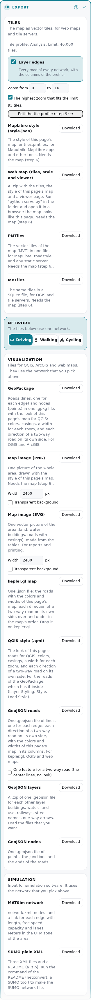
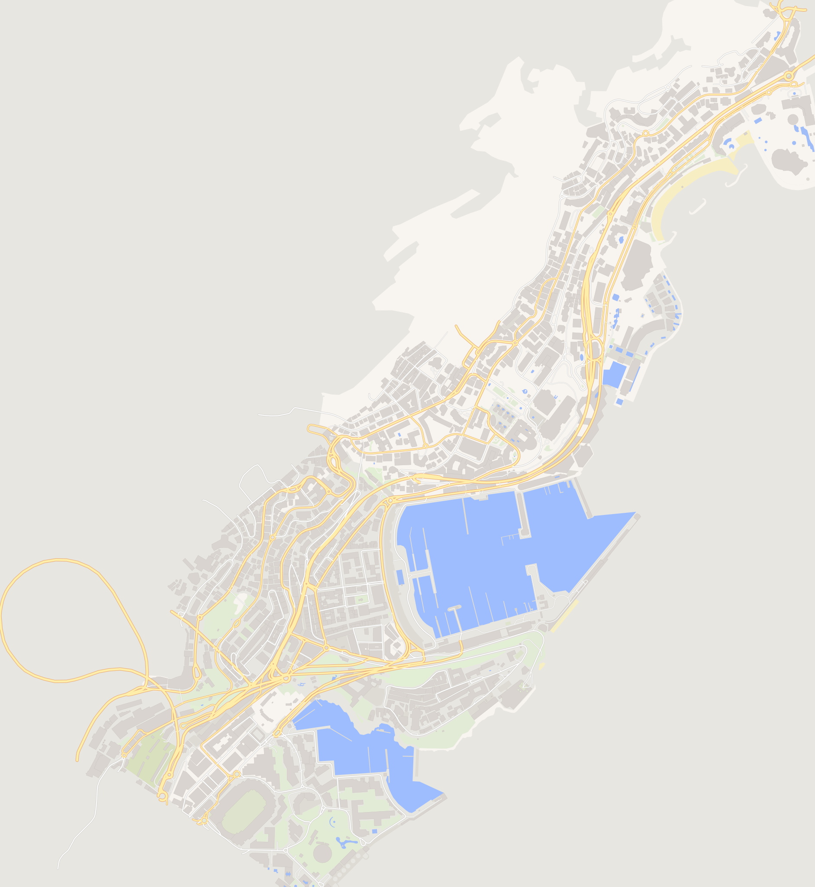

# Step 10: Export

Card 10 makes files for other software. It is gray until a build ends. The page makes each file in your browser.



## Download a file

1. If you built more than one network, pick **Driving**, **Walking** or **Cycling** in **Network**. The tiles do not use this choice.
2. Find the format in the list below.
3. Press **Download** next to it.

The tile formats, the **MapLibre style** and the **Map image (PNG)** need the map. Draw it first with **Show on map** (step 6).

## Choose a format

`<area>` is the name of the area. `<network>` is `driving`, `walking` or `cycling`.

| Format | File | What it is | Open it with |
|---|---|---|---|
| **MapLibre style** | `<area>_style.json` | The style of the map. It reads `tiles.pmtiles`. | Maputnik, MapLibre |
| **Web map** | `<area>_webmap.zip` | The tiles, the style and a viewer page. | A web browser (see below) |
| **PMTiles** | `<area>_z<min>-<max>.pmtiles` | The vector tiles in one file. | MapLibre, a static web server |
| **MBTiles** | `<area>_z<min>-<max>.mbtiles` | The same tiles in a SQLite file. | QGIS, a tile server |
| **GeoPackage** | `<area>_<network>.gpkg` | The roads and the nodes, with the style of the map inside. | QGIS, ArcGIS |
| **Map image (PNG)** | `<area>_map.png` | A picture of the area. | Any image viewer |
| **Map image (SVG)** | `<area>_<network>_map.svg` | A vector picture of the area. | A web browser, a vector editor |
| **kepler.gl map** | `<area>_<network>_kepler.json` | The roads with the colors and widths of the map. | kepler.gl |
| **QGIS style** | `<area>_<network>_roads.qml` | The style of the GeoPackage roads, as a file. | QGIS |
| **GeoJSON roads** | `<area>_<network>_roads.geojson` | One line for each direction of a road, with its colors and widths. | kepler.gl, QGIS, web maps |
| **GeoJSON layers** | `<area>_<network>_layers_geojson.zip` | One file for each other layer, for example buildings and water. | QGIS, web maps |
| **GeoJSON nodes** | `<area>_<network>_nodes.geojson` | The junctions and the ends of the roads. | QGIS, web maps |
| **MATSim network** | `<area>_<network>_matsim_network.xml` | The network for a traffic simulation. | MATSim |
| **SUMO plain XML** | `<area>_sumo.zip` | Three XML files and a `README.txt`. | SUMO `netconvert` |

**Map image (PNG)** and **Map image (SVG)** have a **Width** field and the check box **Transparent background**.



## Open the web map

1. Unpack the `.zip`.
2. In the folder, run `python serve.py`.
3. Open `http://localhost:8000/` in a browser.

The viewer needs the internet to load MapLibre.

## Make a SUMO network

1. Unpack the `.zip`.
2. Run the command of the `README.txt`:

```bash
netconvert --node-files area_driving.nod.xml --edge-files area_driving.edg.xml --connection-files area_driving.con.xml -o area_driving.net.xml
```

## Use the two directions of a road

In the GeoPackage and in **GeoJSON roads**, each direction of a two-way road is one feature with its own `edge_id`. The property `direction` is `forward` or `reverse`. `edge_id_pair` is the `edge_id` of the other direction.

To get one center line for each road, turn on **One feature for a two-way road (the center lines, no look)** before you download **GeoJSON roads**.

## Set the tiles

The [tile profile](edit-design.md#tiles) of step 9 sets what the tiles hold. The card also has **Layer edges**, **Zoom from ... to ...** and **The highest zoom that fits the limit**.

If the number of tiles is more than the limit, the tile buttons are off. Use fewer zooms, or increase the limit in the tile profile. The default limit is 40,000 tiles.

The tiles do not have colors. To see the map as the page shows it, use the **Web map**, or the **MapLibre style** with the **PMTiles** file.

## Read the check

After each download, the page compares the file with the tables. A green "Checked" line or a red "Problem" line under the format shows the result. The check does not use the other software.

## Keep the ids as text

The `edge_id` and `node_id` values are 64-bit numbers. The files write them as text. If a program reads them as numbers, it can lose digits.

## All the files that you can download

| Card | Button | File |
|---|---|---|
| 2 The area | **Boundary** | `boundary.geojson` |
| 3 The data | The arrow in a row of the region list | An `.osm.pbf` region file |
| 5 The result | **.zip**, **.duckdb**, **.osm.pbf**, **.yaml** | The tables, the database, the cut area and the fixes ([the fixes file](fixes-file.md)) |
| 7 Edit OSM data | **Download** (tab **Changes**) | The fixes file |
| 8 Edit levels | **Download edits.csv** | Your level rules |
| 9 Edit design | **Download**, **Download all my themes** | `.design.json`, `duckosm-themes.json` |
| 10 Export | **Download** | One of the formats above |

## Next

[The tables](tables.md) tells you what the tables hold.
