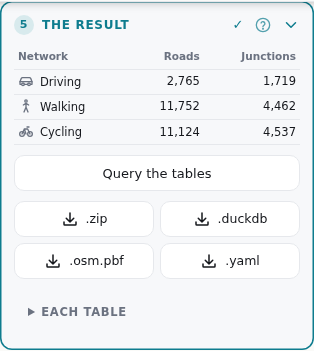
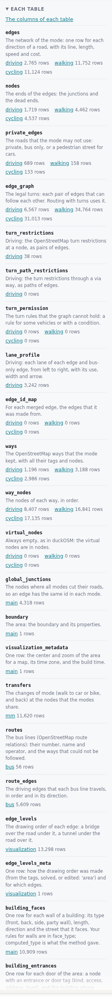
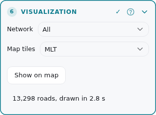
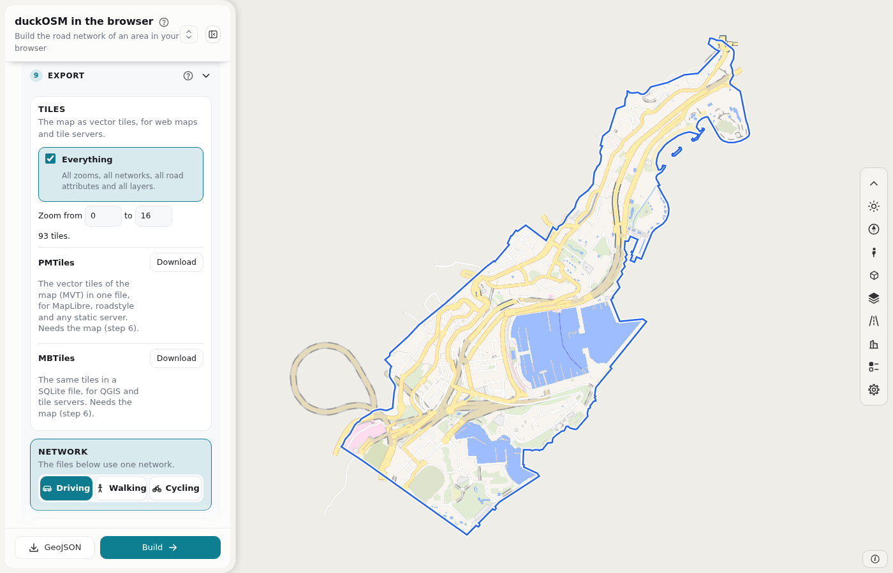

# Steps 5 and 6: Result and map

After a build, step 5 gives you the tables, and step 6 draws the roads on the map.

## Step 5: The result



Card 5 has three parts:

- **The result table.** The number of roads and junctions of each network.
- **The downloads.** Four buttons.
- **Each table.** The list of the tables, with a link to their columns.

### The downloads

| Button | File | Use |
|---|---|---|
| **.zip** | All tables as Parquet files | Open them in Python, QGIS, DuckDB or Spark. |
| **.duckdb** | One DuckDB database | Open it with the DuckDB CLI or Python. |
| **.osm.pbf** | The OSM data of the area, cut from the region file | Build again with no big file. Shows only when the build cut the data. |
| **.yaml** | The fixes of this build ([its format](fixes-file.md)) | Use it in the next build. Shows only when the build had fixes. |

### Query the tables

Download the **.duckdb** file and open it with DuckDB (the CLI or Python). Write the name of a table with its network, for example `driving.edges`. Some examples:

```sql
-- the length of the roads of each class, in km
SELECT highway, count(*) AS edges, round(sum(length_m) / 1000, 1) AS km
FROM driving.edges GROUP BY highway ORDER BY edges DESC;

-- the streets with a speed of 30 km/h or less (the speed limit, or the default speed of the class)
SELECT DISTINCT name FROM driving.edges WHERE maxspeed_kmh <= 30 AND name IS NOT NULL;
```

### Each table



Open **Each table**. The list shows each table and its number of rows. The link above the list opens the columns of each table. [The tables](tables.md) explains what each table is for.

## Step 6: Visualization



| Part | What it does |
|---|---|
| **Network** | The network that the map draws: driving, walking, cycling or all. It shows when you built more than one. |
| **Map tiles** | MLT (smaller, the default) or MVT. |
| **Show on map** | Draws the roads. |
| The note under the button | Says how many roads the page drew, and how long it took. |

A small area draws by itself after the build. For an area with more than 20,000 roads, press **Show on map**. The map has a limit: 200,000 roads on a computer, and 40,000 on a small device. If the area is larger, the page lists the networks that fit. Add `?maxroads=N` to the address to change the limit.

The roads have the style of [roadstyle](https://github.com/Khoshkhah/roadstyle): bridges and tunnels have outlines, and one-way roads can have arrows. Click a road to see its data.



## Next

- Look at the map. If a road, a building or a turn is wrong, go to [step 7](edit-osm.md).
- If the data is right, go to [step 8](edit-levels.md), or to [step 10](export.md) to export.
