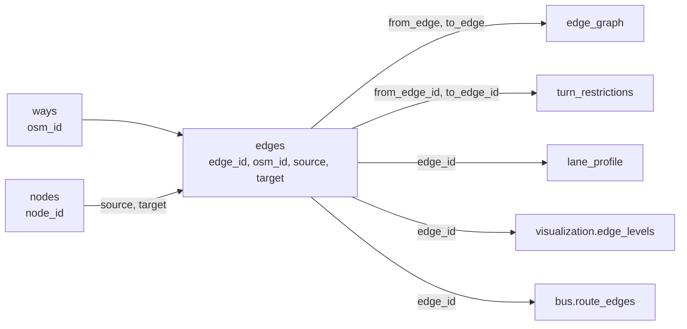

# The tables

A build writes a set of tables. Each table is a Parquet file in the `.zip` download. All tables are also in the `.duckdb` download, in schemas. This page tells you what each table is for. [Columns of the tables](../output-tables.md) lists every column.


## Where the tables are

| Schema | What it holds |
|---|---|
| `driving`, `walking`, `cycling` | The tables of one network. |
| `main` | The tables of the area: the boundary, the junctions, the buildings. |
| `mm` | The tables that join the networks. |
| `visualization` | The drawing order of the roads. |
| `bus` | The bus routes. |
| `features` | The layers of the base map. |

In SQL, write the schema and the table: `driving.edges`. In the `.zip`, the file is `edges_driving.parquet`.

## How the tables join



Three keys join the tables:

- `edge_id` (BIGINT) is the key of an edge. It is a hash of the OSM way and the two end nodes, so it is the same in every build.
- `source` and `target` (BIGINT) are the `node_id` values of the two ends of an edge.
- `osm_id` (BIGINT) is the OSM way that an edge comes from. A way can give more than one edge.

Keep these keys as BIGINT in every join. A program that reads them as floating-point numbers loses digits.

## The tables of each network

Each network (driving, walking and cycling) has its own set.

| Table | What it is for |
|---|---|
| `edges` | The network. One row for each direction of a road, with its line, length, speed and travel time. Start here. |
| `nodes` | The ends of the edges: the junctions and the dead ends. |
| `private_edges` | The roads that the network cannot use: private roads, bus-only roads, and pedestrian streets for cars. |
| `edge_graph` | The legal moves. Each row is a pair of edges that can follow each other. A router with turns uses it. |
| `turn_restrictions` | Driving only. The OSM turn restrictions at one node, as pairs of edges. |
| `turn_path_restrictions` | Driving only. The turn restrictions through a via way, as paths of edges. |
| `turn_permission` | The turn rules that the graph cannot hold: a rule for some vehicles, or with a condition. |
| `lane_profile` | Driving only. Each lane of each edge, from left to right, with its use, width and arrow. |
| `edge_id_map` | For each merged edge, the edges that it was made from. |
| `ways` | The OSM ways that the network kept, with all their tags and nodes. |
| `way_nodes` | The nodes of each way, in order. |
| `virtual_nodes` | Always empty, as in duckOSM. The virtual nodes are in `nodes`. |

An example: the length of the driving roads, by class.

```sql
SELECT highway, round(sum(length_m) / 1000, 1) AS km
FROM driving.edges GROUP BY highway ORDER BY km DESC;
```

## The tables of the area

| Table | What it is for |
|---|---|
| `main.boundary` | The area: its shape and its properties. |
| `main.global_junctions` | The nodes where all networks cut their roads. So an edge has the same id in each network. |
| `main.visualization_metadata` | One row: the center and the zoom of the area for a map, its time zone and the build time. |
| `mm.transfers` | The changes of network at a node that two networks share: walk to car or bike, and back. |
| `mm.edges` | A view. All edges of all networks, with the name of the network. |

## The drawing order

| Table | What it is for |
|---|---|
| `visualization.edge_levels` | The drawing order of each edge. A bridge is over the road under it. A tunnel is under the road over it. |
| `visualization.edge_levels_meta` | One row: how the drawing order was made (from the tags, solved, or edited). |
| `level_edits` | Your rules from [step 8](edit-levels.md), one rule for each row. The table exists only when you have rules. |
| `level_heads` | The head lengths that you set in the level editor. |
| `level_caps` | The line ends that you set in the level editor. |

## The buildings

These tables need a build with **Layers** on.

| Table | What it is for |
|---|---|
| `main.building_faces` | One row for each wall of a building: its type (front, back, side, party wall), its length, its direction, and the street that it faces. `face_type` has your rules. `computed_type` has what the method found. |
| `main.building_entrances` | One row for each door: a node with an `entrance` or `door` tag. It names the building that has the node in its outline. |
| `main.building_info` | One row for each building: floors, height, roof shape, roof and facade colors, and materials. The page reads them from the OSM tags. |

[Step 7](edit-osm.md) edits these data.

## The bus routes

| Table | What it is for |
|---|---|
| `bus.routes` | The bus lines (OSM route relations): their number, name and operator. |
| `bus.route_edges` | The driving edges that each bus line travels, in order and in its direction. |

## The data of the base map

These tables need a build with **Layers** on.

| Table | What it is for |
|---|---|
| `features.buildings` | The buildings. |
| `features.land` | Land use and natural areas: forest, grass, parks, residential land and more. |
| `features.water_polygons`, `features.water_lines` | Lakes, the sea and rivers. |
| `features.streets` | Every way with a `highway` tag, and the railways. It is for drawing, not for routing. |
| `features.paved` | Open ground that people stand on: squares, pedestrian areas and piers. |
| `features.sites` | Areas with a use: parking, bus stations, schools, universities, hospitals and sports centers. |
| `features.public_transport` | Bus stops, train and tram stations, ferry terminals and airports. |
| `features.pois` | Points of interest: shops, offices, tourism and other amenities. |
| `features.traffic` | Traffic signals and crossings. |
| `features.place_labels` | Place names. |

The map and the tiles read these tables. You can also load them in QGIS. The CLI and the Python wheel also write `raw.nodes`, `raw.ways` and `raw.relations` (the OSM data of the area, as read from the file) when you give a boundary. The page does not keep them in its database.

## Next

[Columns of the tables](../output-tables.md) lists every column. [Step 10](export.md) tells you which files hold the tables.
