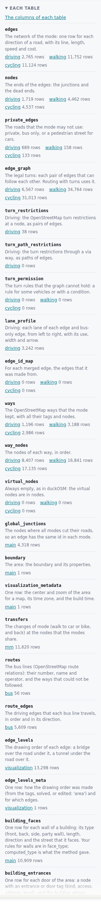
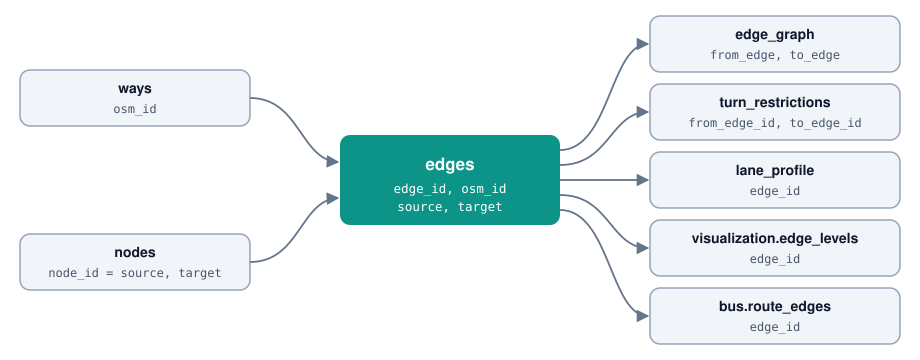

# The tables

A build writes a set of tables. The `.zip` download has each table as a Parquet file. The `.duckdb` download has all tables, in schemas. [Columns of the tables](../output-tables.md) lists every column. [The roads](roads.md) tells you which roads each network has.



## Find a table

| Schema | What it holds |
|---|---|
| `driving`, `walking`, `cycling` | The tables of one network. |
| `main` | The tables of the area. |
| `mm` | The tables that join the networks. |
| `visualization` | The drawing order of the roads. |
| `bus` | The bus routes. |
| `features` | The layers of the base map. |

In SQL, write the schema and the table: `driving.edges`. In the `.zip`, the file is `edges_driving.parquet`.

## Join the tables



| Key | What it is |
|---|---|
| `edge_id` | The id of an edge. It is the same in every build. |
| `source`, `target` | The `node_id` of the two ends of an edge. |
| `osm_id` | The OSM way of the edge. One way can give more than one edge. |

All keys are BIGINT. Keep them as BIGINT in every join. If a program reads them as floating-point numbers, it loses digits.

## The tables of each network

| Table | What it is for |
|---|---|
| `edges` | The network: one row for each direction of a road. Start here. |
| `nodes` | The junctions and the dead ends. |
| `private_edges` | The roads that the network cannot use. [Access](roads.md#access-who-can-use-the-road) gives the rules. |
| `edge_graph` | The pairs of edges that can follow each other. For a router with turns. |
| `turn_restrictions`, `turn_path_restrictions` | Driving only. The OSM turn restrictions at a node, and through a via way. |
| `turn_permission` | The turn rules for some vehicles, or with a condition. |
| `lane_profile` | Driving only. Each lane of each edge, from left to right. |
| `edge_id_map` | The edges that each merged edge comes from. |
| `ways`, `way_nodes` | The OSM ways of the network, with their tags and their nodes in order. |
| `virtual_nodes` | Always empty, as in duckOSM. |

An example: the length of the driving roads, by class.

```sql
SELECT highway, round(sum(length_m) / 1000, 1) AS km
FROM driving.edges GROUP BY highway ORDER BY km DESC;
```

## The tables of the area

| Table | What it is for |
|---|---|
| `main.boundary` | The shape of the area. |
| `main.global_junctions` | The nodes where all networks cut their roads. |
| `main.visualization_metadata` | The center, the zoom and the time zone of the area. |
| `mm.transfers` | The nodes where you can change network, for example from walking to driving. |
| `mm.edges` | A view of all edges of all networks. |
| `bus.routes` | The bus lines: number, name and operator. |
| `bus.route_edges` | The driving edges of each bus line, in order. |

## The drawing order

| Table | What it is for |
|---|---|
| `visualization.edge_levels` | The drawing order of each edge. |
| `visualization.edge_levels_meta` | How the page made the drawing order. |
| `visualization.level_edits` | Your rules from [step 8](edit-levels.md). Only when you have rules. |
| `visualization.level_heads`, `visualization.level_caps` | The head lengths and the line ends from the level editor. |

## The buildings and the base map

These tables need a build with **Layers** on. You can edit the building data in [step 7](edit-osm.md).

| Table | What it is for |
|---|---|
| `main.building_faces` | Each wall of a building, and the street that it faces. |
| `main.building_entrances` | Each door of a building. |
| `main.building_info` | Each building: floors, height, roof, colors and materials. |
| `features.buildings` | The buildings. |
| `features.land` | Land use and natural areas. |
| `features.water_polygons`, `features.water_lines` | Lakes, the sea and rivers. |
| `features.streets` | All ways with a `highway` tag, and the railways. For drawing, not for routing. |
| `features.paved` | Squares, pedestrian areas and piers. |
| `features.sites` | Areas with a use, for example parking or schools. |
| `features.public_transport` | Stops and stations. |
| `features.pois` | Points of interest, for example shops. |
| `features.traffic` | Traffic signals and crossings. |
| `features.place_labels` | Place names. |

## Next

[Step 10](export.md) tells you which files hold the tables.
